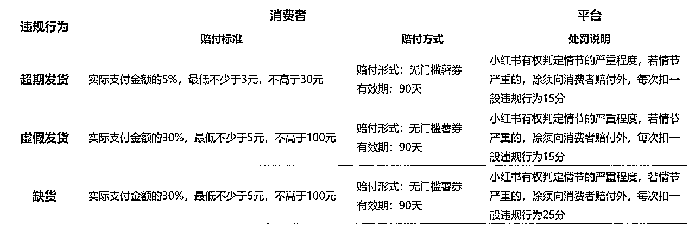

# 8.2.3 超期处罚规则一览

同一笔订单如果涉及多项违规，赔付并不是简单叠加，具体要看下面几条：

1. 当订单同时被认定为超期发货和虚假发货时，消费者这边只会获得一次赔付。

2. 如果被认定为缺货，这项赔付可以和超期发货或虚假发货的赔付一起发起。

3. 关于赔付封顶：同一买卖双方（是否属于同一买卖双方以平台认定为准）之间，付款时间在同一自然日内的多笔交易，只要同时出现上述任一情形或多项情形，赔付金额合并计算后，最高不超过 500 元。

