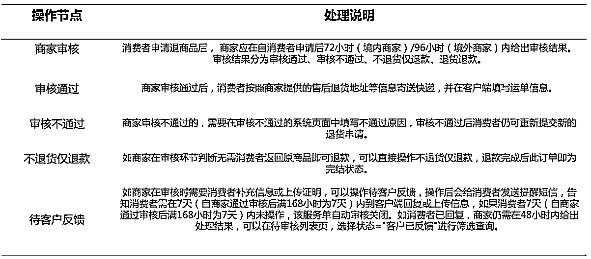
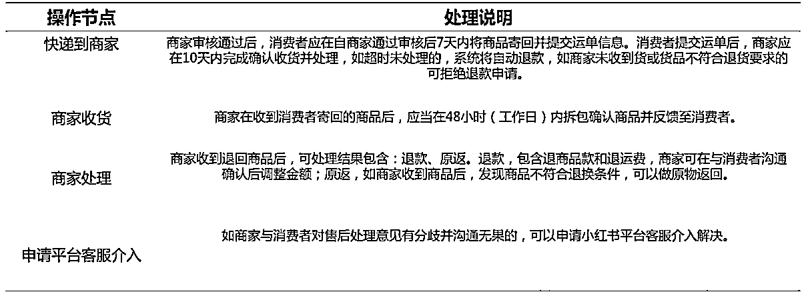
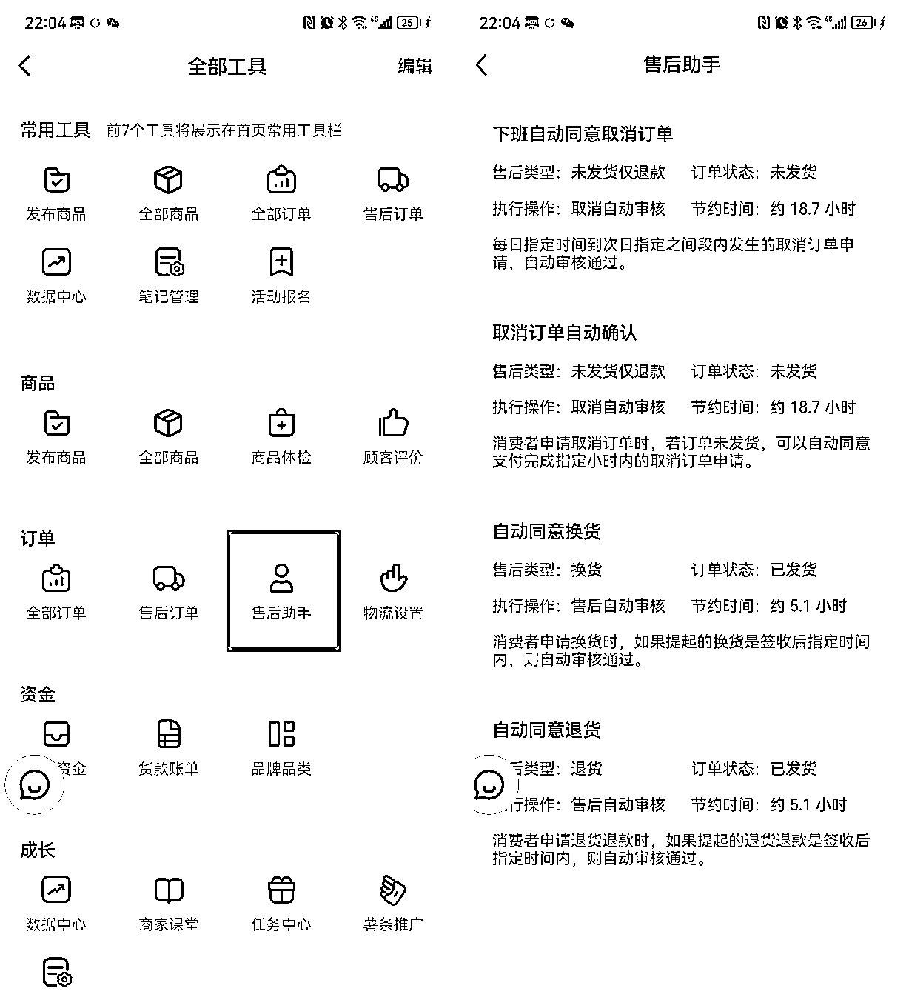
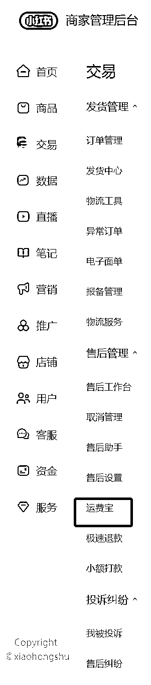
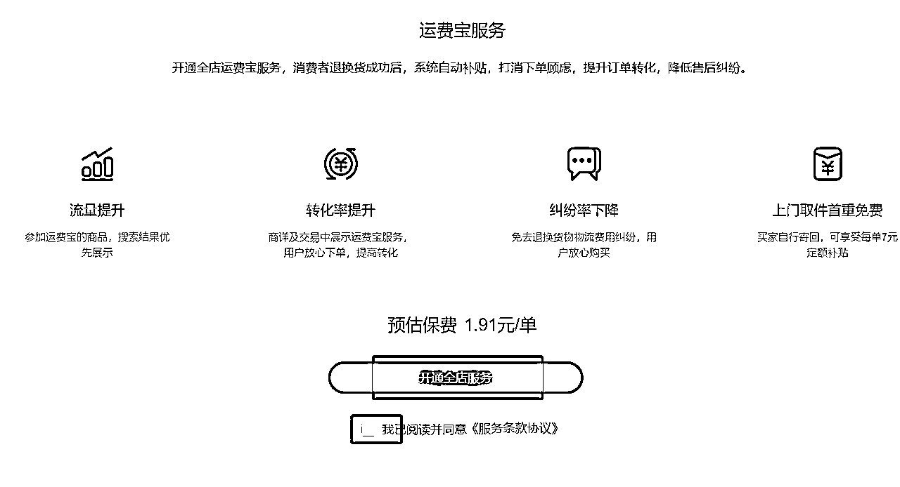
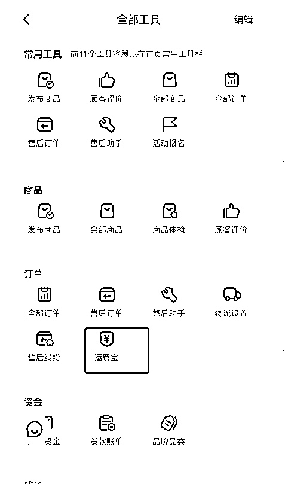
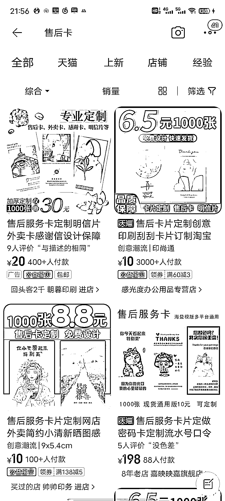

# 8.3.1 退换货：时效与减损

买家提交退货申请后，商家必须在72小时内完成审核。具体时限可对照下方审核节点表：；商家收到退货后的处理流程，则看收货环节表：。

想降低退换货带来的损耗，可以分两类情况处理。

**一、买家反馈商品有问题**

一旦收到商品异常反馈，要立刻向买家索要图片证据，并同步给上家商家。

比如买家在生鲜店买了五斤橙子，收货时坏了一半。客服没有第一时间要求对方把受损果品和快递面单放在一起拍照，买家隔了两三天才再次联系客服；此时已超出签收后24小时的生鲜售后时限，再找商家理赔，对方就可能以此为由拒绝。

遇到这类情况，可以先问买家是否接受补发；若对方同意，损失通常能降下来。

ps：涉及质量问题时，务必第一时间索要问题商品图片，先弄清商品状况，再和上家沟通交涉。

**二、普通商品退换货**

小红书的售后审核时效一般为48至72小时；淘系和拼多多的审核时间通常比小红书短，但同样要尽快向上家提交申请，并主动向买家核实商品情况。

例如确认商品是否拆封、是否使用过、是否完好，确认后再去问商家是否符合退换标准。

在小红书商家后台，可以设置简单的自动售后，比如未发货前的自动退换货。

普通商品下单时，建议勾选运费险（拼多多自带）；小红书可在后台开通运费宝。这样即使发生退换货，也能从上家商家退还的运费中获得收益。

开通运费宝路径：

【电脑端】：[商家管理后台](https://ark.xiaohongshu.com/)-交易-售后管理-运费宝

【手机端】：商家APP-首页-全部工具-运费宝

如果做的是实物电商，还可以通过快递售后卡引流。售后卡一般由引流话术加二维码组成，具体设计可参考同行；淘宝和拼多多上就有不少店铺专门做售后卡。

