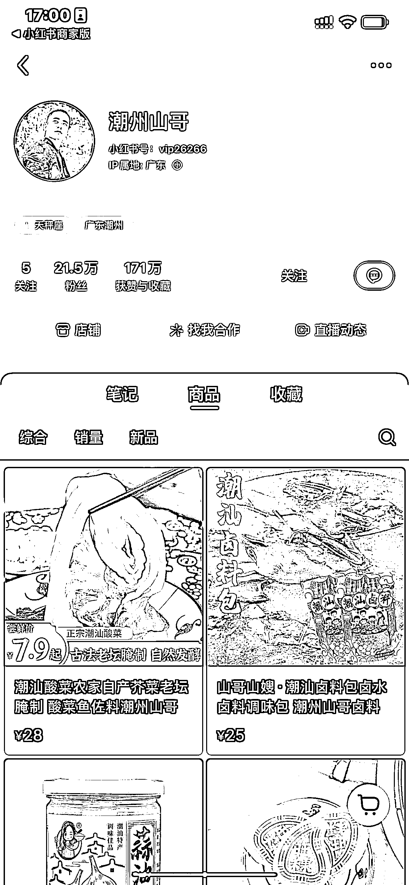
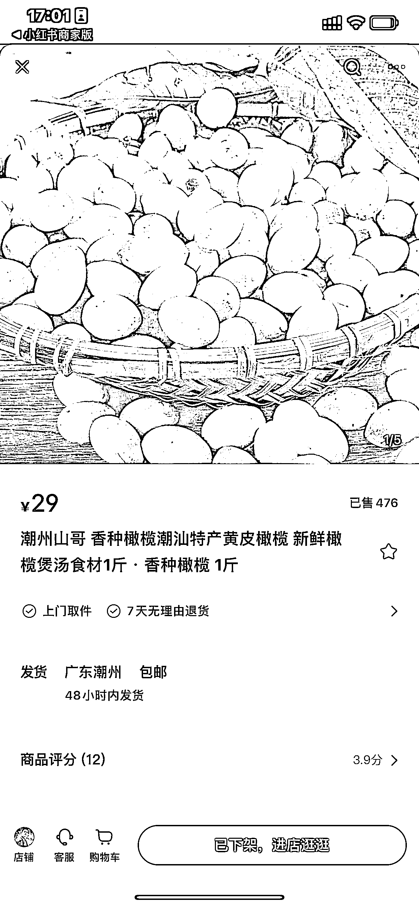
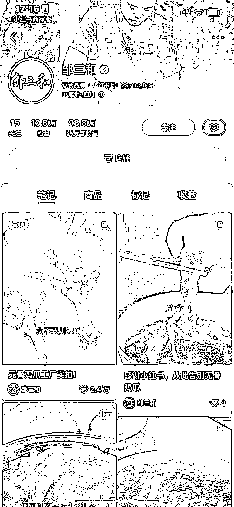
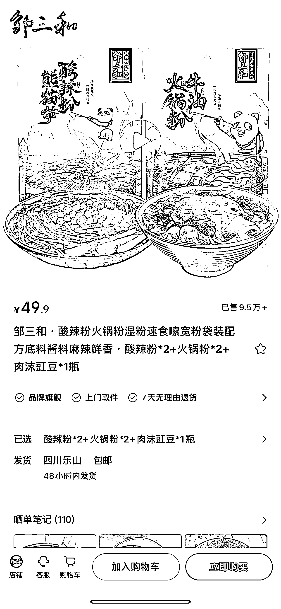
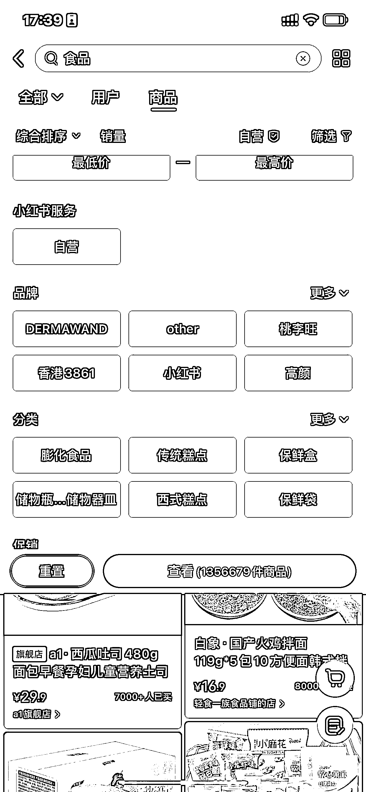

# 案例一：家常餐桌卖预制菜，这套打法能照搬

1）账号与样本情况
运营方是“潮州山哥”，店铺挂名为“潮州山哥的店”。原始页面链接如下：  
[`www.xiaohongshu.com/user/profile/5c4c05750000000011035521?xhsshare=CopyLink&appuid=639a89460000000026012bb6&apptime=1676710945`](https://www.xiaohongshu.com/user/profile/5c4c05750000000011035521?xhsshare=CopyLink&appuid=639a89460000000026012bb6&apptime=1676710945)

选它作为样本，原因在于：把预包装菜嵌入家庭烹饪场景，选品偏通用基础食材；从内容到货盘都容易照着做。

2）流量从哪来
呈现方式：短视频挑大梁。  
内容思路：每期做饭内容都能顺带展示原料、调味品与成品；预包装菜或普通食材都能接上购买入口。地域色彩越强，曝光通常越占优；出镜货品多是大众熟悉、日常会吃的品类。更值得借鉴的是，这些素材还能搬到抖音继续分发，并接购买入口。  
渠道分布：首页“发现”贡献最多，搜索入口紧随其后。  
起量办法：围绕潮汕地名标签做深做透，再借方言与本地菜式形成记忆点，独特性就出来了。

3）靠什么变现
出镜内容：预包装菜与调味酱。  
货盘：预包装菜、食品用酱。  
供货方式：自己生产自己卖，或者通过电商平台采购。  
价格带：25至1500；累计卖出60W+。

4）可参考的同类账号

小结：  
食品赛道中较容易跑出爆款的方向，大致有三类：一是鸡爪，如脱骨鸡爪、香辣鸡爪；二是糕点零食，如代餐小食、面包饭团、辣条、轻脂类；三是速食预包装类，如酸辣粉、螺蛳粉。在平台搜“食品-店铺”，同类样本很多；有数据提到，相关食品体量已达135万+。

