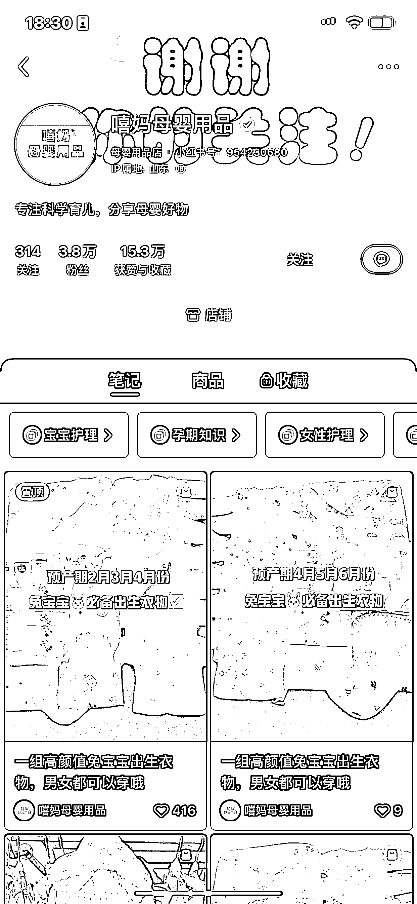
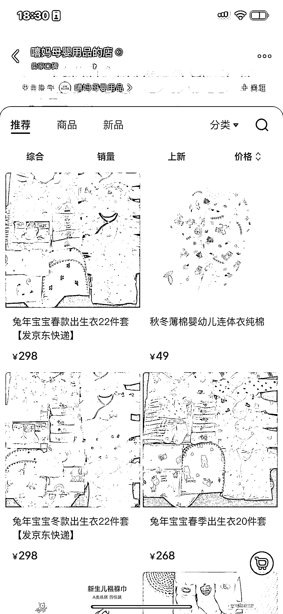
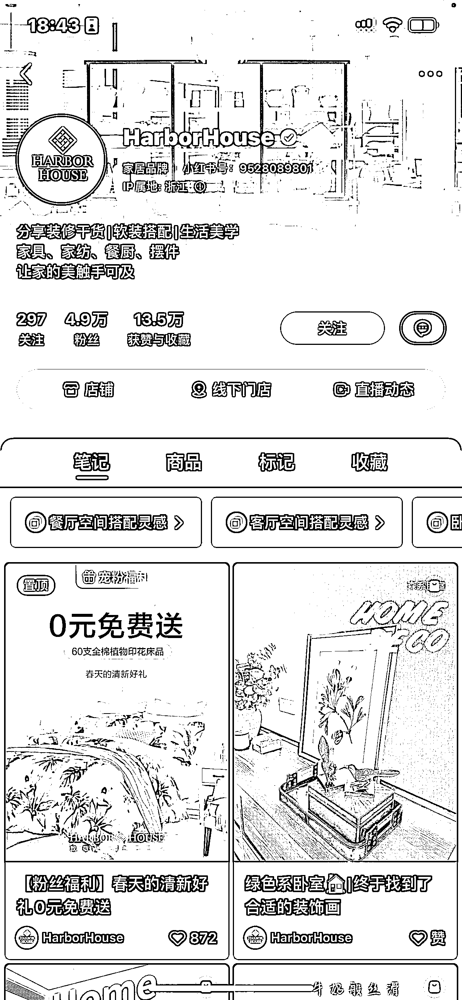
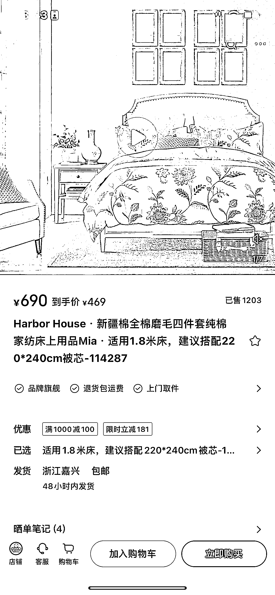
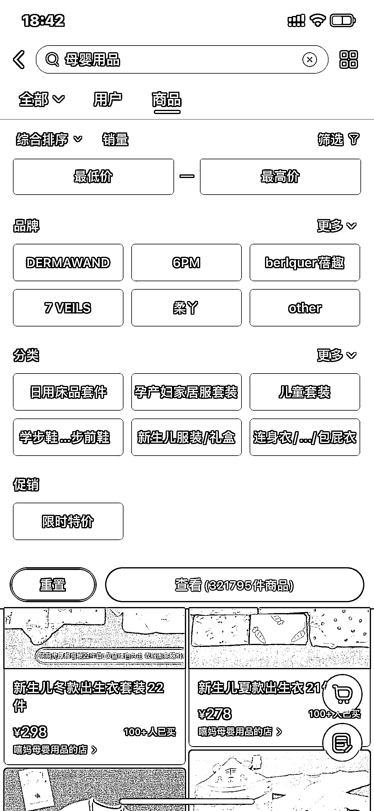

# 赛道四：母婴账号拆解

1）案例概况
• 账号名称：妈母婴用品
• 店铺名称：嘻妈母婴用品的店
• 案例链接：[`www.xiaohongshu.com/user/profile/5984266d82ec39418c184728?xhsshare=CopyLink&appuid=639a89460000000026012bb6&apptime=1676716261`](https://www.xiaohongshu.com/user/profile/5984266d82ec39418c184728?xhsshare=CopyLink&appuid=639a89460000000026012bb6&apptime=1676716261)
• 选择该账号的原因：封面风格高度统一，货品类型丰富，核心人群集中在一岁以内新生儿；成交单价不低；同一套方法迁移到其他年龄段也具备可复制性。

2）流量入口
• 内容形式与载体：短视频占主导。
• 内容拆解：持续复用爆款封面的结构，反复强化同一种封面模板，同时圈定明确的目标用户；用合集与单品两种方式重点推婴儿服饰。相近玩法还能延伸到婴儿待产包、孕妈好物、儿童学习工具与玩具等。
• 流量渠道：首页—发现为主，搜索流量为辅。
• 获取方法：围绕兔年出生宝宝的衣物做精准切入，男女宝宝都能穿，垂直吸引新生儿妈妈，并赶在宝宝出生前完成集中采购；封面把衣物展示得足够全，排列整齐、色调干净舒服，再叠加京东物流的省心与速度。

3）变现方式
• 形式：实物出镜拍摄，以短视频呈现。
• 品类：母婴类目。
• 货源/渠道：自营，或由电商平台代发。
• 价格/销量：单价多集中在30—300元，销量10W+。这个阶段的新手妈妈更看重穿着舒适、男女皆宜，避免因性别不合适而踩雷。

4）可借鉴案例
日常家居四件套同样属于母婴用品类目，客单价表现很亮眼。

