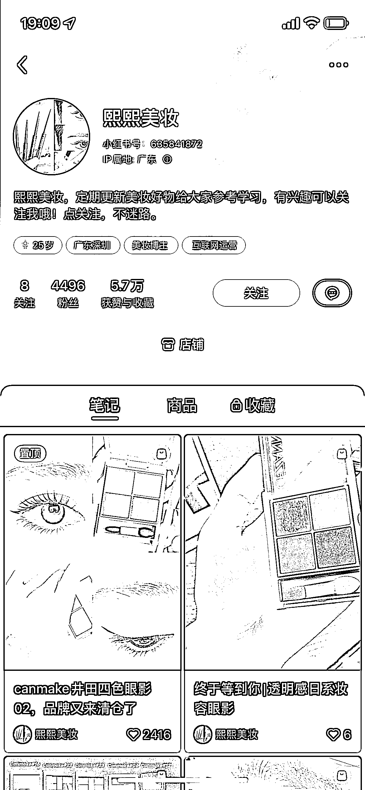
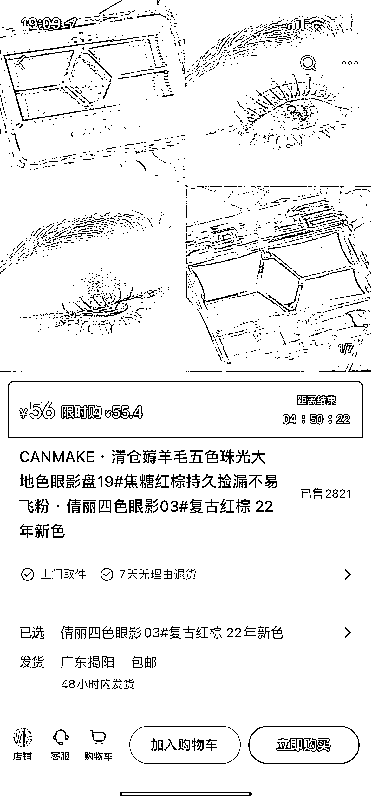
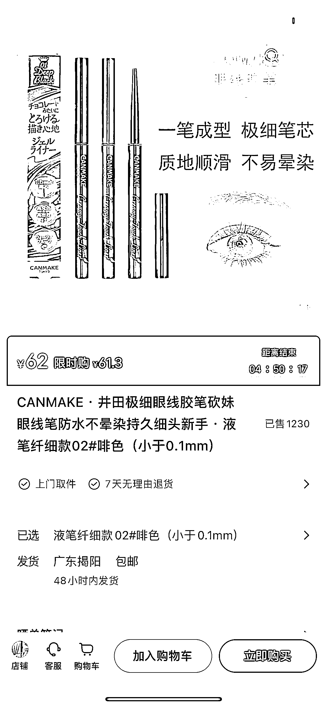
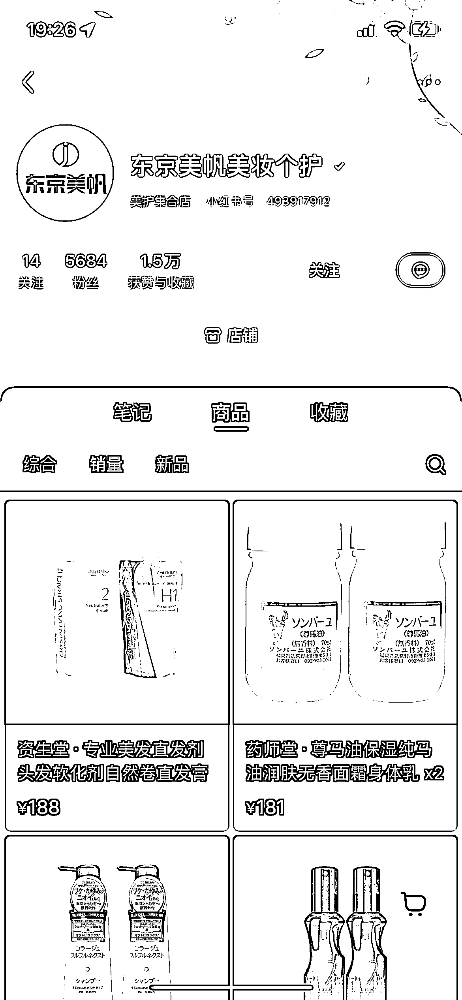
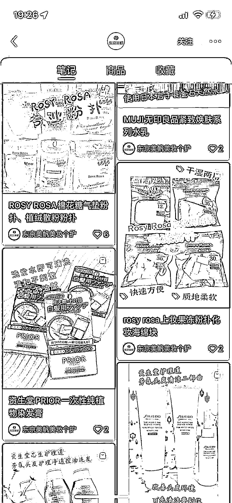
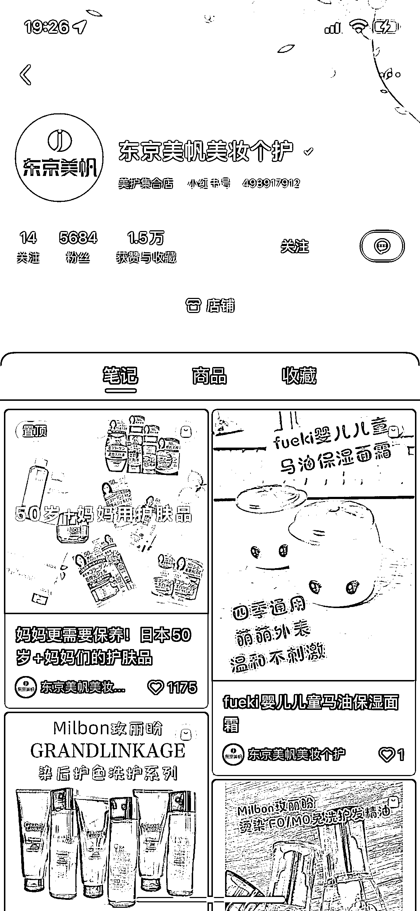
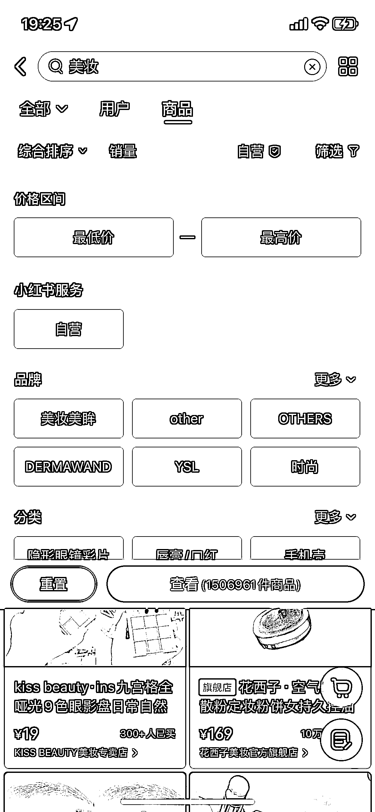

# 赛道六：美妆店免认证起量思路

做美妆店，很多人先被认证和授权劝退；这个案例走的是更轻的路子：没有商家认证也能把店做起来。女生日常会用到的彩妆基本都能上架，商品展示图多来自淘宝等电商渠道。

1）案例信息

账号叫“熙熙美妆”，店铺为“熙熙美妆的店”。案例链接：[`www.xiaohongshu.com/user/profile/5a706fd4e8ac2b6df2a7069a?xhsshare=CopyLink&appuid=623ebe2e0000000021029a34&apptime=1676718742`](https://www.xiaohongshu.com/user/profile/5a706fd4e8ac2b6df2a7069a?xhsshare=CopyLink&appuid=623ebe2e0000000021029a34&apptime=1676718742)

入选理由：免商家认证即可运营美妆店；女生平时使用的彩妆大多能放上去；产品图以淘宝或电商平台素材为主。

2）流量来源

呈现方式为图文。这类彩妆在平台上数量很多，天然能承接品牌相关流量；玩法接近拼多多店，没拿到品牌授权也能卖，实际经营过的商品就能上架。若配有真人试妆内容，成交率会更好。认知度太低的小众品不太吃香，已有一定知名度的品更契合这种店。

流量入口来自发现页和搜索流量。获取思路是抓眼影盘、眼线笔这类集中采购品，它们和📕主流用户的购物偏好对得上。

3）变现产品

承接方式为视频，重点做美妆类目里的眼影品类。货源包括自营、代购和电商平台。单价约30—60元，销售额35W+。

4）相似案例

这类代购货可以从淘宝或电商平台补货，用来开海外美妆集合店。美妆商品池很大，约150万+商品。

