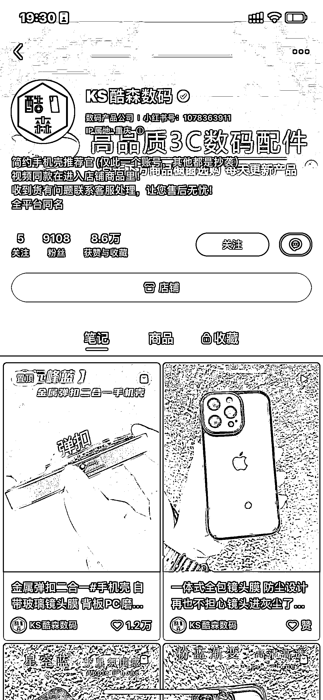
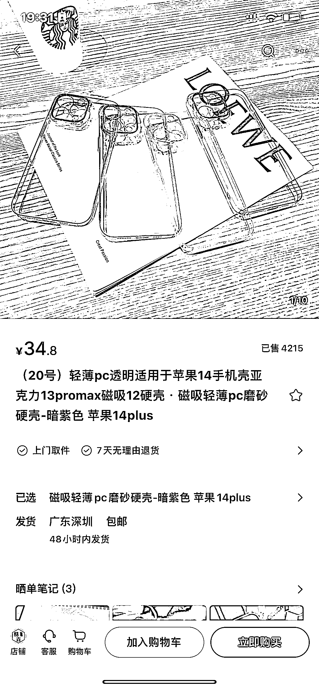
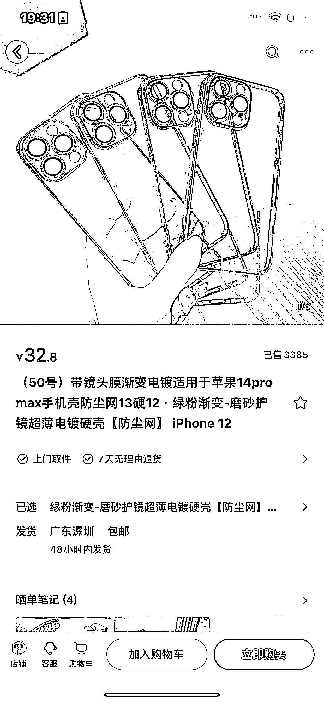
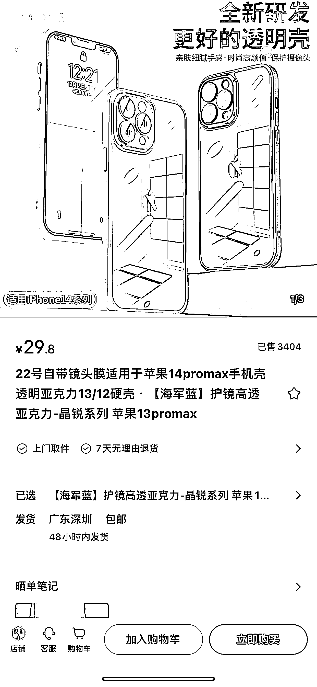
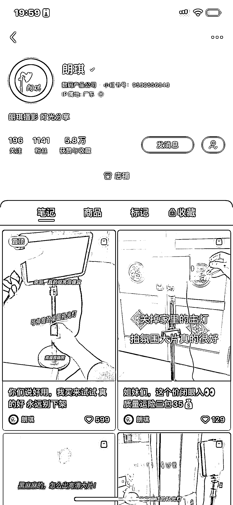
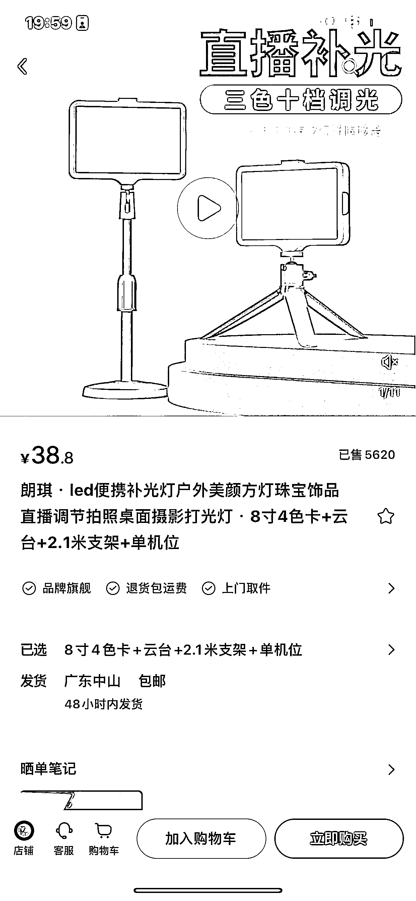
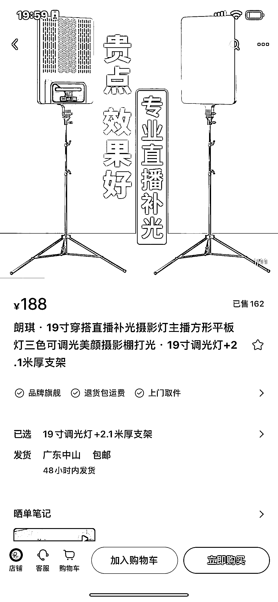
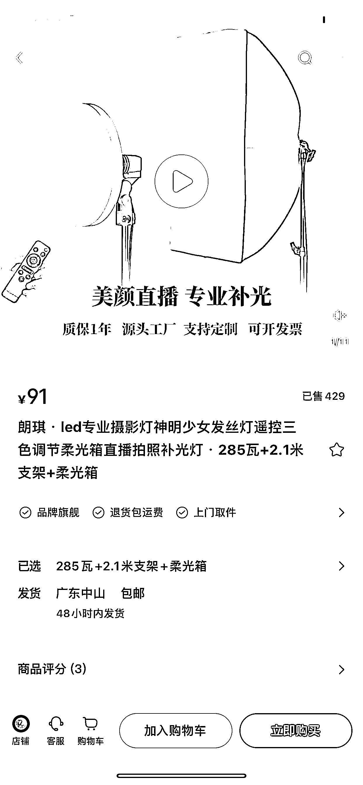

# 赛道七：个护：30元手机壳卖出50万

这一期看一个个护赛道的实战样本。账号叫“KS库森数码”，对应的店铺是“KS库森数码的店”，先放案例入口：[`www.xiaohongshu.com/user/profile/5fd9ec43000000000101fc70?xhsshare=CopyLink&appuid=639a89460000000026012bb6&apptime=1676721160`](https://www.xiaohongshu.com/user/profile/5fd9ec43000000000101fc70?xhsshare=CopyLink&appuid=639a89460000000026012bb6&apptime=1676721160)。为什么会挑中它？因为单品定价大概30元，而且像普通保护壳、数据线这类数码小配件，都能套用同样的打法。

接着看流量怎么来。内容以视频为载体，核心卖点全放在透明壳的细节上，一条片子控制在30秒内，配上音乐，精准筛出有购买意向的人。流量渠道并不复杂，主要靠搜索入口和发现页推荐。

再聊变现端。形式是视频加上实物细节特写，品类落在个护产品上，货源来自自营或代理商。价格方面，均价30元以上，关键是几乎每个单品都是爆款，总销售额做到了50万+。

最后看一个同类参考：补光灯。

