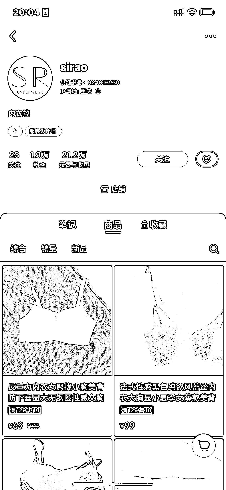
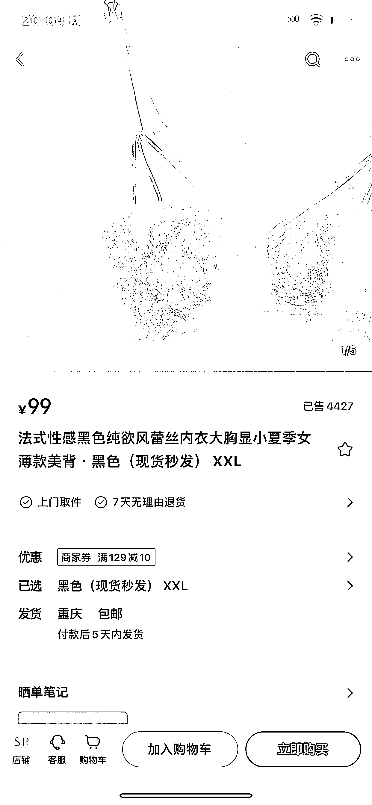
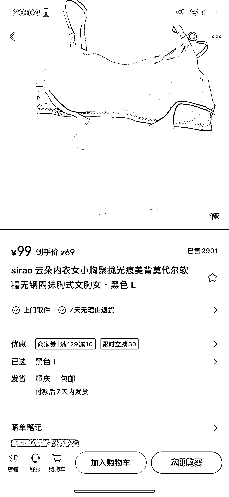
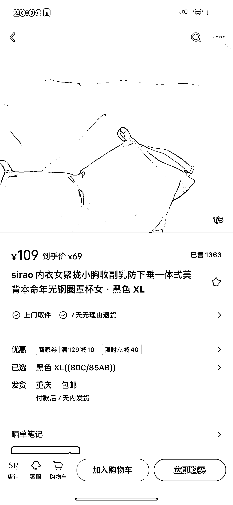
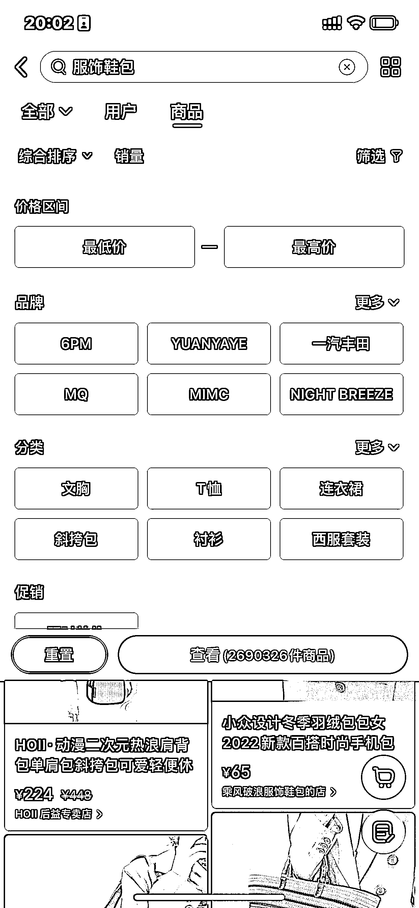

# 赛道八：服饰鞋包｜手拍内容也能跑出60W+

1）案例概况
这次看的账号是“sirao”，店铺名为“sirao的店”。案例链接：`www.xiaohongshu.com/user/profile/5dc8ea880000000001009795?xhsshare=CopyLink&appuid=639a89460000000026012bb6&apptime=1676721917`

选它的原因很直接：拍摄方式不复杂，产品呈现也容易照着做，绝大多数素材都是在家用手拍完成的。

2）流量从哪来
内容以图文加视频为主。拆开看，这类内容不依赖专业摄影，也不要求产品有多强的辨识度；各平台已有大量现成产品介绍可参考。它更适合有供应链能力的人批量复制，用性价比打学生党，配色也贴合小红书年轻用户的审美。素材中还提到单价不算低、价格偏高的说法；结合后文30—100元均价和60W+销售额看，走量仍是重点。流量入口集中在发现页和搜索，获取方式是围绕内衣、文胸等垂直关键词布局。

3）怎么变现
变现靠图片与视频的实物拍摄。品类覆盖文胸、鞋包配饰。货源可自营，也可来自电商平台。均价约30—100元，销售额达到60W+。

4）相似案例
排在前面的，基本都是小红书里搜索量和商品量较大的类目。

