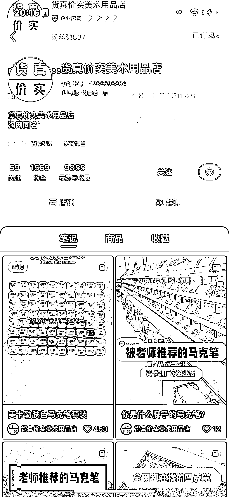
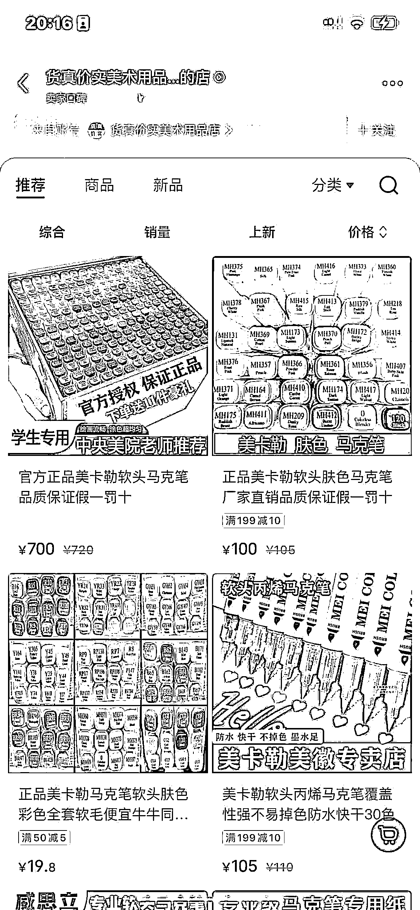
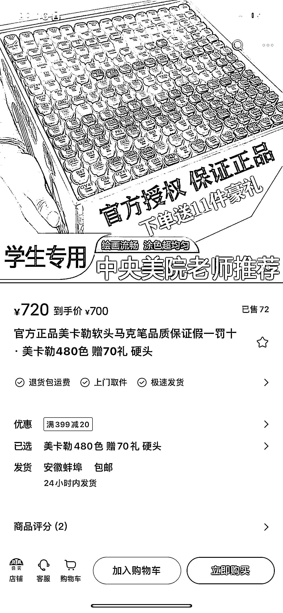
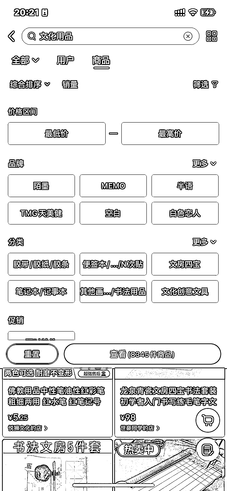
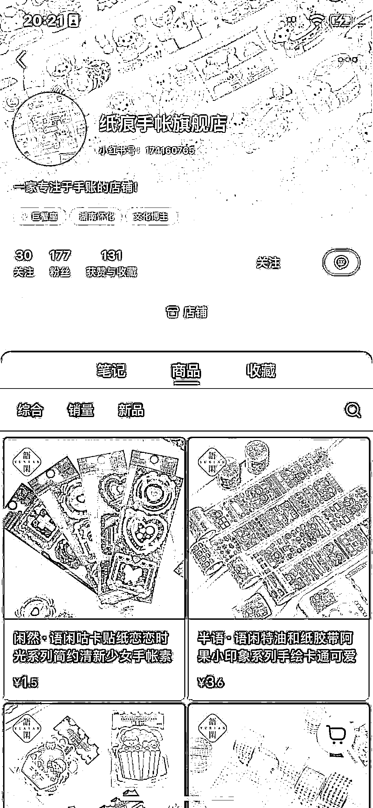

# 赛道九：文具账号拆解

文化办公赛道里，这类账号的打法很值得拆一拆。先看一个可复制的样本。

1）案例概况
- 账号名称：货真价实美术用品店
- 店铺名称：货真价实美术用品的店
- 案例链接：[`www.xiaohongshu.com/user/profile/606433f60000000001007f66?xhsshare=CopyLink&appuid=639a89460000000026012bb6&apptime=1676722581`](https://www.xiaohongshu.com/user/profile/606433f60000000001007f66?xhsshare=CopyLink&appuid=639a89460000000026012bb6&apptime=1676722581)
- 选择理由：兴趣班常用的笔类、文具类产品，都适合做成多支笔或文具组合的图文、视频内容。

2）流量从哪来
- 内容形态与载体：图文配合短视频。
- 内容拆解：用“中央美院推荐”“全网都在找”“老师推荐”做背书，效果很强；拍摄方式不复杂，其他文具同样能照搬。
- 流量入口：搜索页与发现页。
- 获取方式：围绕“美卡勒”“马克笔”等关键词承接垂直流量。

3）怎么变现
- 形式：以实物出镜和视频为主。
- 品类：文具文创。
- 货源：自营或代理渠道。
- 价格与销量：单品最高售价700+，销售额约10W。

4）相似案例

