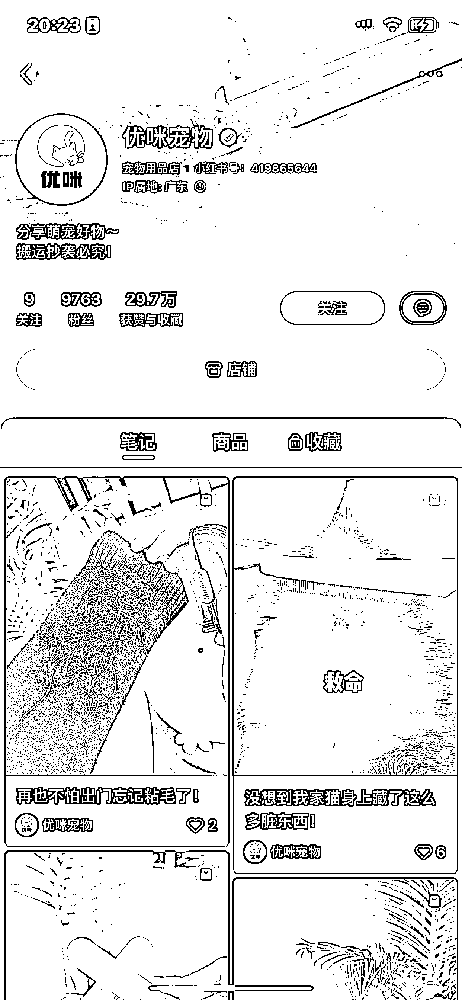
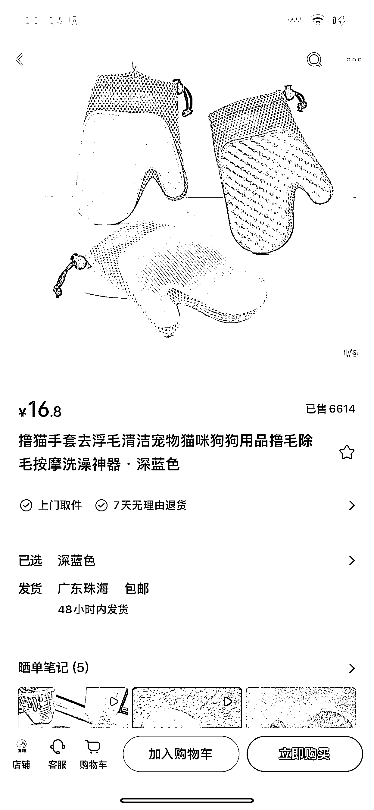
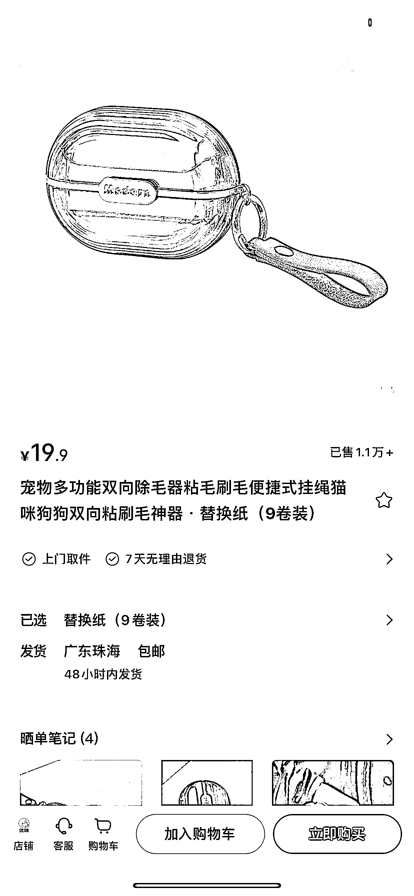
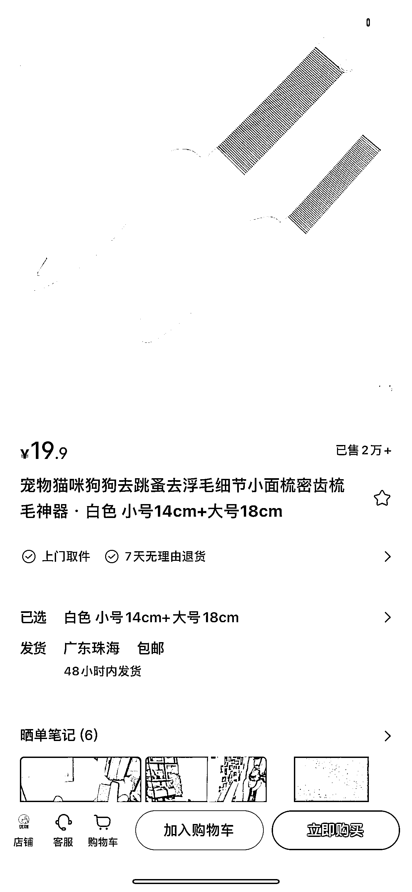
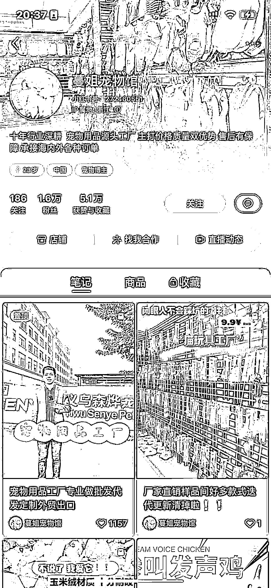
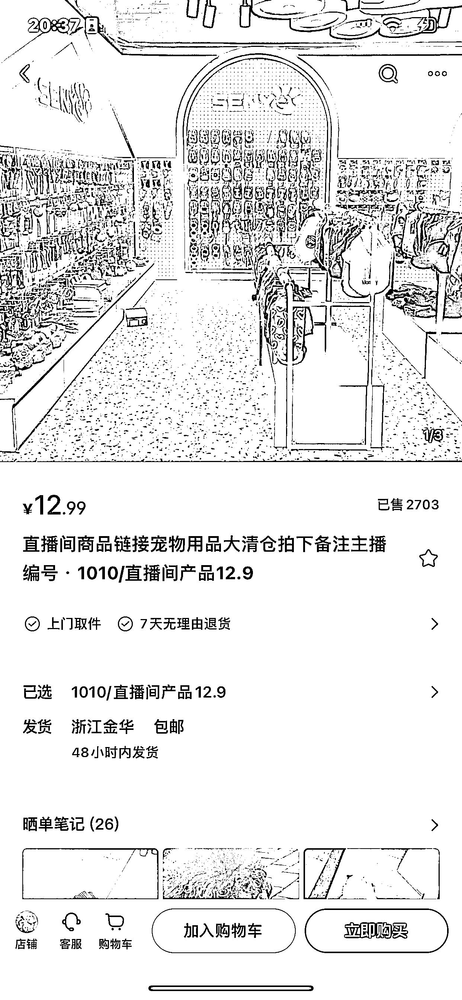
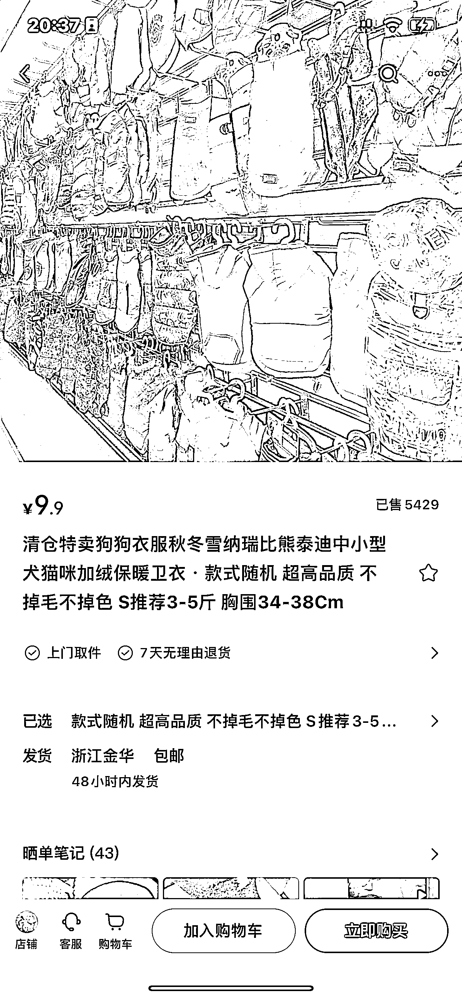
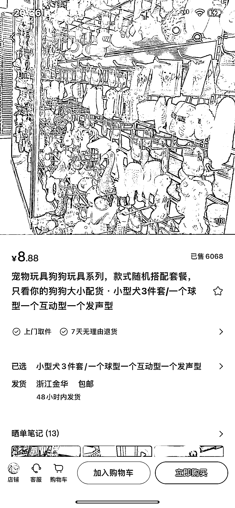
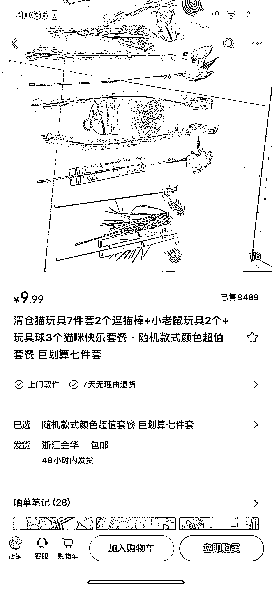
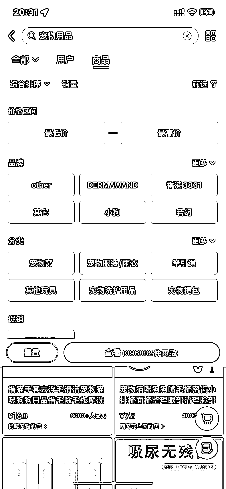

# 赛道十：宠物小件，百万销售额

宠物用品赛道里，不一定非要铺大而全的货盘。选对刚需小件，再用生活化短视频把需求讲透，同样有机会做出不错的生意。

1）案例档案

• 运营账号：优咪宠物
• 店铺名：优咪宠物的店
• 案例入口：[优咪宠物主页](https://www.xiaohongshu.com/user/profile/5c18ddca0000000006013f74?xhsshare=CopyLink&appuid=639a89460000000026012bb6&apptime=1676723063)
• 入选原因：和同类案例相比，销售额排名更靠前；店内有明确爆款，单款销量突破两万件；内容场景贴近日常生活，拍摄门槛也不高。

2）流量入口与内容打法

• 内容载体：以短视频为主。
• 内容特点：篇幅短、拍摄不复杂，养宠人群都能照着拍；已有爆款产品可供对标，同类竞品还不算多，增长空间较大。更关键的是切入用户刚需，例如粘毛，也能延伸到猫窝等其它宠物用品需求。
• 流量渠道：覆盖发现页与搜索入口。
• 获取方法：深耕宠物用品垂类内容，核心围绕粘毛和干燥剂，把用户的具体需求解决到位，并对同类产品持续重复发布。

3）卖什么、怎么卖

• 呈现形式：商品实拍视频结合生活场景。
• 品类：宠物用品。
• 货源渠道：可自营，也可代理。
• 价格与销售：价格带约20—100元，销售额约100万元。

4）相似案例与延展

宠物玩具同样属于刚需，而且非标品属性更明显，复制和模仿都更容易。整体来看，这类账号的可借鉴点在于：选刚需小件、用生活化短视频解决具体问题、靠垂直内容持续打透。对养宠内容创作者来说，门槛不高，仍有增长窗口。

