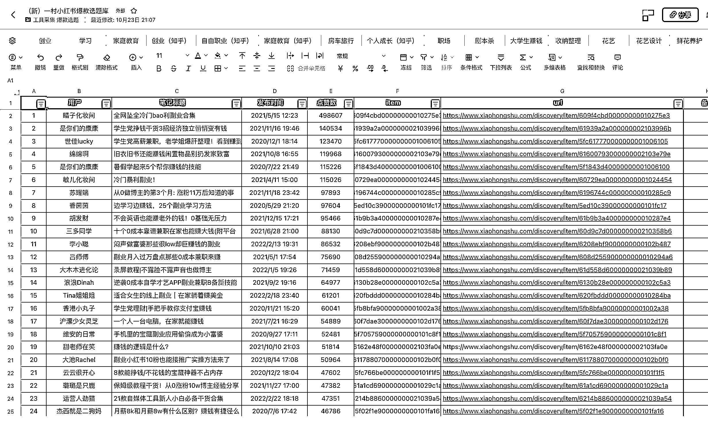
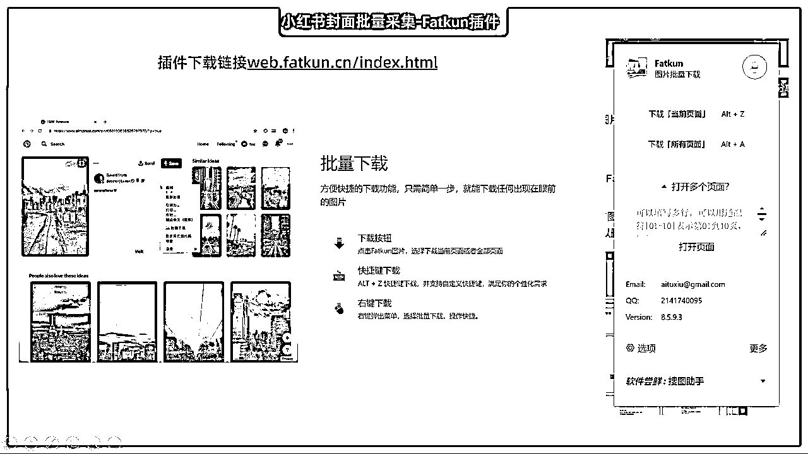
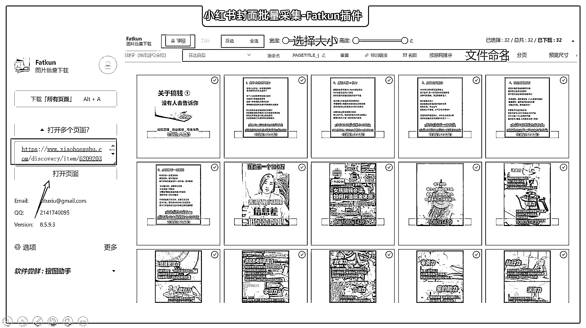
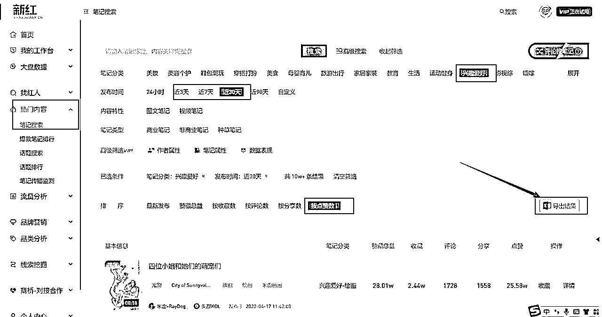
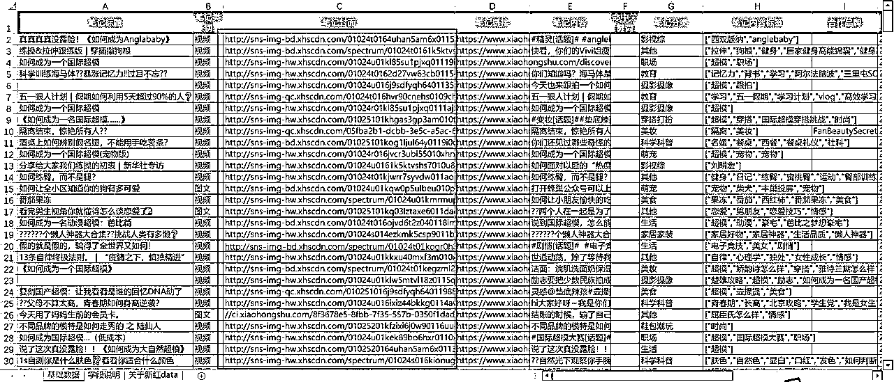
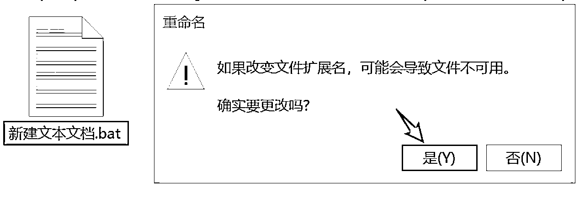
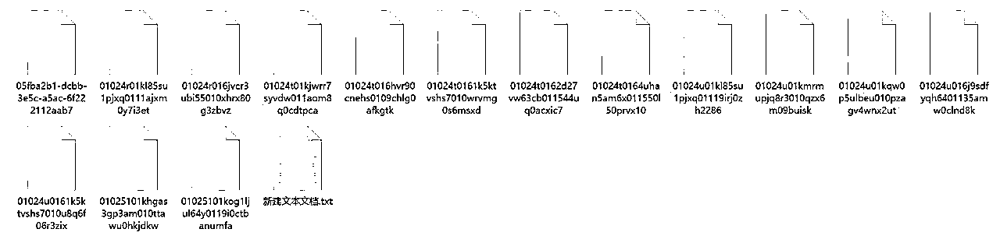
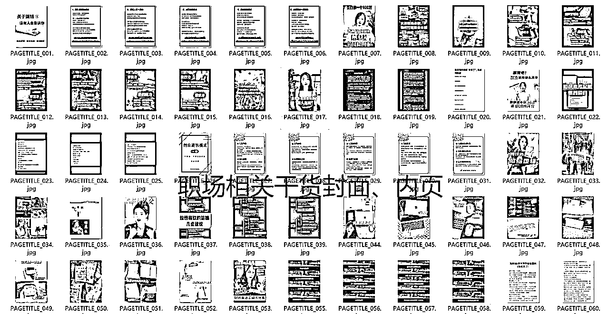

# 10.2.2 爆款封面成批收，素材库这样搭 @吴一村

不同内容赛道，封面打法差别很大：职场账号常用信息密集的干货图，减脂账号偏爱前后对比出镜，情感账号则常借微信聊天截图做视觉钩子。想持续做出点击率在线的封面，先把本赛道的高热封面整理成库，找设计灵感会更高效。下面给出两条成批收集封面的做法。

## 1）借助 Fatkun 插件，把热门封面成批抓下来

一村整理过《小红书各行业内容数据库》，可以拿来参考：

里面还包含更新版“一村小红书爆款选题库”。

先在浏览器里装上 Fatkun 插件。它自带针对小红书的图片下载脚本，封面与笔记内容图片都能成批抓取。插件文件放在这里：[Fatkun 图片批量下载插件 v5.7.7](https://search01.shengcaiyoushu.com/upload/doc/T8Zfd0iJjoSKEnxEWJXcZFCen2Y/QsWbbqgP0o65MsxfJ7icBqNVn3g)

具体操作如下：

从选题库里一次性复制多条笔记地址，打开浏览器中的 Fatkun 图标，选择打开多个页面，再把地址粘贴进去。接着再点一次 Fatkun 图标，执行“下载所有页面”，界面会出现类似右图的结果。这样一来，这批链接里的图片就被集中取出。全选后直接下载即可；不想要的图也能先剔除。

## 2）更省力的方案：用新红数据平台导出

平台入口在这里：[xh.newrank.cn/](https://xh.newrank.cn/)。新用户注册可领 7 天免费会员（不是广告，纯推荐）。领完后进入笔记搜索页，定位自己的分类，再按时间和排序条件筛选，直接导出结果。

导出的文件打开后可能不是图片，这是小红书反爬机制改了图片格式。接下来用几行代码把后缀统一成 jpg。

先建一个 txt 文件，在里边敲入：ren * *.jpg，存盘；退出后把文件名末尾改成 .bat，系统询问时选“是”。

最后双击这个 .bat 文件，下载内容就会全部变成 jpg 图片。

举例来说，可以建一个职场类热门笔记的封面与内页库，方便随时翻看研究。照着优秀案例练，在模仿中调整，往往能更快做出爆款。

封面设计工具可以试试：

• 稿定设计（[www.gaoding.com/](https://www.gaoding.com/)）
• 创客贴（[www.chuangkit.com/](https://www.chuangkit.com/)）
• 黄油相机 APP
• 醒图 APP
• Canva 可画 APP
• Picsart APP
• PPT

