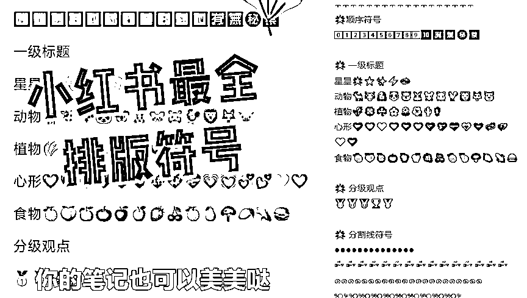
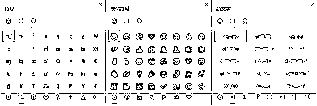

# 10.3.7 Emoji 实用工具 @云端行走：三个入口

想让文字更有表情感？这几个 Emoji 入口可以收好，随用随查。

先看下载站：`emojixd.com/`。这里有现成 Emoji 资源可取用。

如果想直接复制表情，可以打开下面两条📕链接：
• `www.xiaohongshu.com/discovery/item/61a0eb760000000001027ef3`
• `www.xiaohongshu.com/discovery/item/6249d070000000002103d271`

还有一个更省事的操作：同时按【Win+;】或【Win+.】，表情面板就会弹出来。

这个面板里的内容分成三大块：表情符号、颜文字和符号；每一块还会继续往下细分。以符号为例，其中又包括人物、食品和植物、庆祝类物品等小组。按自己的场景需要挑选即可。

