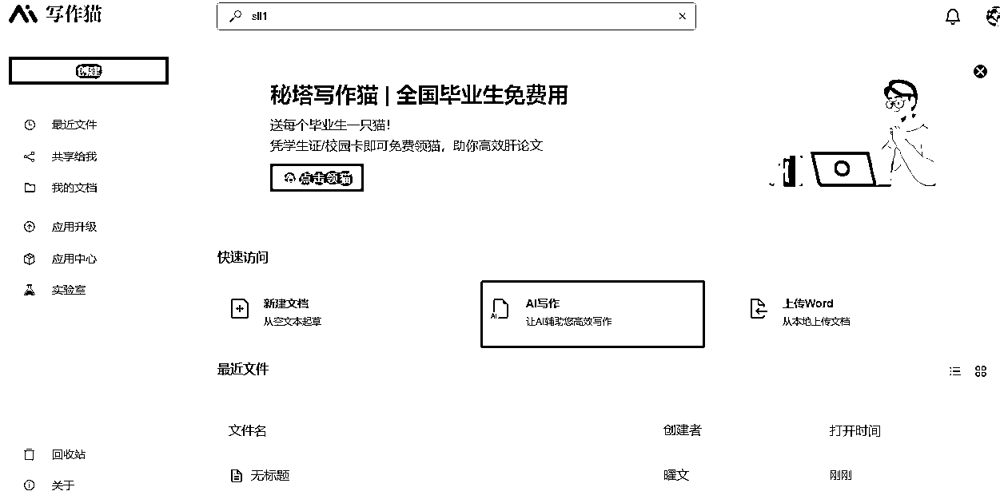
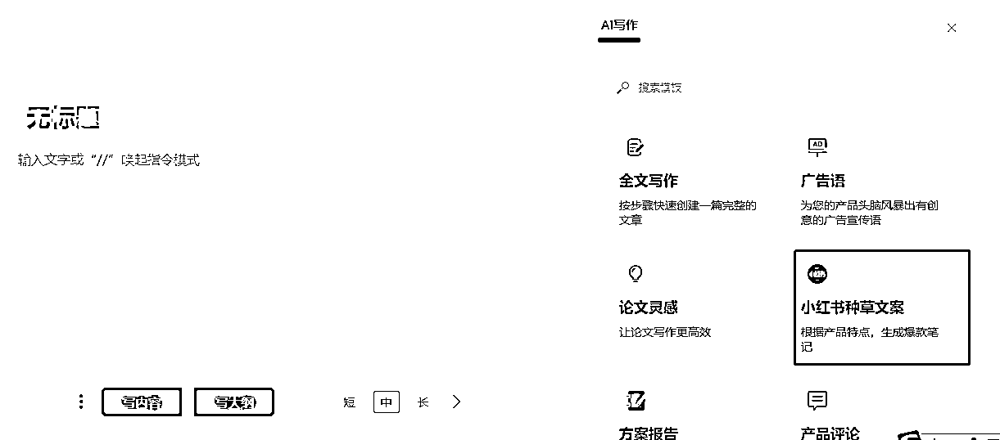
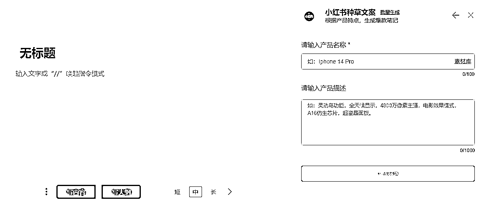
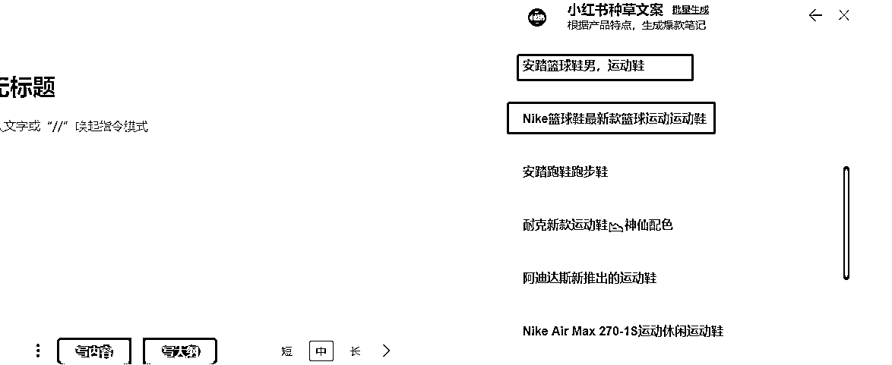
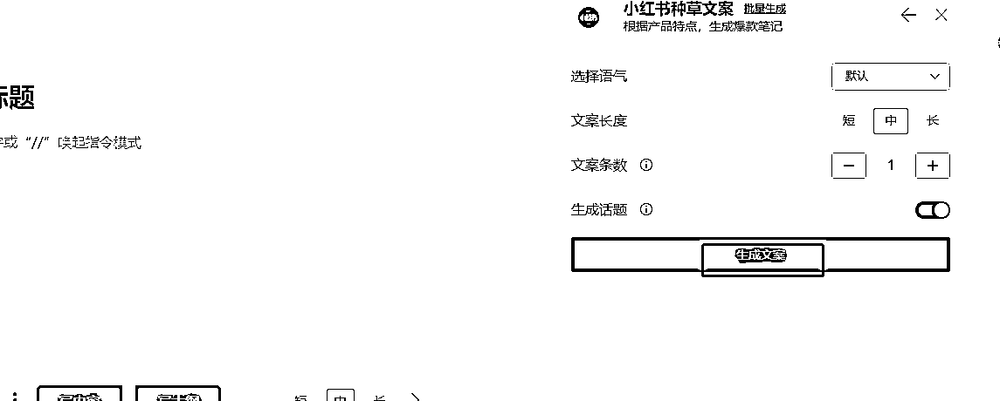
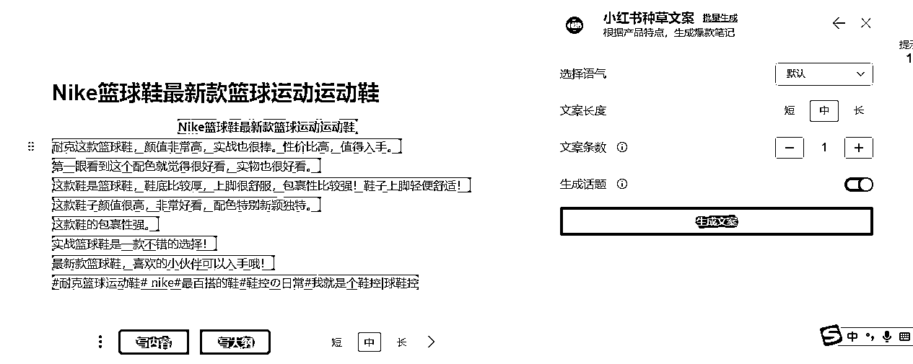

# 10.3.8 @曜文：标题与文案，一键生成

工具入口：[`xiezuocat.com/`](https://xiezuocat.com/)

进站后先找到“AI 写作”入口并点开：

在功能里选“小红书种草文案”：

把产品名称、描述关键词填进去：

结果出来后，挑一个合适的标题点进去：

接着选择要生成的文案，生成条数、语气都能按需调整，还能查看更多参考：

生成完成后，再结合关键词和热门笔记润色修改，让表达更顺；基础文案编辑的时间也能省下来。

