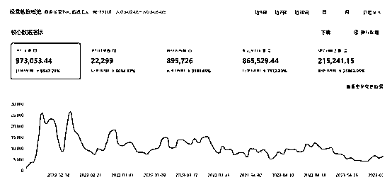
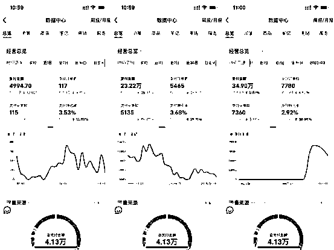
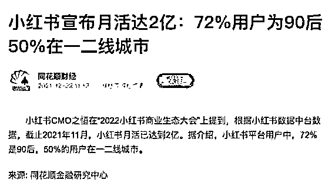
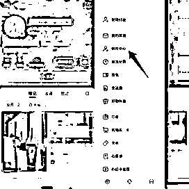
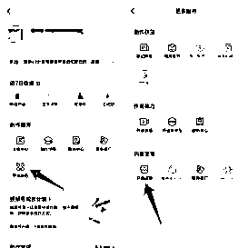
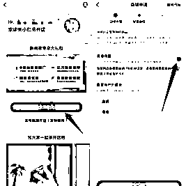
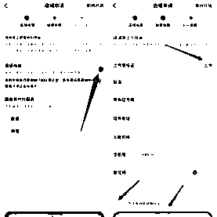
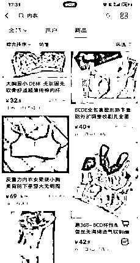
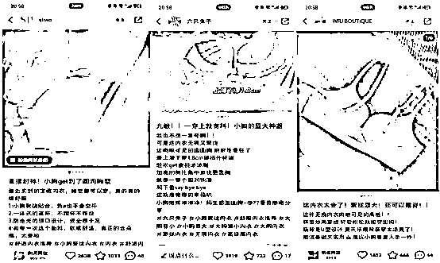

# (精华帖)(1134赞) 月赚30W的店，我是从零这样跑通的

作者：宅男（周恩俊）  
日期：2023-05-11

我是宅男（周恩俊）。在生财有术待了一阵子，学到不少。今天不绕弯，直接复盘：一个普通人从0起步，把小红书无货源店做到每月净赚30W+，中间到底做了哪些动作。想入局的朋友，可以当一份操作笔记看。

先讲结论：新流量入口出现时，往往就是生意机会。趋势来了，顺势走比逆势硬扛轻松。线上生意的底层还是流量，流量聚集的地方，变现概率就高。

淘宝竞争激烈，短视频赛道拥挤，那2023年新的增长点在哪？从现有数据看，答案是月活2.6亿的小红书。它还在流量红利阶段。今年讨论度很高的项目之一，就是小红书无货源店。你在朋友圈、抖音、视频号、知乎应该都刷到过。它到底是什么？怎么做？下面拆开讲。

我们算入局较早的一批。小红书店铺功能是去年年中上线的，我们10月左右开始测试，11月、12月就有了反馈。其中一家店，单店业绩接近100万。

先看后台截图，这是小红书商家版。类似店铺我们大约有15家，截图里这家不算最强，大概能排前三。

 

想把这件事做好，先别急着上货。平台规则、流量逻辑、用户习惯，得先摸清楚，后面才跑得快。

**1.** 为什么把阵地放在小红书？

**01.** 平台月活2.6亿，等于一个超大的人流入口。

从公开分析看，这2.6亿人里，90后、00后是核心；女性超过七成，男性约三成；一线、二线人群超过一半。换句话说，消费意愿和消费能力较强的一批人，大量聚集在这里。用户质量高，种草后更容易转化，这是出单的基础。

另外，小红书很像“消费前做功课”的地方。比如计划旅行，很多人会先搜攻略；按攻略体验不错，下次做决定时会更信任这个平台。

**02.** 无货源店真正热起来是今年，而今年平台也在加码电商。

2023年可以看作这个玩法的窗口期。现在进场，抢到先发位置的概率更大。往后拖，同行变多、规则变细，红利会被摊薄。个人也好，团队也好，想认真做，建议尽早动手。现在做小红书，有点像2010年前后开淘宝店：赚钱的人，很多是吃到了阶段红利。趋势出现时，动作要快，才能分到份额。

**03.** 时机有了，具体怎么玩？

店开好后，把商品挂上去，再用笔记批量铺量，不烧付费广告，也有机会出单。和京东、淘宝这些成熟平台比，小红书的电商还在增长期，机会更明显。淘宝已经拥挤；拼多多的店群模式受过平台治理，一些商家遇到资金冻结，也不轻松。

我们的做法是走1688货源，客户下单后由批发端直发，也就是一件代发。早期规则没那么严，也没有明确针对无货源的限制。从1688拿货，链路正规，不用太担心合规问题。

**2.** 我们为什么愿意长期做？

小红书对交易板块的投入在加大，电商也是平台收入的重要来源。

前两年感知不强，今年很明显：商品类笔记出现得更频繁。你点过某个店，或者买过东西，信息流更容易继续推同类内容。平台在推电商，我们铺内容就更容易借力。

这个项目我算有点发言权。去年11月开始测，数据一直在往上走。前面那家店累计做到约七位数成交，对应利润接近四十万。时间越久，店铺分值会爬坡，埋的关键词逐步进系统词库，排名稳住后，哪怕暂时停更，仍会有订单进来：一部分来自站内搜索，一部分来自商城推荐，还有老客复购。

所以，这不是短平快生意，而是正规、可长期、能沉淀的项目。

2023年它正处在红利期，这也是我们决定继续加码的原因之一。

**3.** 实际执行流程怎么走？

**01.** 整体流程先捋一遍。

下面按步骤讲。

简单说：先定类目，比如水果、萌宠、女性用品、女装、时尚用品、美妆、家居、生活百货、儿童玩具、母婴用品、鞋帽箱包、饰品、奢侈品、运动类目等。方向定了，再开始布局。

假设做内衣。先在站内搜“内衣”，找销量靠前的同行，拆解爆款笔记的形式，再把选中的货挂到自己店。上架后铺笔记，出单后去1688下单，让上游直接发给买家。大致就是这条链路。

**02.** 店铺有哪些类型？怎么开？

目前有个人店、个体店、普通企业店、专卖店、旗舰店、跨境店铺。

个人店门槛最低，一张身份证就能开。个体店要营业执照；一张个体执照最多开三个店，但每个店要绑定不同账号。其他类型，比如普通企业店、专卖店、旗舰店，需要对应营业资质。

我们主做个人店和个体店。原因很直接：成本低，运营性价比高。普通企业店不是不能做，而是不适合批量铺。它的保证金比前两类高一倍，部分类目更高，批量操作不划算，也不匹配我们的模式。

**03.** 开店入口在哪？

用已经注册好的账号，点“我的”，左上角菜单图标进创作中心；在创作服务里找更多服务；再到内容变现板块，选开通店铺，按页面提示走。

手机、电脑都能开。电脑端可以直接复制链接到浏览器操作。开店前有个细节别漏：养号。

  

**04.** 开店前怎么养号？

建议先养2到3天。刷同领域内容，模仿真实用户，但别只滑走，适当点赞、评论、关注。到第3天，发一篇纯干货、不带广告的笔记试流量。如果浏览在50左右，账号基本正常，可以准备开店。

具体可以这样：早中晚各刷一轮，每天累计2到3小时，同行的图文或视频都看；每天关注3到5个权威号或对标号；遇到喜欢的内容，点赞、收藏、评论，保持真人操作痕迹。

平台有账号等级任务，可以按官方任务逐项完成，提升等级，这也算养号的一部分。设备上建议一机一卡一号，同一台设备别频繁换号，否则容易被判异常。

这么做是为了省时间。账号有问题却直接开店，发什么都没效果；后面想注销重开，还要等30天，成本更高。先测再开，这个细节很关键。

**4.** 多平台找货时，定位、选品、定品、测品、优品怎么做？

店注册好后，第一件事是选品上架测试。测试可以拆成五步。

**定位**：先看自己擅长什么、对什么有兴趣，再看手里资源是否符合站内用户画像。符合就做。有自有货源且匹配，更好。动手前，先搜同行，如果同店单品累计销量能到1000以上，可以试。没有资源也没关系，可以去拼多多等平台找货，走无货源。

**选品**：主要看拼多多、阿里巴巴、淘宝。以拼多多为例，先看大类：内衣、食品、百货、水果、女装、母婴、电器、鞋包、手机、男装、家纺、美妆、饰品、家居、家装等。假如选饰品，就看该类目前排高销量款。比如一条销量10W+的发圈，选中后去站内查同款表现。

**定品**：在站内搜“发圈”，看销量和爆帖。如果反响不错，说明受众面可以，直接上架测。上架后模仿对标同行铺笔记，单个品每天至少2条。也可以顺藤摸瓜，看同行店里有没有延伸款，一起测。参考线是：该品累计出1000单以上，或者种草帖数据不差，例如近15天笔记点赞破100、近30天到500；首页发现页也能当参考。

**测品**：商品上架后铺笔记，盯浏览、商品访问、加购。饰品大类下还有不少高销量款，可以一天上5到8款，每款每天发2条以上笔记，再看数据反馈。

**优品**：根据数据优化商品和笔记。商品侧看封面主图、次图、详情细节，展示是否到位；笔记侧看封面、文案（标题和正文）、标签三块。如果走视频，还要看封面吸不吸睛，BGM有没有节奏、卡点，画面是否符合场景。精心选品后仍没效果，就多拆同行，逐项对比再改。种草内容要戳痛点，比如袜子，透气、面料、弹力、舒适度，用户在意什么就讲什么。

再补一条选品思路：除了跨平台看淘宝、京东、拼多多、抖店的高销量款，站内本身也值得挖。

站点用户里女性超过七成，90后、00后是消费主力，这批人目标明确、有预算、下单率不低。所以女性相关类目值得深挖。

我们测出效果的店，多数集中在女性用品或女性时尚用品。比如内衣、内裤、美背，饰品里的发圈、发夹、耳环、项链、手链，以及美妆、防晒、厨房用品、家居好物等，买家大多为女性，几乎都是。

还有一个细节：年龄层要筛。有个朋友上过某男明星爱豆同款，笔记很爆，转化却差。拆完发现，围观的多是低龄粉丝，18岁以下，购买力有限，转化自然低。后来我们测厨房用品，站内女性多、年轻用户多，起量反而快。选品不看年龄，笔记白铺，很可惜。

**5.** 拿内衣举例：怎样找对标、拆爆款、选出能打的品？

下面用内衣走一遍。先在站内搜“内衣”。

搜索结果分三栏：全部、用户、商品。切到商品栏，看普通店的内衣销量（旗舰店参考意义不大）。排前面的通常是高销量款。挑一个月销10000+的品，截图款式，再去拼多多或淘宝用图片识别找同款。淘宝、拼多多的图可以直接保存，通常无水印。图有了，再准备详情页素材。

详情页怎么做？两条路：一是截别家店的素材，拼凑；二是自己动手，在稿定设计、图怪兽这类网站搜模板，模仿商家风格做简改。第二种更稳，但耗时间，不如搬运快。

选好品后，除了手动编辑上架，还能用“蚂蚁搬家”这类工具。比如选了一款内衣，复制淘宝或拼多多的链接，一键搬到店里。它支持阿里巴巴、淘宝、拼多多、京东等渠道批量铺货，适合前期想快速铺量的玩法。

工具在电脑端商家后台的服务市场能找到。前期先试用，觉得顺手再买会员，单月29元。需要铺货可以试。但搬运后一定要检查：图片是否敏感，详情页有没有上家信息，有就违规，上不了架。多花时间查和改，别偷懒。

上架后开始铺笔记。先搜“内衣”，切到全部栏，看爆款是视频还是图文。对方发视频，我们也做视频，可以从多个渠道找2到3条素材混剪。

混剪不能只加滤镜、切一刀、换首歌，那样容易违规。建议按这个顺序：先分割，再打乱顺序，接着做转场，最后叠画中画，透明度调到1左右。这样处理完，视频完整度更高，系统不容易判搬运。别忘了查水印，有别人的水印就用贴纸遮住，或者想办法去掉，否则也可能违规。

视频比例按官方建议，16:9或9:16，格式支持MP4、MOV、MPV。

图片处理也一样。先看有没有水印，无水印且清晰，素材质量就过关。

做图片差异化时，可以先加滤镜，微调明艳度。别小看这一步，改完视觉上就是新图。图里有多余元素，比如英文、中文说明或杂物，可以用消除笔抹掉，或者用贴纸遮住。

尺寸建议统一：1:1、3:4、4:3，其中3:4观感最好。

发笔记还差文案。文案拆三块：标题、正文、标签。

以内衣为例，参考爆款同行，做简改重组。标题控制在25字内；正文别太长，简洁说清卖点。现在用户注意力短，太长容易被划走。标签要认真，它是拿关键词和系统分流的重要入口，关键词要提炼准。

**01.** 标题组合：

同行1：这件内衣太懂女生了！聚拢显大，露背也好看！！
同行2：救命！上身就有料，小胸也能显大。
同行3：直接封神！小胸也能穿出圆润胸型。

重组标题：
这件内衣太懂女生了！上身就有料，小胸也能穿出圆润胸型

这就是一个可用的标题。多看同行，把不同表达拆开再拼，变成自己的。

**02.** 正文组合：

同行文案1：
这件内衣太懂女生了！聚拢显大，露背也好看！！
无痕设计，质感一眼在线！！
杯型很聚拢，轻松穿出沟！

同行文案2：
救命！上身就有料，小胸也能显大
我也不想一直夸！！
可它无痕又聚拢
圆润胸型很明显，真的爱住
上薄下厚1.8cm，升杯有支撑
轻松get蜜桃波波胸
侧比加高，集中聚拢更显胸

同行文案3：
直接封神！小胸也能穿出圆润胸型
最近挖到的宝藏内衣，睡觉都能穿，舒服到不想脱
再夸一次面料，软糯亲肤，云朵感十足，太爱啦

重组正文：
这件内衣太懂女生了！聚拢显大，露背也好看！！
无痕设计，质感一眼在线！！
我也不想一直夸！！
可它无痕又聚拢
圆润胸型很明显，真的爱住
直接封神！小胸也能穿出圆润胸型
最近挖到的宝藏内衣，睡觉都能穿，舒服到不想脱

标签不逐个列了，但关键词要会拆，热门话题要多试。例如：

**03.** 标签：

#内衣 #舒适内衣 #小胸聚拢内衣 #舒服内衣推荐 #大胸显小 #小胸显大 #大胸显小内衣 #大胸内衣 #聚拢内衣 #无痕内衣 #高级感内衣 #舒适内衣推荐

# 小红书无货源：铺货、售后与答疑全流程

搞内容创作，本质上是把同行跑得好的笔记拆开、重组，做出既好看又能批量产出的一篇新帖。关键优势在哪？效率。你想，一家店假设50个SKU，每个SKU配2篇内容，那总共就是100篇，全部自己从零写，得熬到什么时候才能弄完？精力全耗在创作上，对手早就跑到前面去了。

前面拿内衣打样，把短视频和图片怎么找、怎么加工，以及标题、正文、标签各怎么写都演示了一遍，这一套走下来就等于一条完整内容的诞生流程。演示的时候拆得比较细，可能有人觉得麻烦——其实真没多难。实操讲究的是能省则省，不需要每条都打磨到这个程度，能照着大框架迅速出稿就行。

真正铺货的时候，不是只把内衣这个样板铺完就完事了，店里其他款同样要陆续挂上去——指望靠单独一个品撑起整店，基本没戏。刚开始独自操作，手头最好备3到5家铺子，每家挂够50个以上的链接，每个链接每天更新2条起步的内容；跑出转化的那几款，得更集中地投入精力去发。做的过程中多拆解同行的玩法，学着变通套用，一边执行一边调整，出单节奏才会快起来。

等真正开始起量，你对小红书无货源这个项目的底气自然就足了。有了底气，执行力也跟得上，后面那些难关更容易扛过去，顺势踩住这波机会，把该挣的那份收入装进口袋。

**6.** 商品突然卖爆，怎么批量发货？

小红书无货源的底层玩法讲完了，接下来看出单之后的维护环节。举个例子：你刚把某个款挂上去，配了2篇内容，首日反馈平平，次日零零散散卖了两单，你顺手就去1688把货拍了。结果到第三天，笔记忽然冲到150单，这时候发货和客服咨询一起涌来，人肯定慌。一旦拖过48小时还没发出，平台是会开罚单的，怎么破？借助逸淘一类的工具就能批量下单，点一下就能搞定，十分顺手。详细的操作教程在淘宝、拼多多、小红书乃至闲鱼上都搜得到，这里就不展开说了，下单本身不复杂，自己点几下就能学会批量拍单。

帖子的数据一起来，私信和咨询量也会成倍增长，客服那边的压力直线上升。打字速度再快，碰上咨询人数多、问题又绕的时候，照样回不完；而回复效率恰是平台给店铺打分的一项，这一点不能忽视，值班时段能尽快处理就别拖着。另外，那些高频使用的电商话术可以提前配置，像迎宾语和关键词自动答复都可以预设。

**01.** 迎宾语：

001. 工作时间迎宾语：“亲，您好呀！我在的，您看上了店里哪件宝贝？我可以帮您详细介绍哦～”

002. 非工作时间迎宾语：“亲，您好！店里在售的商品均有现货，看中了直接拍下就好～客服当前不在线，有疑问留言即可，我们上线后会尽快回复您。”

**02.** 关键词自动答复：

001. 发货时间：

“亲，我们一般24到48小时内安排发出，您放心，会尽快为您处理的。”

002. 质量问题：

“亲，您好！请安心，我们发出的每一件商品在打包前都会过一遍检查，品质方面不用担心。要是您仍有顾虑，不妨翻翻评价区，都是买家给的认可。万一后续商品真的出现质量状况，本店承诺7天无理由退换。”

003. 结束语：“感谢您的光临，我们会尽快安排发出，请注意查收，方便的话给个好评哦～”

把迎宾语和关键词自动答复配置到位后，客服这块会省下很多力气，处理效率也明显提升。即便有顾客半夜来问，自动答复就能解决大部分疑问，照样不耽误成交。

**7.** 碰上售后纠纷，怎么处理能把亏损降到最低？

做过电商的人都清楚，这行挺难，订单多了、爆单了，就必然伴随退换货，没有哪个商品能件件完美。出现售后该怎么应对才能少亏？首先按承诺给买家走完售后流程，同时马上找上家对接，问明白他们的退换货机制，讲清情况后拿到退货地址，转交给顾客；顾客寄回后取得物流单号，再回填给上家，两头同步退款，自己基本上不需要承担什么损失。要是上家本身带运费险，流程还会更顺畅。

小红书这边的商品同样能投保运费险，只不过平台上管它叫“运费宝”，入口在物流工具里。像服饰、鞋履这类跟尺码挂钩的品类，最好都开上——否则顾客因为尺码不对想退，又不愿意承担运费，扯起来很费劲。而且开通运费宝对转化率也有正向作用，不少买家就是确认有运费保障才敢放心拍。

另外提一下7天无理由退货，这个在发布商品时就能勾选是否开通。水果、生鲜、农产品之类的可以不勾，但像女装这种退换率偏高的类目，开上它反而有助于提升店铺转化。

**8.** 小红书无货源运营中的高频问题与破解办法

前面把运营全流程和售后环节都聊过了，下面来梳理实操时最常撞上的几类麻烦，以及对应的处理方式。

**01.** 拿个体营业执照开店，提示实名被占用，咋办？

一张个体执照能绑定3家小红书店铺，分别对应3个账号。假如你已经用它成功开了第一家，再开第二、第三家之前，得先把那两个账号升级为蓝V，交600元认证费才能接着开，这样就不弹实名占用的提示了。具体怎么升？在百度里搜“小红书专业平台”，用你自己的小红书号登进去，页面右侧有个专业号认证入口，按步骤升级完就能继续开店，第三家照此办理。

**02.** 淘宝、1688上的视频怎样无水印保存？

装一个叫“哈士奇”的浏览器插件就能抓取，拿到的素材不带水印，简单处理后直接用就行。

**03.** 单店每天挂几个品、发几条内容比较合适？

如果是自己一个人做，前期先备好3到5家铺子，每家试水不同的类目。单店每日上新5到8个SKU，每个SKU每天至少配2条内容；已经跑出订单的品，可以加大发布密度，整体算下来单日至少20条打底。这样跑上一个月上下，效果应该能看出来。

**04.** 小红书的抽成比例是多少？

月销售额突破一万后，平台按5%佣金外加0.7%渠道费来扣。

**05.** 店铺没流量，要不要注销了重新开？

别急着注销。一旦店里有订单记录，注销后得等满30天才能再开，时间代价太大，一个月干等着实在熬人。那流量起不来又不注销，怎么破？直接换类目重新跑测试，定好方向后重新养号、重新挂链接发内容。

**06.** 上家有好几个，发货和退货地址怎么设？

发货地址填你自己真实的就行；退货地址可以挂一个海外地址，比如美国纽约州，这样一来买家想走售后退货反而退不成，会主动来找我们要地址，到时候按对应的上家把详细地址发过去就好。

**07.** 运费模板该如何配置？

默认全境包邮，新疆、西藏、内蒙古、青海、甘肃、海南这几个边远省份设为首件30元，后续按件数累加。

**08.** 在1688成批下单，会不会被风控或封号？

放心，完全不会。1688本身就是源头批发平台，走的量越大账号权重越高，不存在被限制或封号这回事。

以上就是无货源实操里最高频的8个疑问和应对方案。再送一个小经验：真正上手后碰到自己搞不定的状况，直接找官方问最靠谱。小红书既有商家版APP，也有网页端商家后台，遇到卡壳的地方不妨向官方客服求助，客服支持人工转接，接通后由专员给你解答。

小红书无货源这个玩法，放在2023年确实算得上势头最猛的项目之一。平台今年对电商的扶持力度有目共睹，无论你是正在物色新方向、想找能长线做的生意，还是团队或工作室需要转型，它都值得放进首选清单。

剩下的就看执行——踏踏实实去做，认真拆解对标账号，借鉴并模仿那些跑出来的爆款，持续打磨自己的内容，起量是迟早的事。

选品这块再偷偷透露几个当下正火的赛道：防晒帽、墨镜、水果、内衣、美背和饰品，外加厨房用品。我们手上几个跑得好的店，基本都押在这几个方向，想入局的可以多花点时间研究优秀同行、动手测款。但愿这些内容对你有用，感谢阅读。

写在最后，想聊两句心里话——

这世上不费吹灰之力就能得到的，恐怕只有年龄增长和囊中羞涩，其余的一切都得靠拼。

没有哪个项目是轻松的，小红书无货源如此，别的赛道也一样。只有沉下去把它的底层运转逻辑吃透，才有可能真正把它做起来。

辉煌从来不是等来的，是一步一步闯出来的。

敢迈出第一步，你就已经赢了一半。共勉。

评论区：

周彦充：哈哈，男哥出品，必属精品

宅男，（周恩俊）：感谢！

Ronronner：太详细了吧[玫瑰]

宅男，（周恩俊）：谢谢，对大家有帮助就好！

蔡晓华：感谢男哥分享，有个疑问想请教，一个账号一天发20条笔记，会不会被限流判定成营销号？我了解到的是前期一天一条，后面稳定了小眼睛一天最好不超过3条。

Pu：感谢分享[强]

宅男，（周恩俊）：不会的，前提是笔记一定要伪原创或原创，再加上小红书平台对商家也比较扶持，毕竟是双方互利。一天发1到3条太慢了，时间成本实在高，红利项目就要抓紧去做。

宅男，（周恩俊）：谢谢