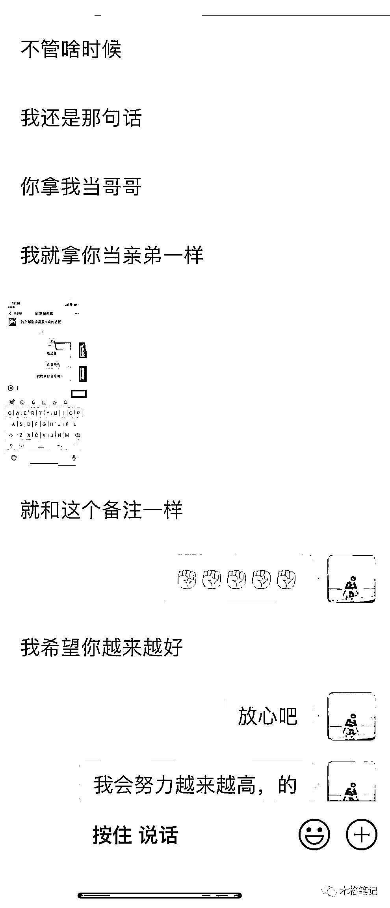

# 📕电商与个人IP：普通人还能怎么玩？

赚钱的朋友们，早上好，我是木格，99年？不，98年，已经不算年轻了。这几天刚被拉进航海群，说实话，这是我头一回参加小航海，既兴奋又有点忐忑。在赚钱这些年，认识了不少并肩创业的伙伴，也学到了很多。我一直在想，自己能输出点什么真正有用的东西？最近ChatGPT很火，📕也很火，IP这事我也摸爬滚打了一阵子，干脆把它们串起来，聊聊我的思考。希望这次航行，我们能互相照亮，一起往前走。

现在是凌晨五点，只睡了两三个小时。我习惯这个点写东西，戴着耳机，放着一些让人安静下来的钢琴曲，比如《The Rain》《天空之城》这类。不知道为什么，一听到这些旋律，整个人反而清醒了，思路也顺畅了。很多人夸我文笔好，其实我学生时代作文也就刚及格。后来琢磨了一下，无非两点：一是看了大量创业类和知乎上的文章，碰到有启发的句子就记下来；二是写长文时一定要听略带伤感的纯音乐，能让我快速进入状态，顺便复盘自己。

去年在朋友的鼓励下，我正式踏上做IP这条路。说实话，IP的抗风险能力很强，周期也更长，算是一件“难而正确”的事。这些年我吃过不少亏：第一次背了几十万的官司，项目从巅峰跌到谷底，当时只怪平台，却没意识到自己根本没有长期规划；第二次又因为追求短期利益，公司散了，朋友也不愉快，虽然直接原因不在我，但战略错了，方向就错了。好在事不过三，我还算清醒。

我不是说不要赚快钱，在从0到1的阶段，有些钱确实得“跪着捡”。记得刚创业时，一位老大哥跟我说：“你现在最重要的是先赚它一百万，这是你的底气。有了底气，出门看项目、交朋友都不慌。”但过了这个阶段，就该停下来想想了。把这段当成积累，可以旅旅游、放放松，但更要认真思考：接下来做什么长线的事？至少赚得心安理得，不会因为平台一变动就从高空摔下来。

平台型生意真的越来越难了。比如美团电商，去年铺货就能躺赚，但只是小红利，今年全变了。我有个朋友做抖音团长，去年GMV两三个亿，看着光鲜，实际退款超过一半，扣掉工资和社保，到手也就几百万，今年更差。所以我很清楚：依附于平台的产品，不可控因素太多。花无百日红，我们公司今年会把产品和服务慢慢收回到私域，形成一个闭环。我不想再“三天打鱼两天晒网”了，在冰冷的小竹筏上飘着太累，我想造一艘能远航的船。

德鲁克说过，企业只有两个功能：一是创新，做出差异化的产品和服务，提供附加价值；二是通过营销，成为顾客心智中的首选。放到私域也一样——流量的红利会枯竭，人心的红利才刚刚开始。

最近📕电商很火，ChatGPT也很火，我都去研究了。说实话，在ChatGPT上花的时间更多，毕竟不想被时代淘汰。今天重点说说📕。朋友发给我一份很细的思维导图，细到标准化流程、每个员工做几个号、每个时间点做什么都写得清清楚楚。但这次我没有马上照做，而是想了好几天。我承认📕电商是个机会，但那种靠铺量、靠概率、靠多号硬怼的玩法，不是我要的。这种模式，发100篇爆5篇，等入局的人多了，概率会越来越低。为什么不急着做？三个理由：

**1. 成本太低，谁都能做，内卷会极快；**
**2. 概率会持续下行，靠运气不长久；**
**3. 无脑铺货没法占领用户心智，只能靠冲动消费。**

抖音带货竞争那么激烈，乔乔好物为什么能跑出来？除了垂直和量大，肯定还做对了什么。这个问题留给各位思考。

那我们应该怎么做？我的思路很简单：只做蓝海赛道，必须引流到私域，提供好的服务创造附加价值，想办法形成裂变复购。说白了就是做私域。有人说不了解行业、不知道做啥，其实方法不难：知乎能解决某个行业50%的问题；再用ChatGPT、New Bing、📕数据分析工具、抖音热门选题去补充。至于图片，用固定热门模板，或者直接用AI绘画。这次参加赚钱小航海，我也有幸成为16151人中的一员，咱们虽渺小，但自带光芒。

我们接下来的操作，就是通过AI实现标准化，解决可复制的问题。这也是我迟迟没做📕的原因。不过3月初我们就要动手了，做不做得成没关系，至少能学会很多，也能看到未来。别太迷恋技术和玩法，那些都不重要，核心还是你自己的认知和思考，这会对最终结果产生天翻地覆的改变。现在我变聪明了，做一个项目不会太着急，更愿意花几天时间想清楚什么才是对的事。慢一点没关系，方向对了，就选择难而正确的事情。

老规矩，送大家一句话：落叶归根，从群众中来，到群众中去。渔夫出海前并不知道鱼在哪，但还是会选择出海，因为相信会满载而归。很多时候，选择了才有机会，相信了才有可能。祝大家本次航海顺利，2023，一起扬帆起航！