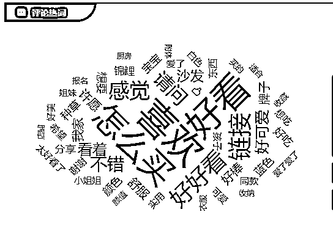

# 1.5 小红书怎么赚钱？@谢无敌

先看一组很直观的对比：2020 年 QuestMobile 的统计中，小红书平均带货转化率达到 21.4%；同期抖音为 8.1%，快手为 2.7%，微博为 9.1%。

小红书之所以能把转化做得这么高，离不开平台里大量愿意下单的用户，也离不开社区自带的推荐与“种草”氛围。正因如此，它的带货效率比不少公域平台更突出。

这背后其实是两端的机会：一边是商家，愿意来这里做引流和投放，找到更精准的客户；另一边是博主，哪怕只是素人，也更容易获得变现空间。

按照销售属性的不同，小红书变现大致可以归为两类。

第一类是“卖东西”。博主自己手里有可销售的产品、货源或服务，既可以是实物商品，也可以是虚拟产品，比如资料、课程等。简单说，就是博主本人有货可卖，这类账号通常被称为商家博主。

第二类是“卖时间”。博主自己没有商品，但希望通过小红书增加收入。这类人大多把小红书当副业，也有人全职来做，比如一些宝妈通过接广告，或者帮别人卖产品来变现，我们一般叫他们纯博主。

接下来，就从这两大类出发，分别聊聊具体有哪些变现渠道。