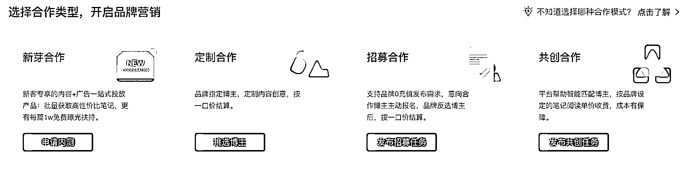
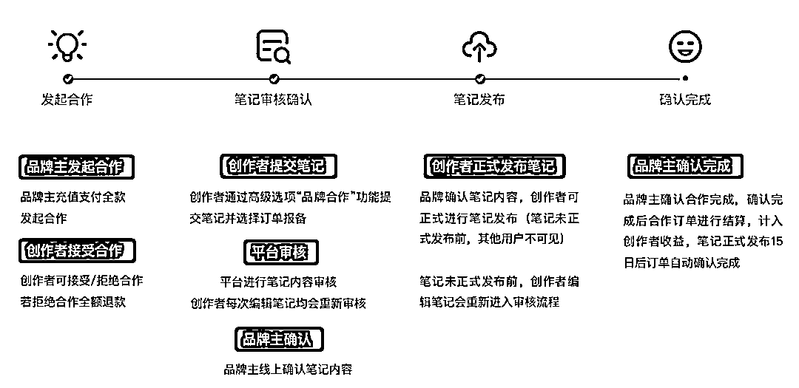
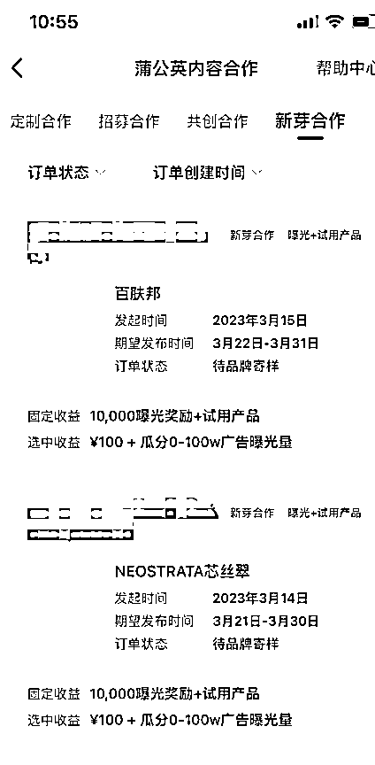

# 1.5.2.4 品牌合作人入驻攻略 @大芝

想走官方正规路径，先进入蒲公英平台并取得品牌合作人身份。门槛有两项：完成专业个人号认证，同时粉丝数达到1000以上。

1）申请入驻蒲公英

小红书眼下也在给粉丝量不高的博主提供变现机会。攒够1000粉，就能提交入驻申请。

蒲公英目前提供四种合作形式：

通常的合作流程如下：

由于走的是官方链路，安全性有保障；代价是平台会抽取10%费用，而且进门有门槛。

2）定制合作/招募合作

二者都按一口价结算，报价一般为粉丝数的10%。例如1000粉对应100元。

3）共创合作和新芽合作

对低粉博主更友好的，是共创合作和新芽合作：前者收益空间更大，后者能获得更多流量扶持。

共创合作除了基础一口价，若视频互动表现亮眼，还能额外获得广告分成。

有两点要提醒：

•一条共创广告允许挂3条笔记，且这3条会分别核算提成。拿到共创合作后，务必将3条笔记全部用上，每条都能带来额外分成，收益自然更高。

•但要注意，共创广告的笔记提交节点与提成统计截止日并不是同一天。

我第一条共创广告的提成统计截止到3月10日，我误以为笔记发布也要在3月10日前完成，实际笔记提交的截止时间是3月2日。时间弄错后，广告关联失败。后来我删掉这篇笔记里的广告部分再发布，数据反而比成功关联的那篇更亮眼，但2000元广告费因此没拿到，教训很深。

新芽合作在固定一口价之外，还会附带额外流量推广，曝光量随之提升，价值很直观。

新芽类广告数量多，报名通过率也较高，因此要留意档期安排。我起初没经验，一次报了太多，结果5个合作集中通过，档期直接排不过来。

