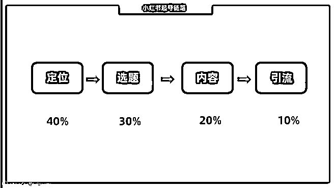

# 2.1.2.2 定位先看变现 @吴一村

V先生有句话：定位就是排头的1，其余事情全是它后面的0。随手写内容也可能产生复利，可一旦持续一段时间却赚不到钱，很多人就会失去动力，最终停更。因此，运营小红书的关键，是让账号具备赚钱能力；不然大多数人很难坚持到底。而账号能否赚钱，前提又落在定位上——定位选得对不对，直接决定账号变现能力的强弱。前期要把四成精力放在定位上，再去考虑选题、内容与引流。

想把小红书做成能盈利的账号，需要记住两条核心原则：

第一，痛点优先于痒点。面对多个定位方向时，优先选能解决用户痛点的，而不是只挠到痒点的。原因很现实：多数人为痛点掏钱很果断，为痒点却容易犹豫退缩。以职场赛道为例，大学生最痛的是怎样尽快拿到一份好工作；这个核心需求里还包含简历优化、入职体检、面试辅导、能力培训等细分项。相比体检和培训，他们更愿意为简历优化和面试辅导买单。所以，在众多需求中锁定用户更愿付费的痛点，把它做深做透，既能最快赢得信任，也离变现最近。

第二，帮别人赚钱优先于帮别人成长。成年人走入社会后，身份不再是学生，单纯“学习成长”的权重会下降，赚钱才是头等大事。如果你有靠技能盈利、做项目赚钱或自媒体变现等经历，定位时更适合选择“帮别人赚钱”，而不是“帮别人成长”。

定位阶段最好把这两条原则想清楚：尽量痛点优先于痒点，赚钱优先于成长。若脱离基本原则，就很难戳中用户最痛的地方和真实需求，信任建立会变慢，变现路径也会被拉长。

注：以上两条原则针对新人，不适用于领域专家。任何一个领域，只要你做到专家级别，赚钱通常都不成问题。

内容源自《14 天从零变现 1000+，适合新人的小红书赚钱定位攻略分享及避坑指南》

