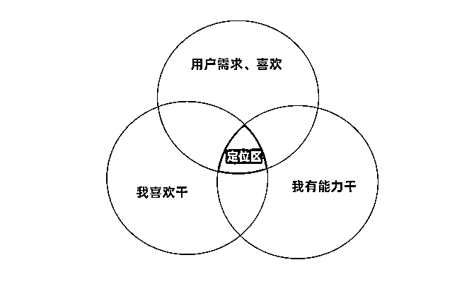

# 1）先找到“想做、能做、有人需要”的交集 @吴一村

做📕，第一步不是急着写笔记，而是想清楚：你能持续分享什么？这些内容属于哪个领域？

举个很典型的例子：一位90后宝妈，家里有两个孩子，自己又有5年人力资源工作经验。照理说，她面前摆着两条路——母婴赛道或职场赛道。但到底该选哪个？

不是看哪个赛道更热闹，而是先了解自己：哪个方向真正让你有热情，并且你确实有积累？假设她发自内心喜欢HR工作，这些年也攒下了不少实操经验和案例，那她的内容完全可以面向0-5年职场经验的用户。可如果她对职场内容毫无感觉，哪怕手里有再多的经验，也很难长期坚持，更别谈做出成绩。这种情况下，职场就不适合当成她的定位。

有兴趣是好事，但喜欢和“能把内容输出做好”是两码事。真正靠谱的定位，落点在“你有能力做”和“用户需要什么”的交叉处。

很多新人是怎么选的？看到别人做某个领域做成功了，就觉得自己也能照搬。结果发出去的数据冷冷清清，原因很简单：用户只会关心自己的问题有没有被解决，不会因为你热爱某件事就买账。所以，别陷入自我感动式的分享，一定要把用户需求放在前面。

当你找到了自己热爱、有能力做、用户又需要的内容后，最重要的一步是把“内容”变成“技能”。什么是技能？就是你早已掌握、可以毫不费力分享给别人的强项。比如摄影、美食营养、健身、赚钱方法，都属于这类可输出的技能。

内容来源：《14 天从零变现 1000+，适合新人的📕赚钱定位攻略分享及避坑指南》