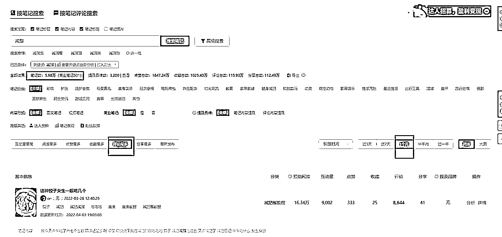
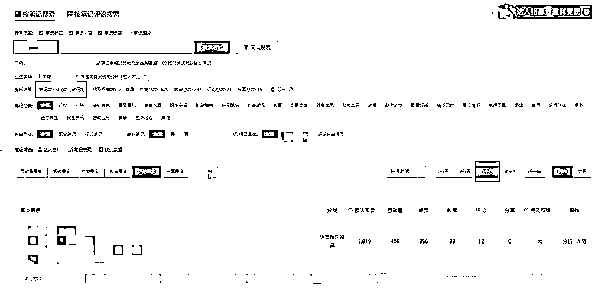

# 换个思路，找到📕的低竞争入口

📕各赛道和别的平台一样，也分竞争拥挤和相对空白。像护肤、穿搭这类已经跑通、离变现近的方向，参与者很多，想挤进去并不轻松。

做账号时，未必要在拥挤赛道硬抢份额；也可以换个方向，挑竞争更小的蓝海领域，先拿到自己的第一笔收益。

下面分享一个筛选蓝海赛道的办法：

先去淘宝买千瓜豪华版，48元一天，然后拿你想做的领域关键词搜笔记，重点看最近30天的笔记数量。

比如我搜“减脂”，结果显示近一个月有5.98万篇笔记，这显然已经是竞争很激烈的红海。【图有点糊，大家主要看字就行】

再换一个搜索词，近一个月只有9篇笔记，这种领域竞争小到不能再小。

愿意在搜索框输入具体名词的人，通常需求很明确，是精准用户。可以想一下：如果搜出来只有9篇笔记，其中4到7篇由我们发布，这样的转化效率是不是很可观？

以上就是找蓝海赛道的方法，方法有点笨，需要自己逐个搜关键词。

在📕运营账号，选定一个领域通常要长期做下去，因此自己在这个方向最好先有一定积累，才能持续输出。所以不妨搜一搜自己感兴趣、或过去有经验的领域，看看是否属于蓝海。

内容来源：《粉丝3000月营收20万，📕低粉高变现的蓝海攻略分享》

