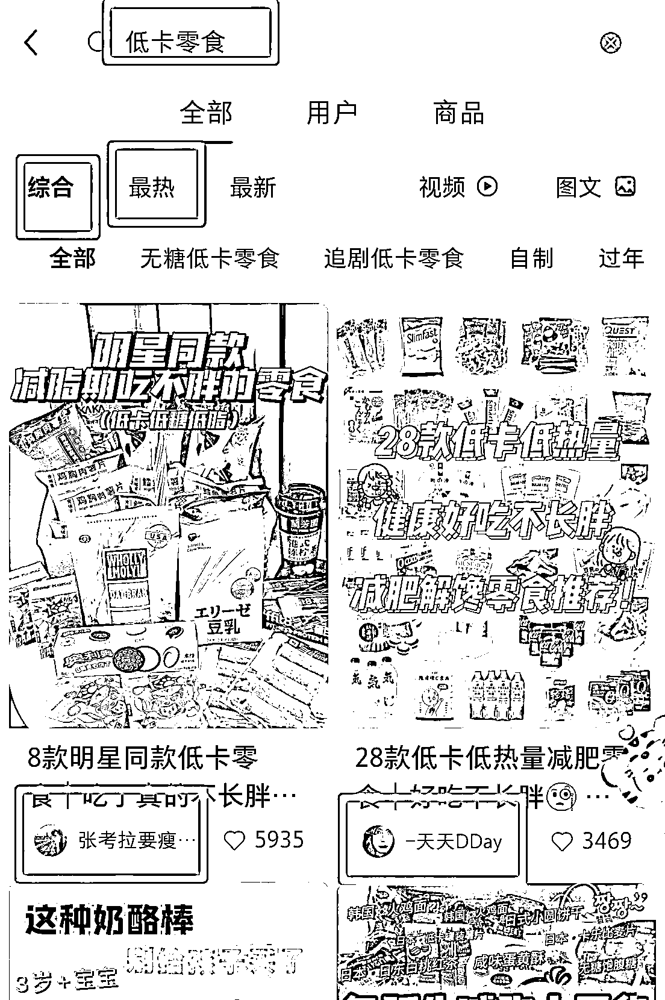
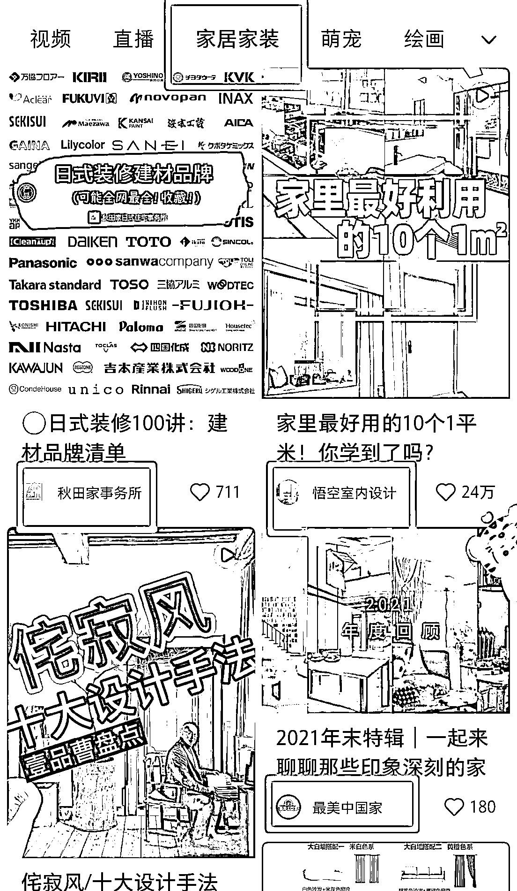
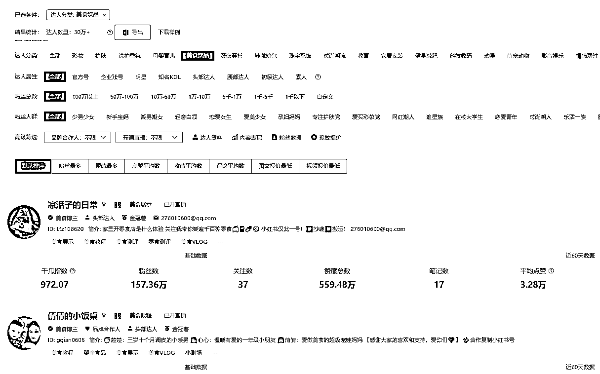
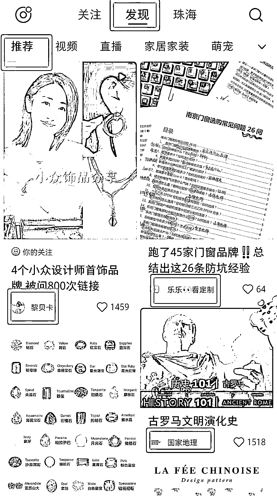

# 2.3.1 对标博主怎么找？四个实用入口

想快速锁定同赛道的对标账号，可以从下面四条路径入手。

1）用领域关键词搜索（最推荐）
在搜索框输入自己所在领域的关键词，重点浏览“综合”和“最热”结果中排名前50的博主，再从中挑选合适的对标对象。

2）进入【频道】下的对应类目
小红书的二级导航里设有家居、美妆、穿搭等频道。点进自己领域的频道后，就能看到该领域博主的笔记，并从中筛选出适合参考的对标账号。

3）借助千瓜、蝉妈妈等第三方工具
这类数据工具通常提供达人榜单和达人搜索功能，可以按分类、账号属性、粉丝级别等条件筛选，操作省事，但费用不低。

4）留意主页推荐页
你平时常看哪类笔记，系统就会结合你的兴趣和浏览偏好，把该领域博主的笔记推送到你面前。

