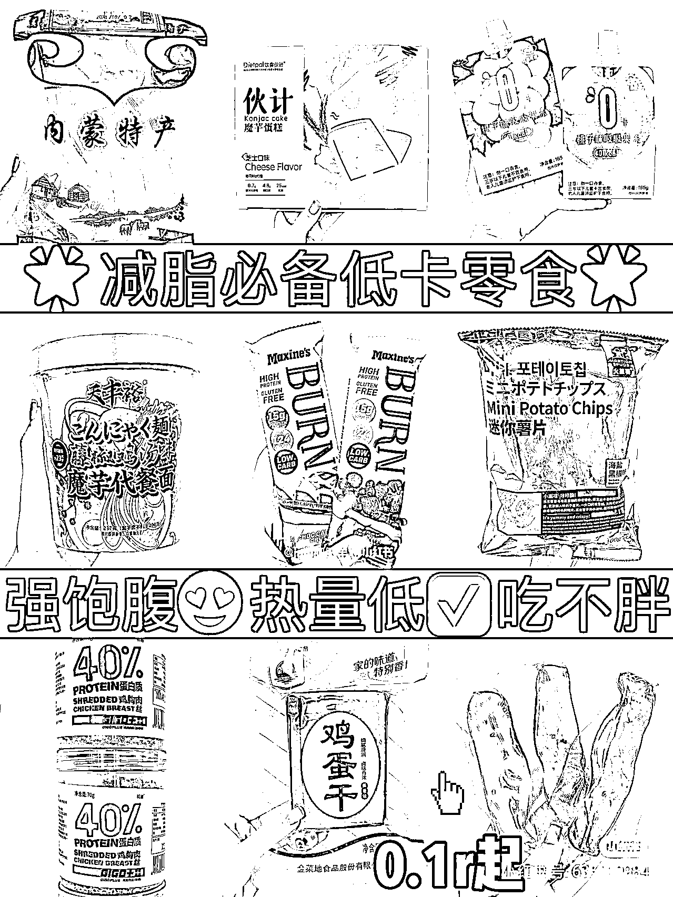
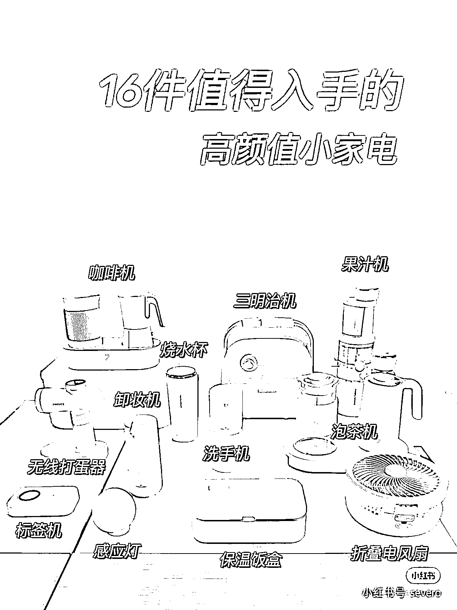

# 3.2.2.1 合集笔记：用“丰富感”抓住点击

上手难度：★☆☆☆☆，几乎没有门槛。

适用面很广：各类目都能用，好物分享和知识型 IP 都适合，其中好物 IP 尤其容易出效果。

在📕里，合集笔记属于起量很快的一种内容形式。它的核心卖点就两个字：够全。选品或内容数量要足，靠“量大管饱”的感觉吸引用户；这一点要放在首图里重点表达，标题也适合用数字制造冲击力，用户通常很吃这一套。

合集笔记的常见做法是：把风格相近、功效功能相似、面向同一人群，或适用于同一场景的物品集中推荐。每一类产品都要展示出来，并概括它的风格特点、使用感受。

**首图特点：** 把多件物品摆在一起实拍，或者做成拼图；每件物品旁边标上名称或价格。画面重点是让用户一眼感受到“选择很多、内容很全”。

**对标笔记：**

[《618 高颜值小家电购物清单🧾》](https://www.xiaohongshu.com/discovery/item/60bb03a600000000210383e2?xhsshare=WeixinSession&appuid=60059a990000000001006ec4&apptime=1642411998)

[《减脂期可囤的低卡零食❤好吃不贵😝还不怕胖》](https://www.xiaohongshu.com/discovery/item/5f7e7a40000000000101c0e7?xhsshare=WeixinSession&appuid=60059a990000000001006ec4&apptime=1642412334)

[《慢慢收藏！50 款平价好物大合集，别错过》](https://www.xiaohongshu.com/discovery/item/6189eefc000000000102a457?xhsshare=WeixinSession&appuid=60059a990000000001006ec4&apptime=1642411908)