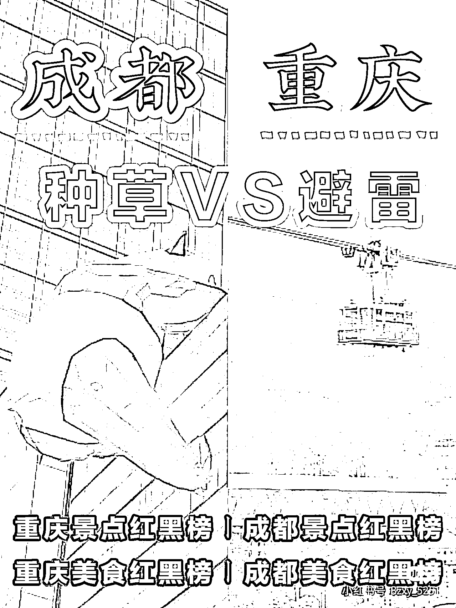
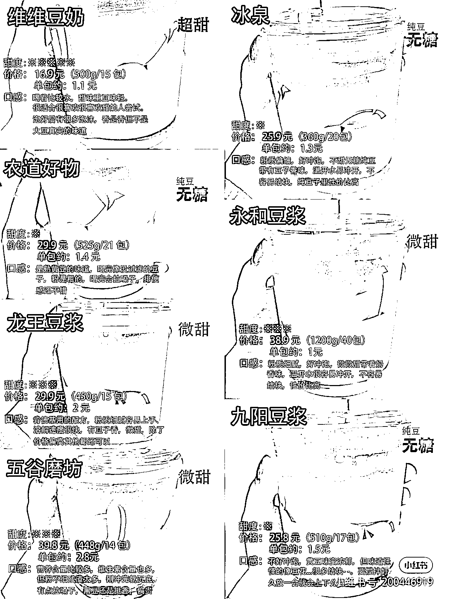

# 3.2.2.2 测评类笔记：红黑榜图文怎么做才吸引人？

想做种草内容，除了“无脑夸”的合集，测评类笔记是另一个很实用的形式。它和合集看起来有点像，但底层逻辑完全不同：合集往往一片叫好，测评则讲究“敢说真话”——用红黑榜或者星级评分，把好用的和踩雷的清清楚楚分开。

难度只有两颗星，不算难。更适合好物类账号来运营；如果你是知识类博主，偶尔做做知识产品的测评，也能玩得转。

一篇测评笔记的骨架很清晰，大致走三步：先用一个场景把读者拉进来，再挨个讲每款产品的真实体验，最后收尾时给出红黑榜、按人群分类或者分维度打分。

封面设计也有讲究。要么直接做成红黑榜对比图，让人一眼看出哪些该冲、哪些该避；要么沿用合集的排版，但要在图上标注好评分或适用人群，信息明确才有点击欲。

对标参考：

[《成都重庆攻略❗红黑榜教你避雷👭旅游必备》](https://www.xiaohongshu.com/discovery/item/5f49011e00000000010062b8?xhsshare=WeixinSession&appuid=60059a990000000001006ec4&apptime=1642413120)

[《【豆浆粉测评】大户人家系列第十三期》](https://www.xiaohongshu.com/discovery/item/617ea001000000000102717a?xhsshare=WeixinSession&appuid=60059a990000000001006ec4&apptime=1642414617)