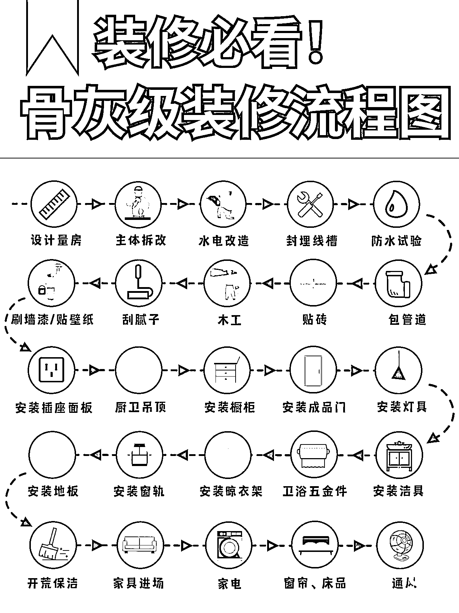
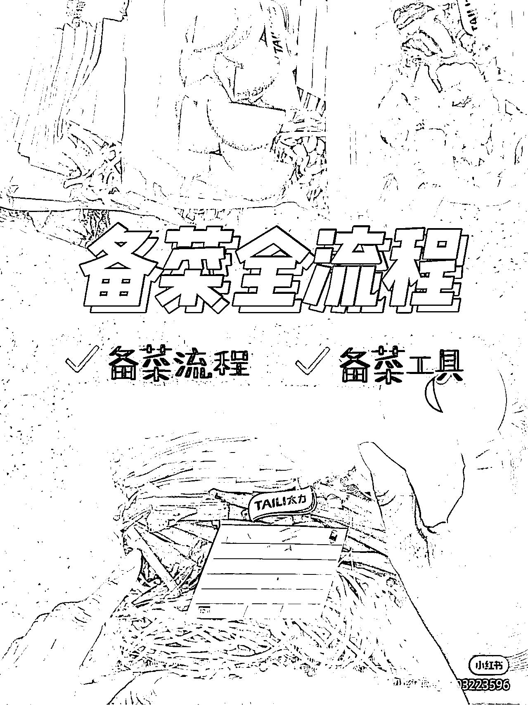

# 3.2.2.5 教程类笔记：把步骤讲明白

难度：★★★（三星）

适合谁：所有类目都能用。无论你是带货账号，还是做知识型IP，都可以把产品或服务自然地嵌进教程里。

这类笔记说白了，就是告诉读者“某件事分几步做完”的操作指南。重点不在抒情，而在“步骤”本身：一共几步、每一步具体做什么，都要交代得清清楚楚。呈现形式有两种：一种是纯文字讲流程；另一种是用图片或视频把每个环节拍出来，再配文字说明。后一种更直观，但拍摄压力也更大——每一步都得留下记录。

首图怎么选：可以把完整步骤一次展示出来，也可以只放其中一部分步骤图。

可参考的笔记：
- [《一周备菜 | 备菜流程和小工具 都在这里‼️》](https://www.xiaohongshu.com/discovery/item/600587da000000000101f09b?xhsshare=WeixinSession&appuid=60059a990000000001006ec4&apptime=1642416734)
- [《骨灰级装修流程攻略✨照着装修不踩坑✔️》](https://www.xiaohongshu.com/discovery/item/61792df4000000000102f9b9?xhsshare=WeixinSession&appuid=60059a990000000001006ec4&apptime=1642416666)