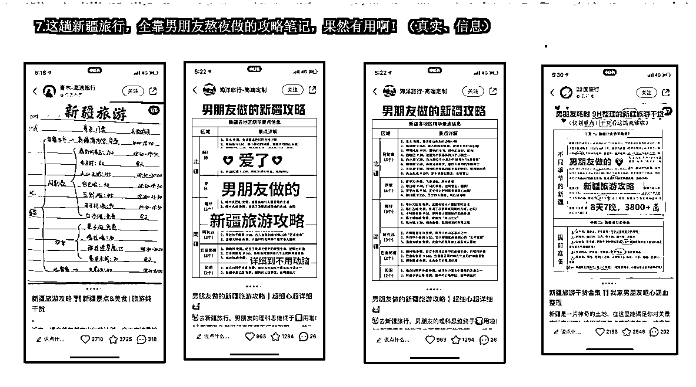
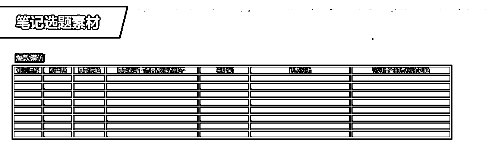

# 3.3.5 从对标账号的爆款笔记里挖选题 @许义

想快速锁定合适的选题？最省心的路子，就是看看对标账号的爆款笔记是怎么做的。毕竟一条内容已经火过一次，就大概率能火第二次。你可以把这类选题整理成一张“藏宝图”，再按成功概率给它们逐项打分，最后决定优先做哪个。

举例来说，下面这些选题就是从这种方法里出来的：

既然选题是照着别人的爆款来的，那有时候就得放下自己的偏好。你花一下午打磨的原创，可能还真不如把一条已经火过的内容重新发一遍。所以，把这张“藏宝图”里的选项排好先后，把已经火过的、容易引流的内容按顺序发出去：

——内容来源：《📕 3 天新号粉丝破千的运营方法论》

不过，如果你做的是个小众领域，情况会有点特别：这个圈子里火过的内容，因为关注的人不多，数据可能也不亮眼。那这种内容还能不能当选题？又该怎么判断呢？

圈友@杨星城给了个办法，他是这么说的：先找到你的对标账号，看他们哪些选题成了爆款，然后照着这个方向去创作新的内容。

什么才算爆款？千赞万赞就一定算吗？未必。如果账号本身就有60万粉丝，一条笔记过了千赞，也真的算不上爆款。按他的标准，可以看这几个角度：

1. 点赞量超过粉丝量；
2. 粉丝数在3万以下，但笔记赞数过千；
3. 万赞级别，且发布时间不超过30天。

还可以顺手做个选题计划：找3～5个对标账号，粉丝数控制在3～5万以下，每个账号挑出3～5个爆款选题，这样你就有10～20个题目可写了。

——内容来源：《📕日引流 200+，简单粗暴！从博主玩法迭代矩阵玩法 2.0 版》

