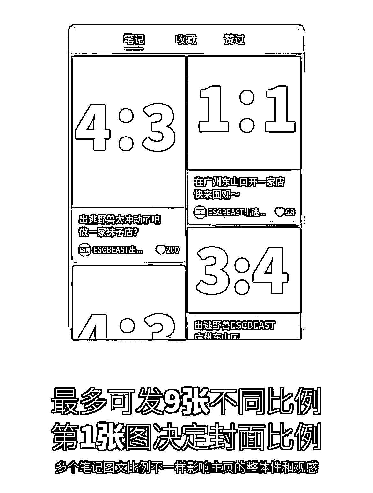

# 3.4.2 好封面，都有这些共同点

多数情况下，一篇笔记的封面想让人愿意点开，通常得满足两点之一：视觉上足够出彩，或者能让人迅速看懂主题、抓住亮点。

那些表现不错的封面，往往有这些相似之处：

• 封面要让人第一眼知道你想讲什么，视觉重心别分散。有人物出镜、有真实场景，通常比单纯把产品抠图摆放更有吸引力。
• 画质干净透亮，构图别塞得太满，减少干扰元素。
• 整体色调要协调，别让颜色互相打架、显得太杂。
• 封面上的文字别绕弯子，短一点更有效；字体、字号最好统一。
• 统一尺寸比例：更推荐 3:4 竖屏，更容易铺满屏幕、抢占注意力；想要更精致，可选 4:3 横屏，电影类、vlog 类内容常用。

内容来源：《航海实战｜📕-合集带货｜实战手册》

