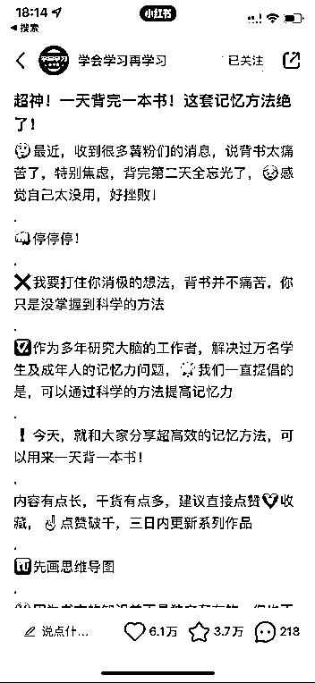
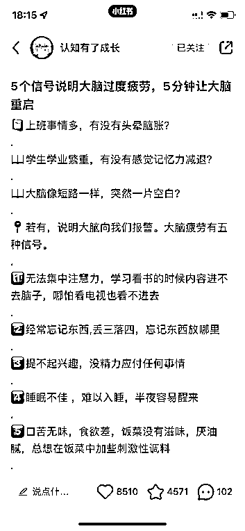

# 3.6.1 开头五步，照写就行

想让笔记一上来就抓住读者，别急着讲大道理，先把人带进他的真实处境里。记住这个顺序：先点出烦恼，再还原具体场景，接着亮出专业身份，随后给出解决方法，最后提醒点赞收藏。你在小红书上刷到的笔记，大约八成都在沿用这套结构。

拿“背书总忘”来演示：有人复习了一个小时，书一合上脑子就空了，越记越泄气；明明想认真拼一把，可资料摞得老高，急得眼眶发红还是装不进脑子。你写的场景越像用户自己的经历，越容易让人产生共鸣。以多年研究学习策略的教育工作者身份切入，再告诉大家：今天分享一套实用方法，干货很足；看到这里先点个赞、顺手收藏，之后需要时翻出来反复看。