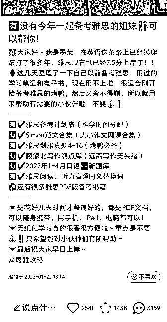

# 3.8.2 爆款不付费？这40%笔记这样写

先把思路定下来：拿出大约四成笔记，专门做“容易火、但不指望直接带来付费”的内容。它们负责把流量冲起来，再带动剩下六成笔记；同时也能让小红书官方看到，这个账号并非只会卖货的营销号，而是在持续给平台用户提供价值。

2）专业干货内容

比如手把手教用户做包子：面粉怎么配、面团怎么揉。此类实操干货发出去后，点赞和收藏通常不低，但评论区基本很安静。原因不难懂——来看攻略的人多数是想自己动手做，而不是来找你买成品。

3）免费发资料

标题可以写成：谁要和我一起做包子？

正文可以写：我有一份祖传包子秘方，前阵子照着做了一次，味道特别好；现在这份秘方我留着也没用，免费送给需要的人。

如果你卖的是知识付费产品，用图片里这种笔记来引流，效果会非常猛，很容易起量。这类笔记吸引来的人，很多领完资料就离开，想让他们付费并不容易；不过发布量堆起来后，总会有一部分人愿意买单。况且这种内容最容易爆，还能顺手把其他笔记带火。

4）借热点新闻，把话题引到自己的业务上

热点新闻要跟，但别只跟热闹，要能挂到自己的业务。像谷爱凌、橘墩墩、刘畊宏等热点出现时，小红书上一搜就是大量相关内容。如果你发现短时间内平台里很多人都在讨论同一件事，那就立刻跟上。