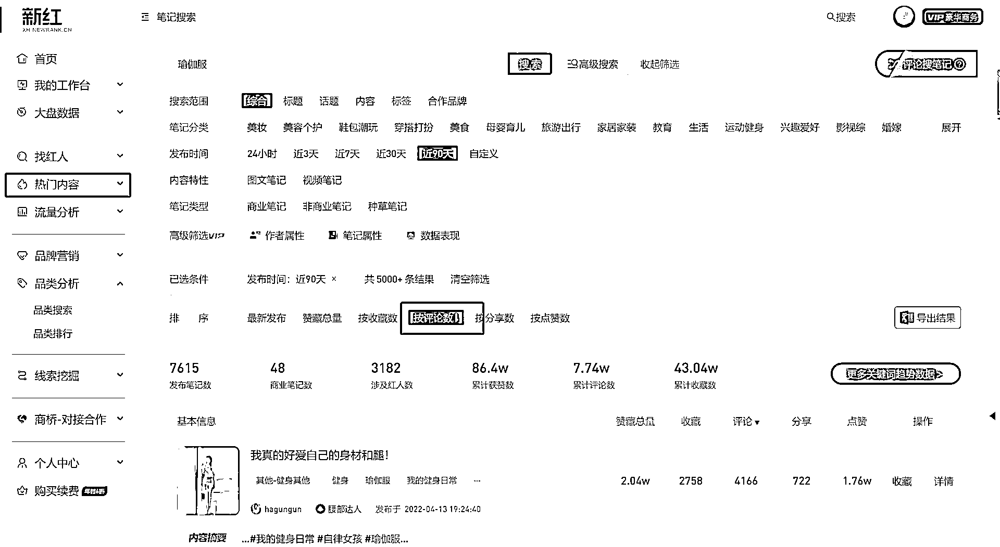
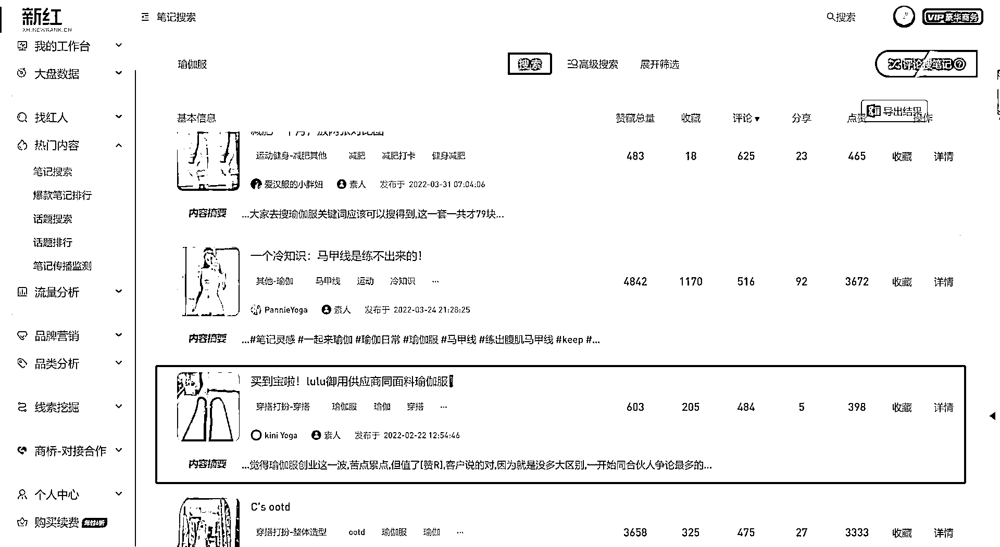
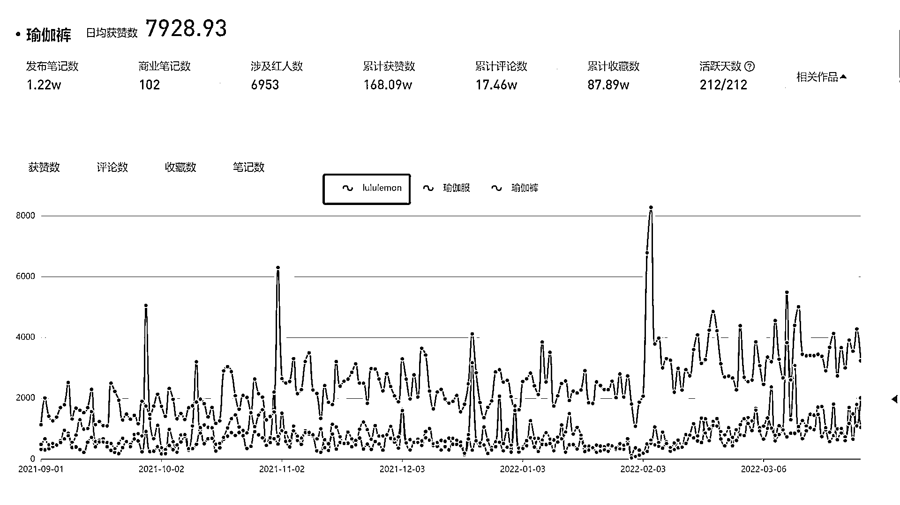
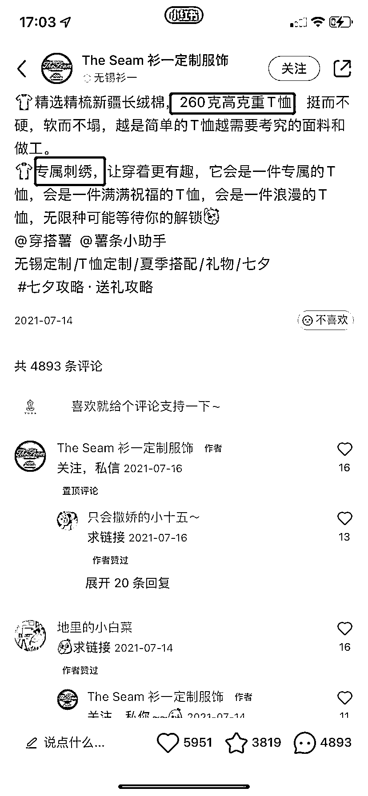

# 4.2.2.2 怎样锁定高转化样本？

先看一个硬指标：点赞数与留言数的比例。两者数量越接近越好，一比一算合格，一比二更值得留意；说到底，留言越多，信号越强。

再往下看，留言本身得带着明确的消费意图，比如有人直接问在哪买、求链接。刚起步时别嫌麻烦，把一个赛道里的大量作品翻出来，一条条过筛。这种土办法费时，却值得投入。

筛的过程里，你会逐步摸到产品打动人的点，也会对选题方向越来越有把握，甚至撞见不少惊喜。

遇到不错的样本，别只存单篇。点进作者个人页，看看他还有什么作品。通常一个能打的创作者，很少只靠单条作品出圈，同类题材往往也有不错表现。

如果发现某位创作者几乎条条作品都亮眼，那真是捡到宝了。可以把它全部作品系统整理，借助软件，或者像蝉妈妈、新红这样的数据服务商来操作。

拿新红来演示：

打开热帖筛选区，输入你所在赛道的词，排序项切到留言量。

别用点赞收藏做筛子——那些数字更像包装纸，对带货型作品参考有限。真正该盯的是留言，尤其是大量追问商品链接的留言。

再用数据服务软件找出高搜索价值的词，埋进文案，让它在搜索里多一层被看见的机会。

直白点说，就是顺势借流量。会主动搜的人，使用站内检索的频率很高。碰到品牌集中推广、上新或大事件时，平台内与该品牌相关的检索量常常陡然上升。

不少用户早把这个平台当成随手查信息的入口。

所以我们要会借势。举例，做瑜伽装备的Lululemon（露露乐蒙）曾有一阵声量极高，甚至品牌名的检索热度压过“瑜伽类服装”这种大类词，那文案里就可以自然多提几次。

把这类样本收集齐后，逐一拆文案。既要看它满足了用户哪层真实诉求，也要细品高咨询作品里的情绪吸引力。

判断别靠直觉，得看真实互动情况。底下若是一串人追着问链接、问怎么下单，说明作品踩中了买家最在意的点。

若留言东拉西扯、话题跑偏，哪怕点赞再高，也只是围观凑趣。记住一句话：

我们要的是能带来成交的样本，不是围观型热闹。最终目标不是制造刷屏内容，而是拿到高意向买家——做这个平台是为了变现，不是为了把点赞数堆漂亮。

这也能当选品尺子。拿短袖T恤来说，赛道早已拥挤，竞争白热化。但有一篇作品拿到四千多条明确的下单咨询，完全符合高价值样本的特征：

拆完文案和产品，结论很清楚：咨询量能冲这么高，是因为这件衣服打中了两个点——面料克数足、能按客户需求做定制。

这说明市场对这类短袖有强烈需求。顺着找样本的路子走，还可能顺带挖到有潜力的品。

另外，制作费用也得算。做矩阵的团队，要把每条作品的出品成本算清楚，心里有本账。找盈利型样本时，其实也在做成本比较。

专业布景、俏皮文案、考究构图，背后一定是高投入。

但投入大就必然换来高咨询吗？不见得。前文那条运动紧身裤就是现成例子（我那条作品花下来连20元都不到）。

无论在这个平台，抑或抖音，投入少却回报高的案例都不少见，这正是内容变现的有趣之处。

内容参考自：《我是如何通过小红书，两个月带货营收 30 万＋》

