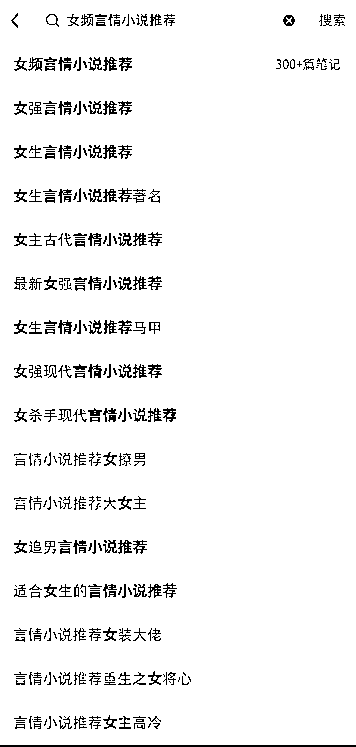
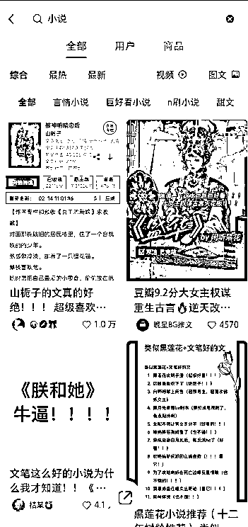
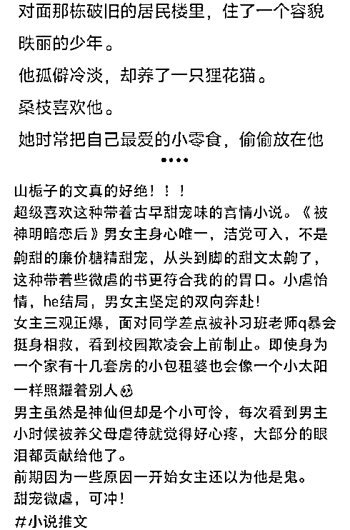

# 4.2.4 要素四：关键词要埋进标题和正文 @云珞 YunL

做内容时，记住一个动作：标题里放关键词，正文里也放关键词。

拿“女频言情小说推荐”这个定位来举例，找词可以走三条路。

方法一：去📕搜索框输入目标词，观察下拉联想。比如输入【女频言情小说推荐】，下拉里可能出现【女强言情小说推荐】【女生言情小说推荐】等，这些都能写进标题和正文。

方法二：搜索【小说】，点开“综合”“最热”“最新”，下方那一排词别放过，例如“巨好看的小说”“n刷小说”等，同样可以用于标题与正文。

方法三：找一篇高赞笔记，拆解它的标题和正文，判断哪些词在承担关键词角色。

以某篇笔记为例，我推测【真的好绝】【超级喜欢】【甜文】【双向奔赴】【可冲】等词，是它埋下的关键词。

关键词怎么落地？
第一步，先写清楚你推荐这本小说的理由；第二步，把收集来的词放到内容中合适的位置。

假设你要推荐《XX（书名）》这本言情小说，自己读过、也很喜欢，可以这样写——

初稿：
标题：安利！女主争霸向言情小说
正文：最近读完一本很合胃口的完结言情。女主穿到异世界，靠金手指一路破局，但她的魅力不只在外挂。很多同类故事里，金手指会服务宅斗、宫斗，或者帮男主登上权力顶峰；这本偏偏不同，女主没有被古代环境同化，而是自己用金手指争天下，让百姓过得更好。情节不别扭，逻辑也顺。男性角色各有看点，感情线同样耐读。

定稿：
标题：N刷！！这本言情巨好看，千万别错过
正文：最近挖到一本巨好看、越看越上头的完结言情，真的好绝，我超级喜欢。女主穿到异世界，靠金手指一路破局，但她的魅力不只在外挂。很多同类故事里，金手指会服务宅斗、宫斗，或者帮男主登上权力顶峰；这本偏偏不同，女主没有被古代环境同化，而是自己用金手指争天下，让百姓过得更好。情节不别扭，逻辑也顺。男性角色各有看点，感情线同样耐读。可冲！
提醒：📕标题最多20字，16—18字更稳妥。

两版差别在哪？关键就在“N刷、真的好绝、超级喜欢、可冲”这些词，被安排进了标题和正文。

靠这个办法，我曾让一篇笔记发布1小时拿到100个赞，24小时冲到千赞。按经验，1小时100赞，往往意味着第二天能到千赞。

当然，它不是每次都灵。你推荐的小说是否贴合账号定位、是否对读者胃口，都会影响结果。有时笔记要过几天才到千赞，有时只停在几百赞；但用关键词法，点赞概率会更高。比如发100篇笔记，千赞可能占20%，几百赞占50%，几十赞占30%——这个比例只是我按自己账号粗略估算的，并不精确，但做过📕的人会明白，这个效率已经不错。

为什么关键词法能加分？看上面的案例就知道，内容并不复杂，核心是把小说亮点讲出来。有时我偷懒，只取个标题，正文写“已完结、超级好看”就发，照样能收到几十乃至几百赞。原因很直接：推荐的小说本身好看、有价值，读者自然愿意点。可如果你做的是学习博主，逻辑就不同了：既要给出有价值的内容，也要用关键词法撬动流量，读者才会点赞。

内容来源：《手把手教你如何成为📕小说博主》
