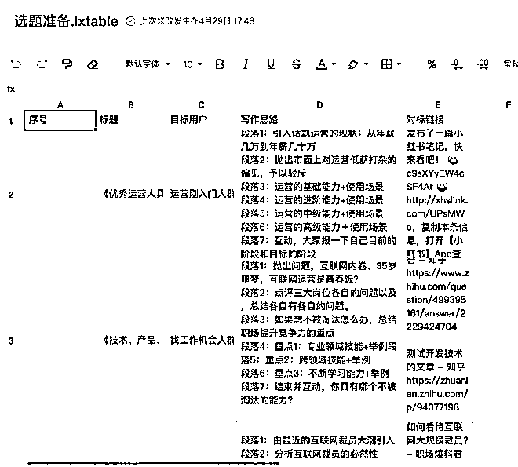

# 4.3.1 复盘到位，素材库才顺手 @子渝

想在自媒体账号上长期稳定地拿出有干货的内容，只靠临时找灵感并不够。两件事需要同时推进：一是把自己的知识框架定期盘点清楚，让内容生产有持续的后劲；二是学习和创作交替进行，输入与输出同步。建议搭一个个人素材库，需要时能迅速查到资料。

归档时最好以栏目为单位。比如账号定位是职场技能，就可以把素材库拆成【技能提升】【求职面试】【加薪晋升】等栏目来存放。

