# 5.1.2 玩法二：用粉丝群撬动精准流量 @蓝子鱼 @阿丰

做小红书引流，粉丝群可以说是目前最稳妥的渠道之一。每个账号能建 5 个群，只要在主页上展示出来，用户点进你的主页一眼就能看到。如果自己还没有群，也可以先让有群的账号帮你建一个，再把你拉进去，对方退出后，你就自动成为群主了，操作非常方便。

群名可以取“资料群”“成长群”这类带有小诱饵的名字，让人一看就想进。进群之后，能做的事情就很多了，群公告、群消息都能用来承接引流动作。

建群的具体步骤：

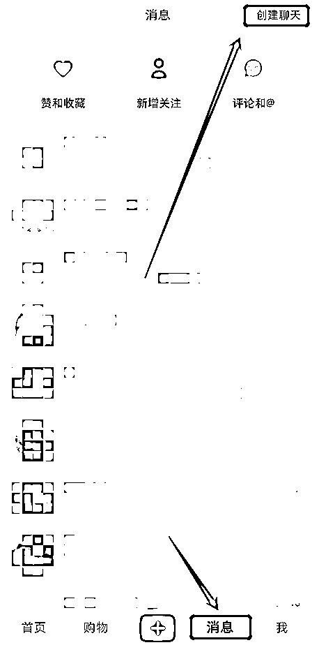

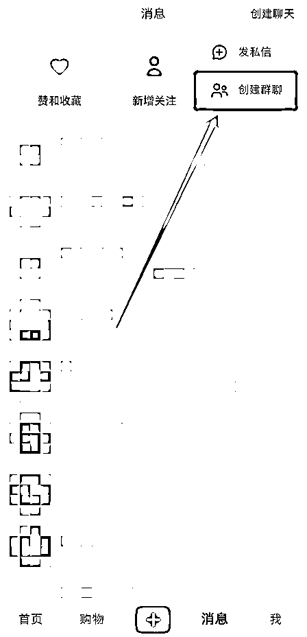

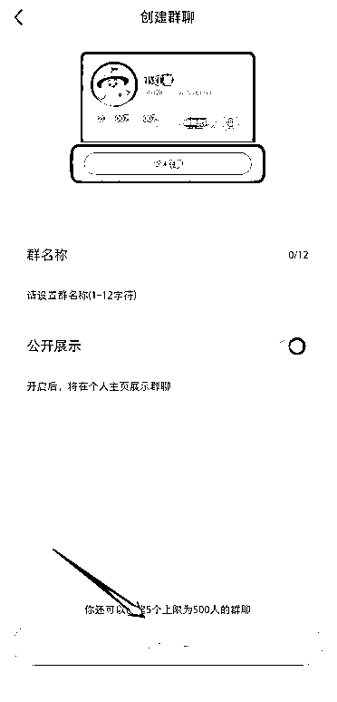

在群管理里，把“自动通过”打开。之后用小号在群里发“想打卡/领资料，+薇：XX”，就能把群里的用户顺利引到微信号上。

群里的几个关键设置要注意：

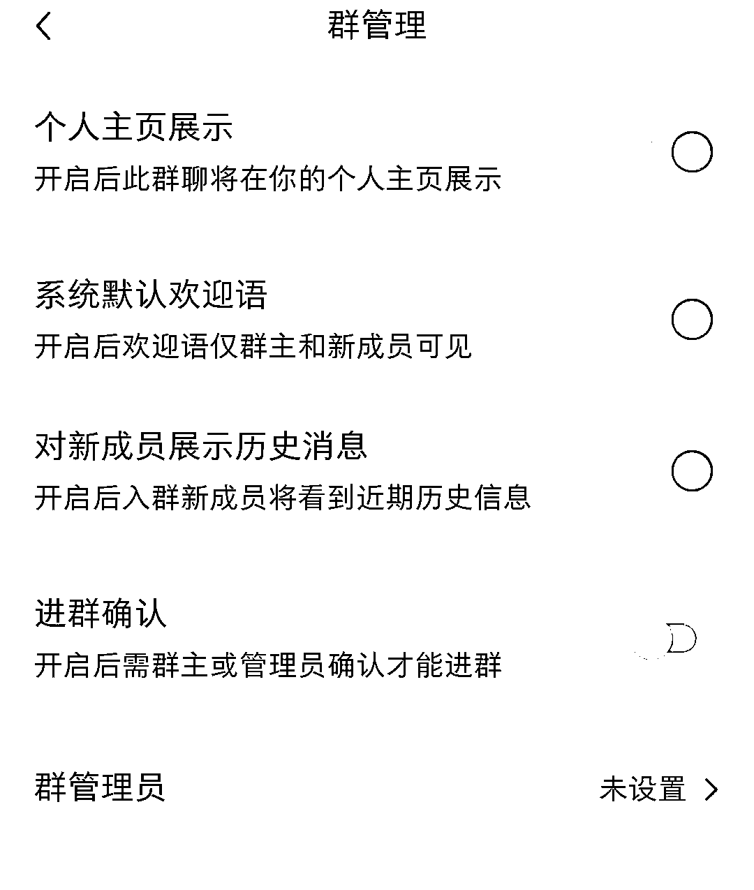

“个人主页展示”一定要开启，这样用户只要点开你的头像进入主页，就能看到粉丝群入口。

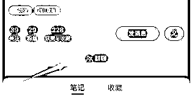

“对新成员展示历史消息”也要打开，这样不管粉丝什么时候进群，都能看到你之前发过的广告信息。

“系统默认欢迎语”记得关掉，否则每次有新人进群，系统都会自动发一条欢迎语，既打扰粉丝，又会把重要的广告内容刷下去。

群建好之后，可以把入群码发到评论区，再把进群链接在评论区置顶（评论超过 50 条就可以置顶）。用户看到后，就很有可能顺手点进群了。

有一点要留意：入群码的有效期只有 7 天。

还有一种方法是在笔记里插入小红书群。不过这个功能目前还在内测，不是所有账号都能用。可以多注册几个号、多发优质内容，用数量去博概率，总有机会被系统内测到。

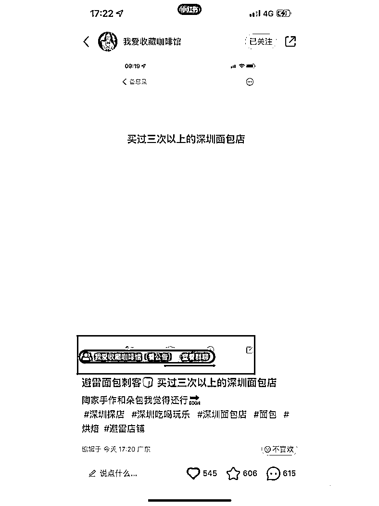

具体操作方式如下：

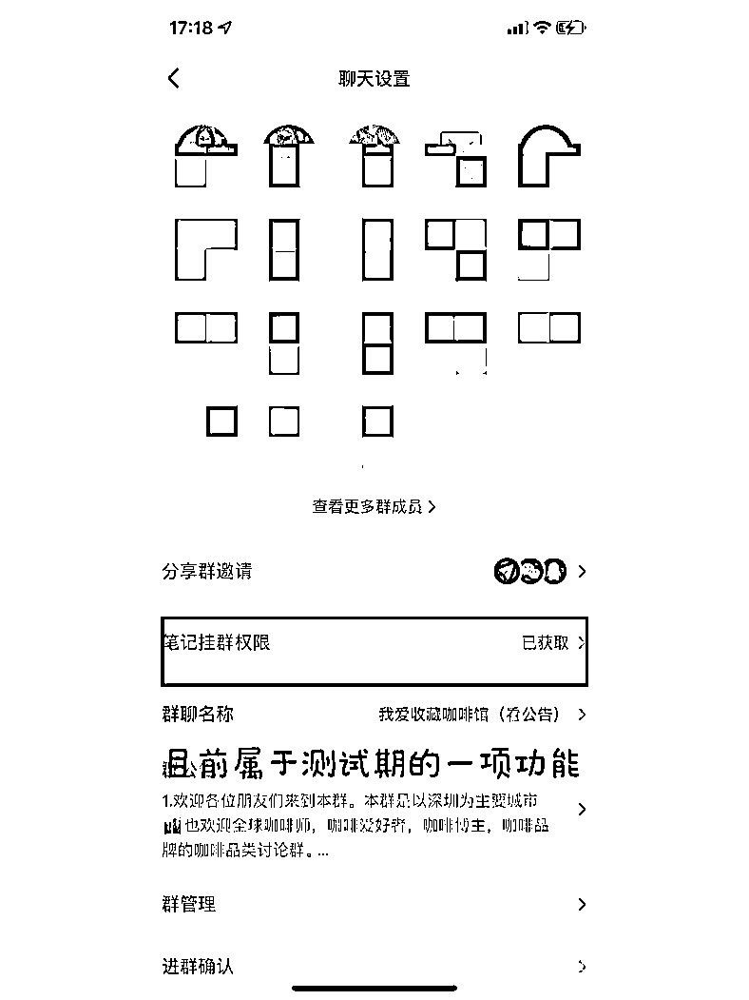

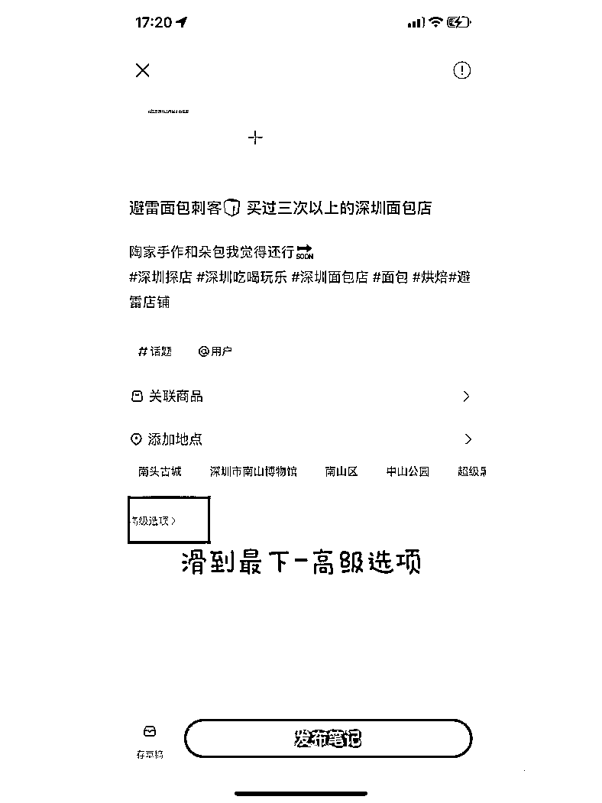

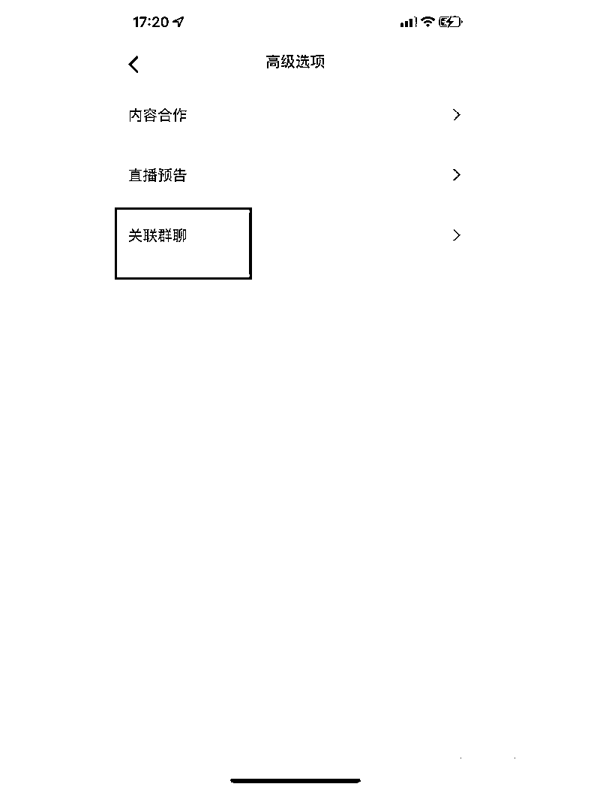

群引流方式一：群公告维护

粉丝进群后，先发一条群公告，比如我们当时这样发：

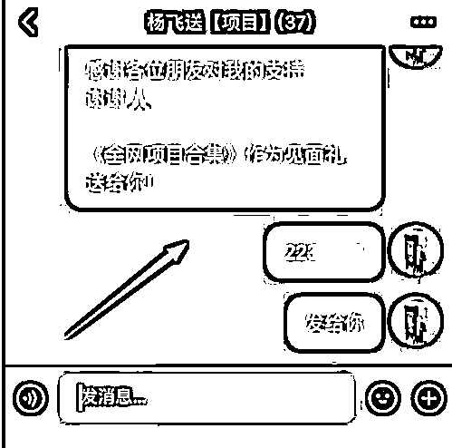

考虑到用户复制起来不方便，可以在群公告里说明情况，再把微信号单独发出来。

有新人进群提问，及时回复就好。群公告每天发一次就足够了，发太多容易触发违规。前面我们已经开了“新成员展示历史消息”，所以不用担心他们看不到广告。

群引流方式二：群聊消息导流

每天在群里发一次公告，提醒大家添加你的微信号。最安全的做法是让助理号来操作，把它设置成群管理员就行。

把微信号单独发在群里，方便大家直接复制。

这套动作坚持重复，我实测添加率能达到 40%。前期稍微辛苦一点，等账号起来后，群公告设置一次、群聊展示到主页，后面基本不用管——粉丝会自动进群、自动看到广告、自动加你微信。

群引流方式三：广告笔记导流

还有一种方式是推送广告笔记，比如下面这个：

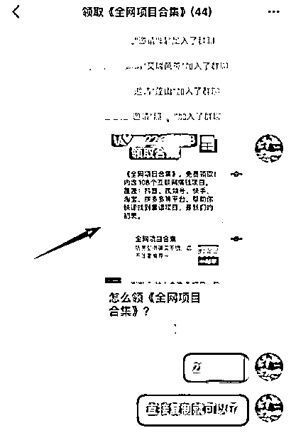

注意事项

• 群聊名称尽量委婉一些，不要太直接。

• 群公告里如果放了微信号，一次设置好之后尽量别改，减少出错风险。

• 每次拉群操作，间隔 10 分钟再拉下一个，不然容易提示操作频繁。

• 如果群被人投诉，第一时间解散本群，别犹豫。

内容来源：《新手做小红书打卡，一周涨粉 5.2 万，变现 6000+，引流私域 1500 人，简单可复制》《小红书引流，一天 300 人加微信，实操分享》

