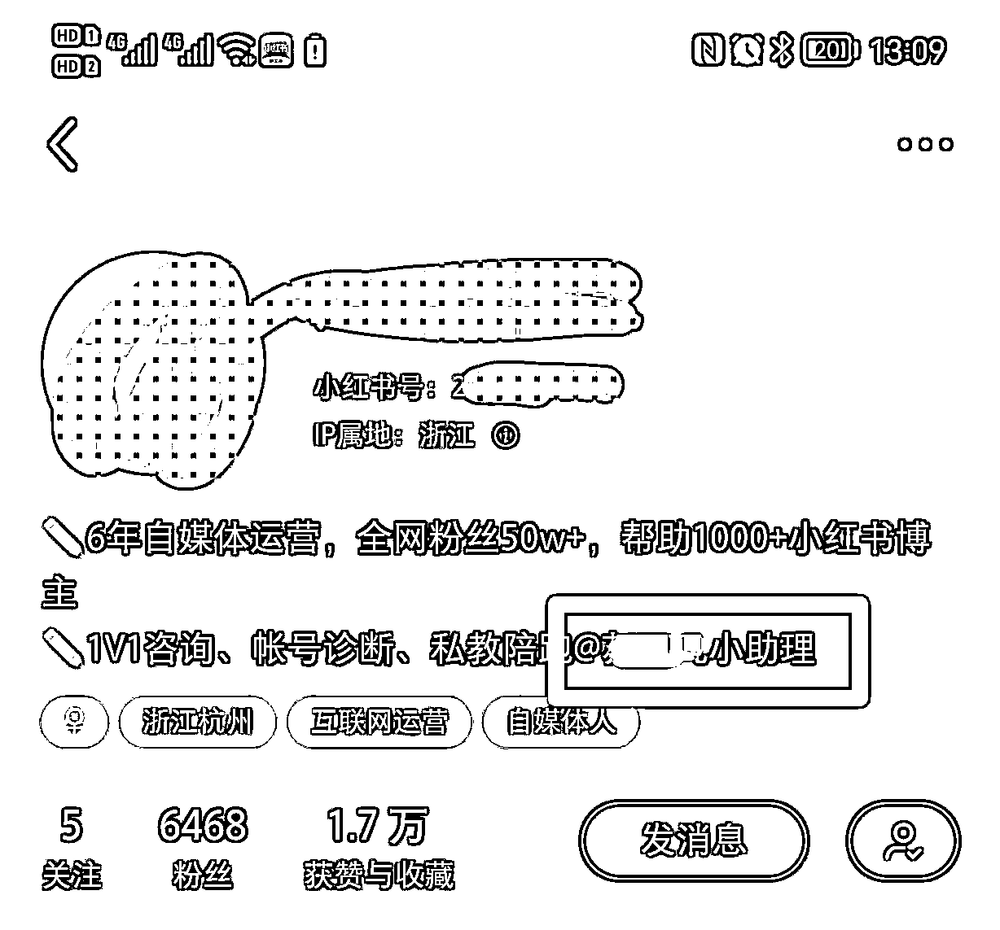
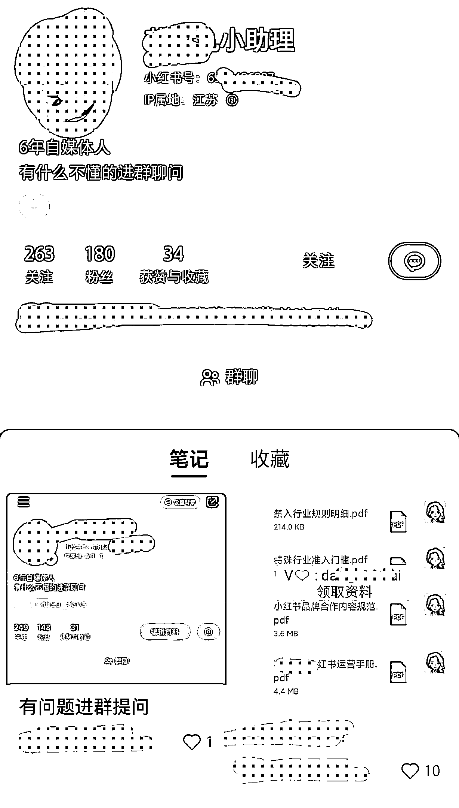
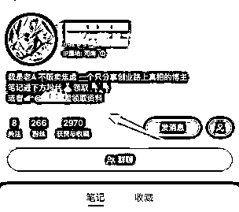
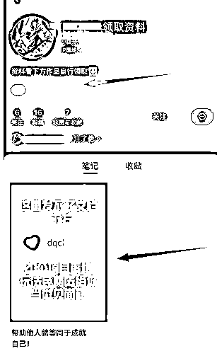
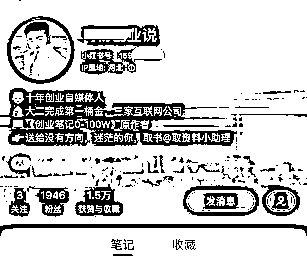
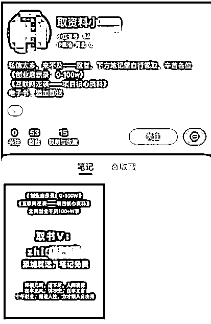

# 5.1.4 小号引流法（参考账号：@蓝子鱼、@杨飞）

如果你手里有备用账号，可以在主页简介里 @ 一下自己的小号。但新手别急着这么干，一上来就操作容易被平台清空，稳妥一点的做法是先攒到一千粉丝，再完成专业号认证。

接着，在小号主页发布一篇笔记，把🛰️号直接亮出来。

小号的命名可以参考这些思路：“小助理”“XX 助理号”“XX 唯一助理”。总之，要让用户一看就知道这个小号跟你有关，想进一步链接你，就得到小号里找答案。

这里分享两个很有代表性的案例。比如有位博主，把自家小号直接命名为“这里领取资料”。

粉丝看到名字就心领神会，点进这个红薯号，两步就能完成私域导流：

第一步，把该账号的个性签名改成“资料看下方作品自行领取↓↓↓”；

第二步，发布一条单图作品，在封面图上放上🛰️号。

另一位博主则把小号取名为“取资料小助手”。

个性签名里直接写明：有 XX 书籍可免费赠送，获取方式就是 @ 取资料小助理。

这种方式的引流效果相当不错，而且吸引来的粉丝意向特别明确。另外要留意，小号别发太多笔记，发得越多越容易出错，最好只保留一条带🛰️号的笔记。

如果是团队做📕矩阵引流，可以多备几个小号。我们目前的配置是：五个专门发笔记的账号，对应一个小号。

大号和小号相互配合——大号在笔记或评论区里 @ 小号，把流量导过去；小号也不能闲着，要多去大号下面评论互动，或者帮忙回复留言。

操作上还有几点提醒：涉及“🛰️”等敏感词尽量用谐音；小号只发一条广告笔记；坚持一机一卡一号的原则。

如果来的人特别多，记得多准备几个🛰️号轮换，不然很容易被限制添加。

另外，小号引流贴要提防同行举报，一旦被举报，帖子可能被屏蔽。遇到这种情况，把文案改一改再重新发就行。

个人🛰️号添加频繁的话，也可以在图文第二张放一张👸号名字的截图，提示用户：🛰️加不了可以走👸号。👸号后台设置好自动回复，发送个微二维码。不过这个二维码要记得经常更换，否则同样可能触发添加频繁。

内容参考来源：《新手做📕打卡，一周涨粉 5.2 万，变现 6000+，引流私域 1500 人，简单可复制》《📕引流，一天 300 人加🛰️，实操分享》

