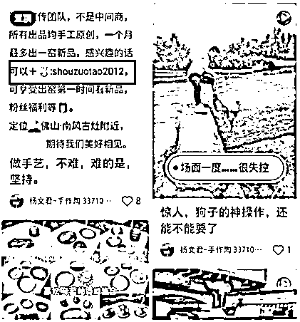
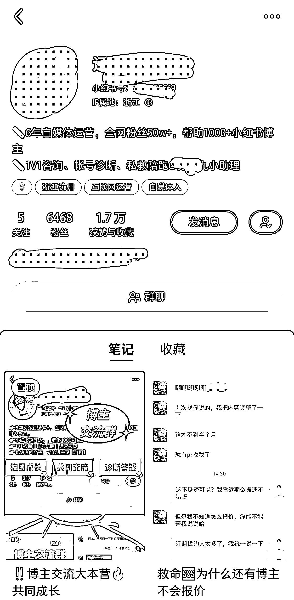

# 5.1.5 置顶笔记：三种引流思路

当账号累计发出20篇以上笔记，置顶功能就能用了。下面整理三种常见的置顶打法。

其一，用“故事名片”做隐蔽引流。你可以在内容里讲清自己是谁、能提供什么服务、擅长哪些方向，但不要主动引导私信，也不要把微信号写进去。重点放在个人经历、人格魅力和优秀案例上，让用户看完后愿意主动来找你。

其二，直接在置顶笔记里放微信号或其他引流入口。这种做法的举报风险偏高，新注册账号和权重不高的账号不建议尝试，因为容易被举报，而且举报成功率也更高。

这里要提醒：在“故事名片”里暗示自己提供某项服务或产品，没问题；可一旦把联系方式直接摆出来，被审核发现就属于明确违规。风险提示：把微信这类联系方式直接亮出来，风险较高。

其三，在置顶笔记中放群聊信息。群二维码可以打马赛克，但要露出群名称和头像。文案里告诉用户有某个群可以加入，不少人会到评论区留言，这时就可以用前面提到的评论区引流方法承接。

另外，也可以引导用户加入小红书粉丝群，想了解这类玩法，可参考下方示例：

参考来源：《初阶 | 小红书-爆款笔记｜航海实战手册》 《新手做小红书打卡，一周涨粉 5.2 万，变现 6000+，引流私域 1500 人，简单可复制》

