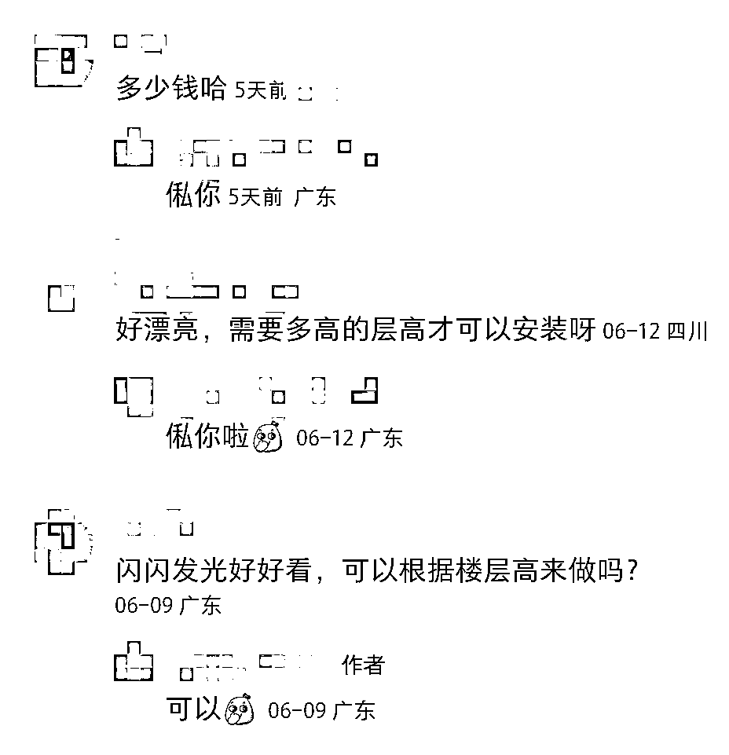
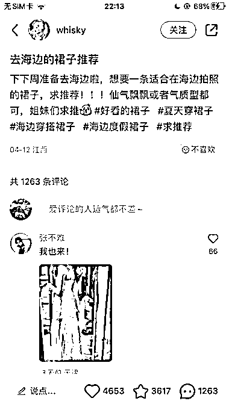
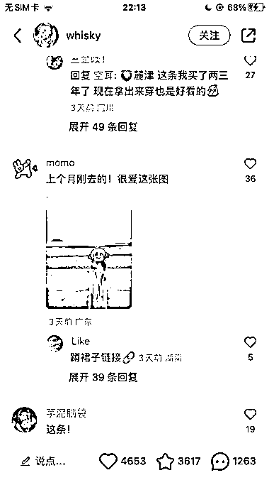
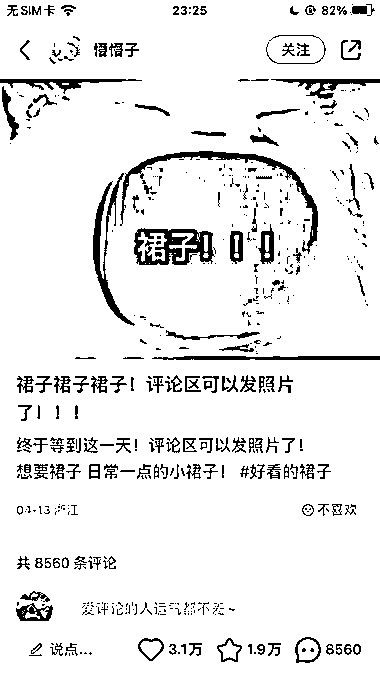

# 5.1.6 玩法六：小剧场+图片，评论区也能引流

想让笔记多一个流量入口，评论区其实可以做出两种玩法。

1）小剧场式互动引流

博主可以提前准备多个小号，也可以参与同行博主之间的互暖互助，让这些账号在评论区彼此配合、营造互动感。

⛔️注意事项：

• 别把多个小号的评论集中塞在同一时间段，太密集会显得不自然，还可能因数据异常带来违规风险。

• 小剧场用到的评论话术要经常换新，老用同一套很容易被看出水军痕迹。

• 这种玩法整体来说风险相对可控。

2）评论区晒图引流 @Sanuk 小伞

📕评论区已经可以发图片。看到求推荐产品的笔记时，可以在评论中晒出产品图来吸引关注，比如先展示某款产品图，再让小号或水军跟评“蹲链接”，把流量带动起来。

内容来源：《初阶 | 📕-爆款笔记｜航海实战手册》[《#风向标# 📕评论区可以发图片了》](https://wx.zsxq.com/dweb2/index/topic_detail/214221225154211)

