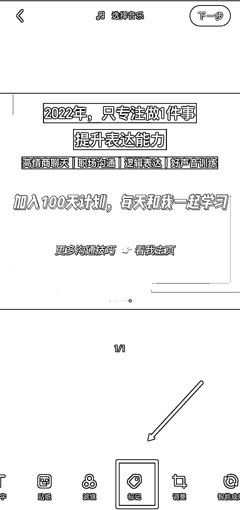
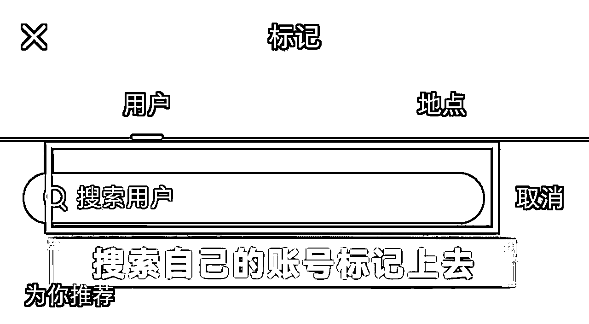
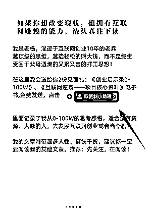
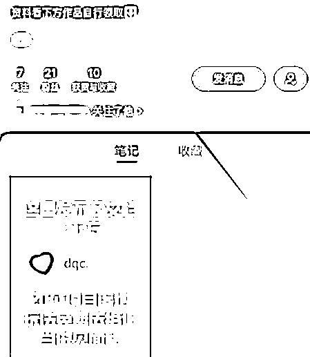
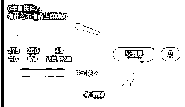
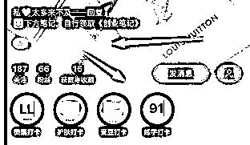
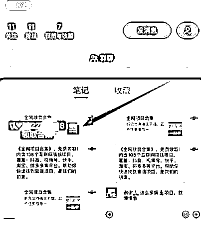
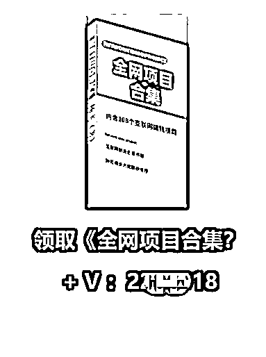
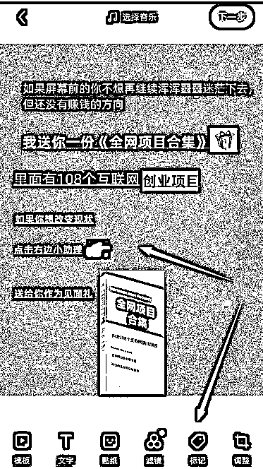

# 5.1.9 玩法九：标记引流法 @杨飞 @蓝子鱼

小红书单篇笔记最多可以放 9 张图，但建议你只用到 7 张以内。第一张当封面，最后一张用来放“关注你能得到什么”“你做过哪些厉害的事”“你现在在做什么”这类信息。

最后一张图里，记得用上“标记”功能，把你的账号直接@出来。用户点击标记就能跳转到你的主页，省去手动搜索的麻烦。这样做，主页访问量至少能提升一倍——只有先进入主页，对方才更有可能点下关注。操作时，在标记框里搜索自己的账号名称即可。

如果你想用更稳妥的方式起步，可以试试“标记”这个小方法。先看看它长什么样，下面这张图就是示例：

当用户翻到这一页时，只要点击【取资料小助理】，页面就会直接跳转到对应账号的主页。

这样做的优势很明显：

- 全程站内跳转，不绕路
- 导流路径相对安全
- 我们实测下来，没有出现一个账号被封禁

如果你也想复制这个玩法，建议先准备一个小号。

第一步，把小号资料完善好。

小号头像可以和大号保持一致，统一视觉能提升信任感。小号名称越直接越好。比如你做装修，引流诱饵是“添加就送设计图”，那名称就可以叫“获取装修设计图”“免费设计装修效果图”“XX设计总监”。如果你是做网创方向的，诱饵是送副业项目，就可以叫“领副业项目”“无偿领取XXX”。总之一句话：让用户一眼看懂这个号是干嘛的。

小号简介也非常关键，因为感兴趣的用户通过【标记】点进来后，第一眼看到的就是这里。常规设置有三种方向：

① 引导用户去看下方笔记

② 引导用户进入群聊

③ 引导用户查看瞬间，用瞬间打卡的方式辅助导流

我们目前用的是第一种：引导用户看笔记内容，效果如下图：

这个小号需要发一条置顶笔记，尽量只放一张图，图片上直接留下微信号。

如果引流诱饵能做得更具体，效果会更好。比如赠送一份手册，简单设计一下就能呈现成这个样子：

具体形式要根据你的诱饵灵活调整。虚拟产品是成本最低的选择，10G资料包、一个软件安装包、一张代金券，都足够有吸引力。

把小号资料和引导内容都准备好之后，以后发布笔记时，只要合理使用【标记】功能就行。

如果你打算每篇笔记都用【标记】，可以提前设计一张固定模板图，每次发笔记直接用，方便又省事。

这是我们团队目前常用的模板：

点击【标记】，选中小号，把它拖到箭头指向的位置就可以了。

内容来源：《新手做小红书打卡，一周涨粉 5.2 万，变现 6000+，引流私域 1500 人，简单可复制》《小红书引流，一天 300 人加微信，实操分享》

