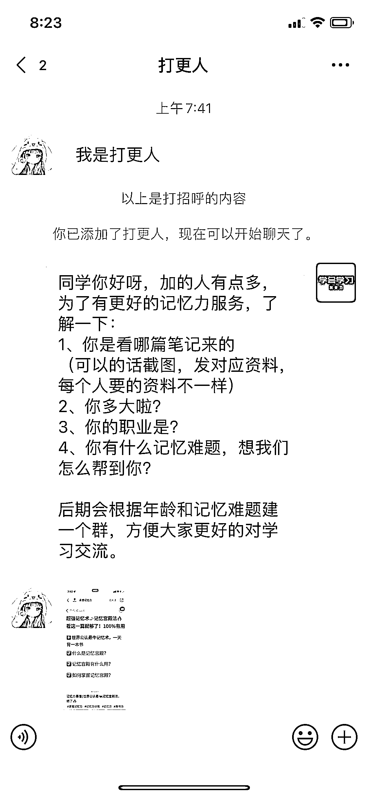
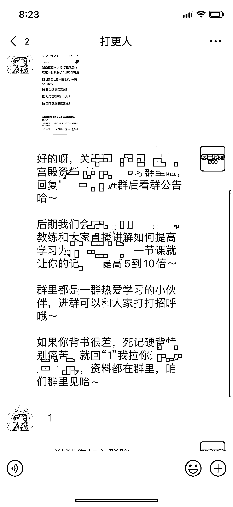
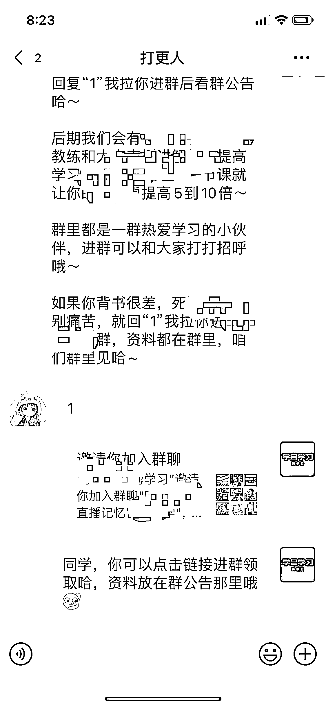
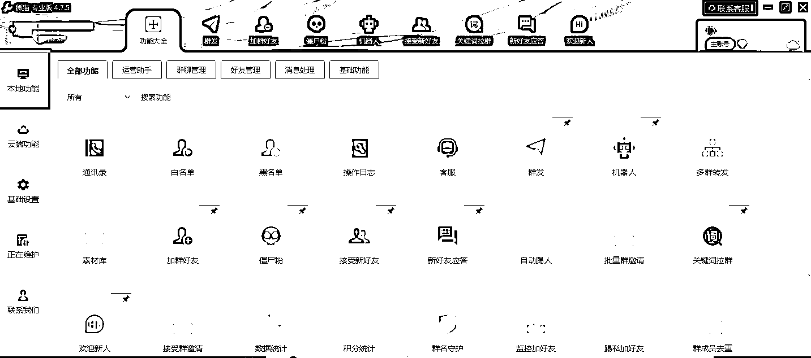
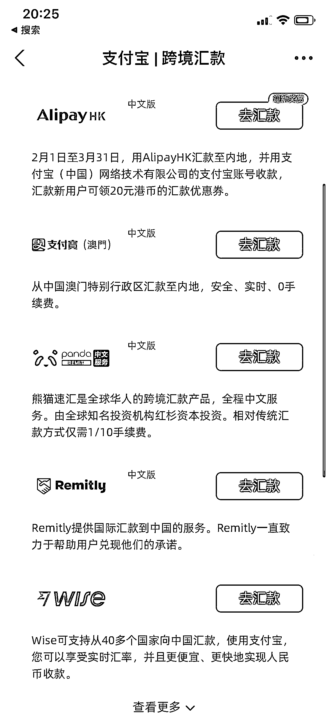
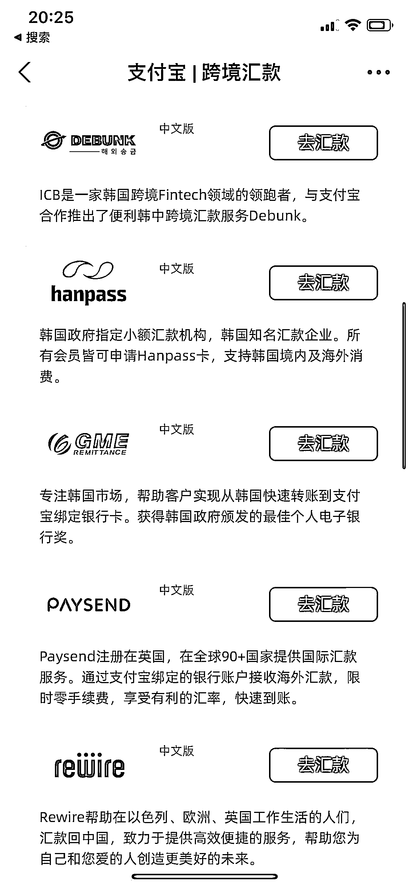

# 6.2 视频号后端转化：先养群，再开播

视频号还在红利窗口，热度不减。从📕导来的流量，不妨把这一平台当作后端承接池：🛰️群做沉淀，线上开播做收口，私域加公开课组合推进。圈友 @杨星城 的实操路径，值得参考。

流量进来之后，真正比拼的是后端能不能接稳。这里分享的思路是：🛰️群先蓄水，开播现场再收口，用私域沉淀配合公开课完成转化。

贯穿全程的一条原则是：眼下每做一步，都要顺手给下一步铺路。

**1）资料当钩子，先请进学习群**

先看一段真实沟通，感受下节奏：

🛰️私信：同学你好，添加量比较大，为了把 xxxx 这块安排得更贴合你，先麻烦回几个小问题：1、你从哪篇笔记找到我们的？（能截图最好，不同笔记配不同材料）2、年龄方便说吗？3、现在做什么工作？4、在 xxxx 上卡在哪里，希望我们怎样协助？

后面会按年龄和 xxxx 难点分群，方便同频交流。

——————————

好的呀，xxxx 材料已经放进学习群，回“1”，我来发邀请，进群先看公告区哈～

后面会由 xxxx 方向的教练在开播时教大家怎样突破 xxxx，一堂课争取帮你的 xxxxx 拉到 5 到 10 倍～

群里都是愿意一起进步的朋友，进来可以先打个招呼～

如果 xxxxxx，回个“1”，我把 xxxxxx 群的入口发你，材料在公告区，群里见哈～

————————

同学，点下方入口即可入群领取，材料在公告区哦

链接：xxxxxxxxxx（入群链接）

这些就是多数新朋友加来后的原样对话。

添加量一大，逐个深聊并不现实；而且很多人只为材料而来，聊太久最后不付费，精力不划算。

但也不能让人拿完就走，所以要设计一个“触点”持续出现。既然愿意加🛰️领材料，说明背后有真实需求。

进量大的阶段，开播可隔 1～2 天一场；进量偏小，就隔 3～4 天一场。

**2）重复回复交给自动化**

🛰️里反复答同一句，尽量让软件代劳。

淘宝搜“微猫”，168 元/月或买断，这是一款🛰️自动化管理工具，能按真人习惯执行，把回复脚本预先设好，相当于少雇一个助理。

如果自己睡得早，而夜猫子凌晨来加怎么办？

把微猫挂在腾讯云主机上，本机关掉也能自动接待。

原理是云上有一台常在线机器，一直保持运行；选最低配置就行，只登录微猫做设置而已。

**3）进群后先做预热**

还是那句话，每一步都要给下一步铺路。

预热是为了让人愿意进开播现场，而开播才是收口场。必须有收口场，去接触并解决实际需求。

用飞书建一份说明文档，把服务说明和要发的材料放进去，固定在群公告栏顶部。新人为了领材料都会打开；材料放末尾，前面是服务说明和实用内容，让人自然知道：我们是谁、能帮上什么忙、能带来什么结果。

光这样还不够，很多人不会细看，需要二次引导。可以在群里发红包唤醒，再把飞书里的内容逐条发到群里。

**4）把开播上座率拉高**

【福利吸引】：

• 通知 8 点开课，现场先发福利包
• 中途老师随机送 xxx
• 坚持到最后，送价值 xxx 元的 xxxx

【再提醒】：

• 进群者用微猫打标签，提醒晚 8 点听课
• 快开播时用🛰️自带群发功能再推一次：已经开播，进视频号学习

【开播中提醒】：

• 8 点开播，主讲 7:57 先发福利，领取方式是截屏直播画面丢进群。群里一热闹，潜水者也会点进来。
• 老师会讲三个方法。每个开讲前，在群里发：“当前主题是 xxx，适合 xxx 这类情况”，同步发🛰️动态；感兴趣的人会重新回到开播房间。

这一步的核心目的，就是让更多人来听。人到得差不多，后面的转化才稳。

**5）开播现场收单**

没播过，可以翻大航海直播课资料，讲得很全。

前几次生疏很正常，核心是真诚，加上方法确实管用，对方觉得有帮助就会下单。

时间分配可以前一小时讲实操，后半小时介绍课程；它不靠抖音式自然推荐，而是把已沉淀的私域名单请进开播现场，逻辑接近过去线下会销。

分享一句：

前期准备都指向最后 10 分钟收单。但真正让人掏钱的，并非那十分钟的讲解，而是此前每一次铺垫。

所以多开播、多露脸、多展示产品；只要有人在场，就有机会。话术多漂亮不是首位，前期做扎实更重要。

**6）收款路径与海外支付**

先配好小商店，在视频号内完成收款；对方若偏好支付宝，单独把收款方式发过去。

特别注意：📕海外粉丝多，🛰️和支付宝可能都付不了，可用以下方式解决：

打开“支付宝”——“转账”——“跨境汇款”——“汇入中国”——“我是收款人”——“分享给汇款人”——把图发给学员即可。

海外常见支付账户大多覆盖，经支付宝这个通道能落到人民币。

**7）播后回访与跟单**

回访时，把“感觉如何”换成“还有哪块没弄明白？”，对方更愿意接话。

若布置了课后任务，用小号先发，带个头，因为有人不愿当第一个；任务里多放正面反馈，对犹豫者影响很大。

观察到一个现象：只要前几条是正面体验，后面真实学员也容易跟上，陆续表达对课程和讲师的认可。

之后多在🛰️动态种草，发学员成果和任务进展，慢慢养熟。

有人首播不下单，过一阵被动态影响，再进开播房间就买了。

**8）低价训练营承接未成交**

当 1280～2480 元的正式课推不动、播后跟进也费劲时，我们开了两期 5 天 99 元训练营，把没下单的和有购买意向的一起收进来。

群内氛围与打卡节奏要做出高价值感，让人觉得 99 元买到了 999 元的体验。

测了两轮，低价转高价的转化在 15%～20%，不算理想，但能把此前没付费的再洗一遍。

名单规模起来后，训练营成绩可常晒到🛰️动态，也能当📕公域笔记素材。

整体来看，后端主要靠私域群、视频号开播、🛰️动态转化配合收单。

开播现场能增加信任，讲干货也能答疑。

后端所有动作都是为了让漏斗更顺，最终看有多少人真的来到开播现场，以及由此带来的转化比例和收款金额。

素材出处：《📕日引流 200+，简单粗暴！从博主玩法迭代矩阵玩法 2.0 版》

