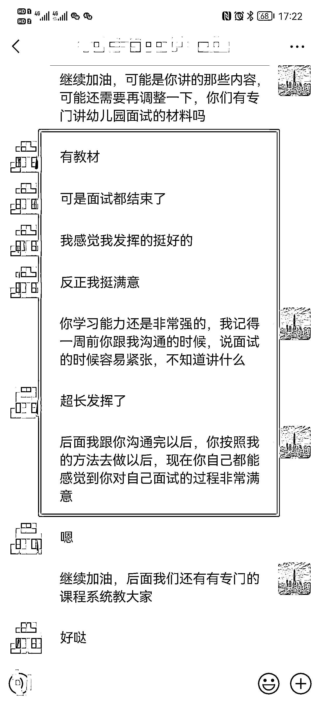

# 7.2 技巧二：用真实案例打动新客户

真实的服务经历、客户的好评，往往能帮新客户放下顾虑，信任感也更容易建立起来。

平时和客户交流时，不妨多留个心眼，把有代表性的对话截图存下来。特别是那些能体现你耐心解答、用心协助的内容，或者客户在使用产品、上完课程后反馈效果不错的部分——这些都是很合适的用户案例。整理好后，可以发到朋友圈，也能放到其他平台展示：

除此之外，还能主动和用户做个约定：等产品使用一段时间，或课程学完之后，请对方写一段总结、给一份反馈。这样既能持续积攒案例，也方便日后做宣传。

内容来源：《新手做📕打卡，一周涨粉 5.2 万，变现 6000+，引流私域 1500 人，简单可复制》

