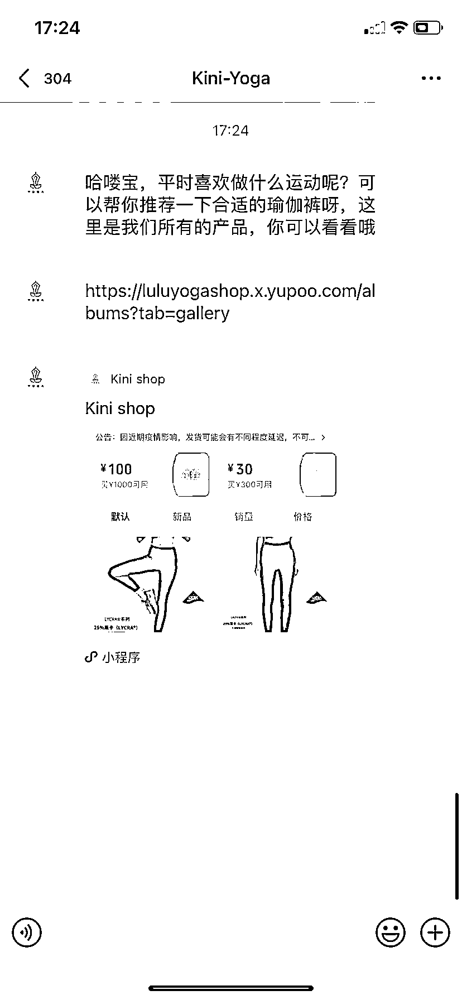

# 7.3 技巧三：用提问掌握主动 @杉木

客户通过微信好友后，第一句欢迎语最好提前定成固定模板。若添加量很大，建议把好友申请设为无需验证直接通过，以免系统频繁提示“添加好友过于频繁”。模板不妨用问题开场——一个问句最容易打破陌生感，也能顺理成章把你准备推荐的产品带出来。

先提问还有一层作用：谁先发问，谁就先握住对话的主导权，把原本被动的局面翻过来，之后客户会自然跟着你的节奏走。

当然，营销要学的东西远不止这些，也别把某一种话术当成万能钥匙。我们每天面对的人各不相同，具体情况具体处理，灵活一点更好。说到底，再多的技巧也比不过真诚。

内容来源：《我是如何通过小红书，两个月带货营收 30 万＋》

