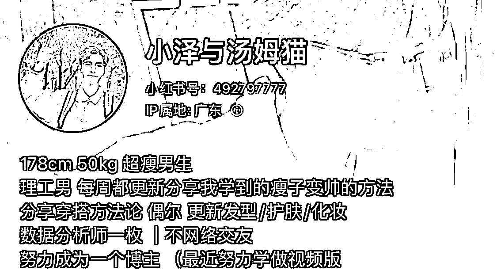
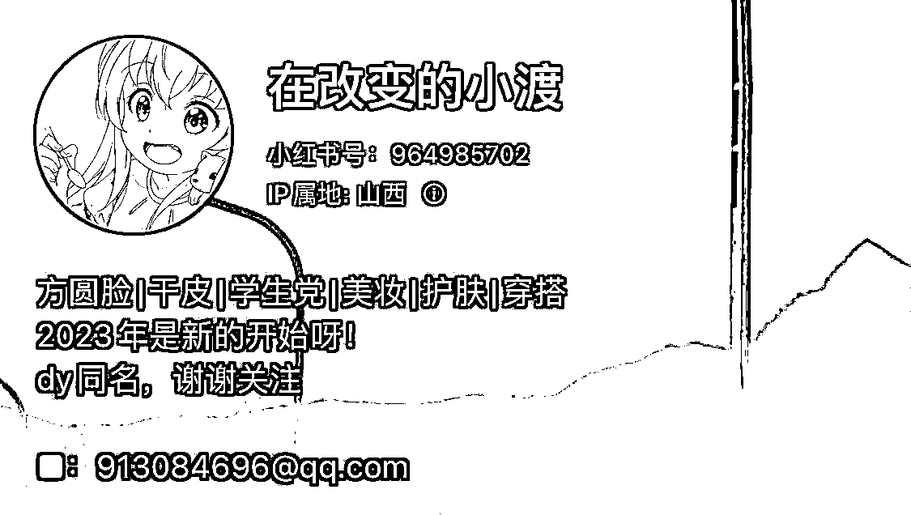
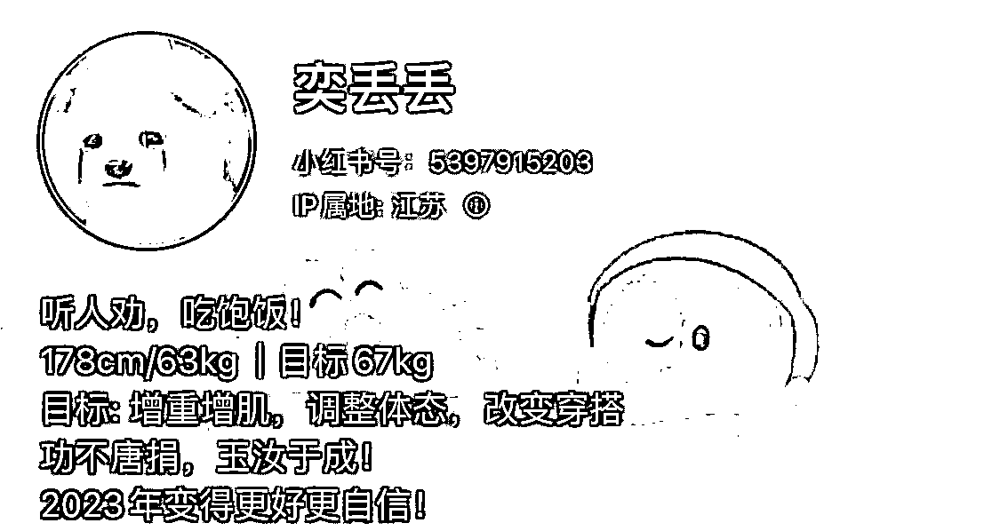
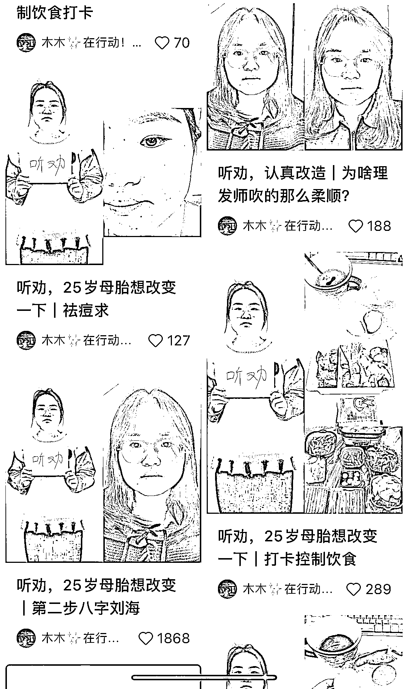
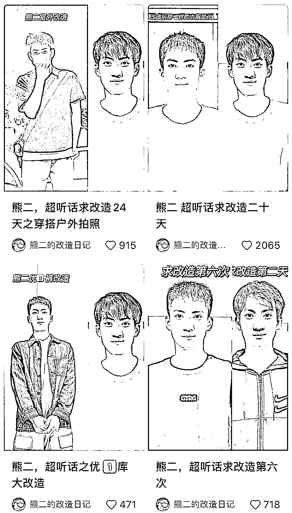
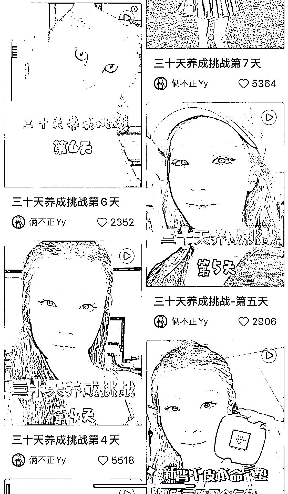
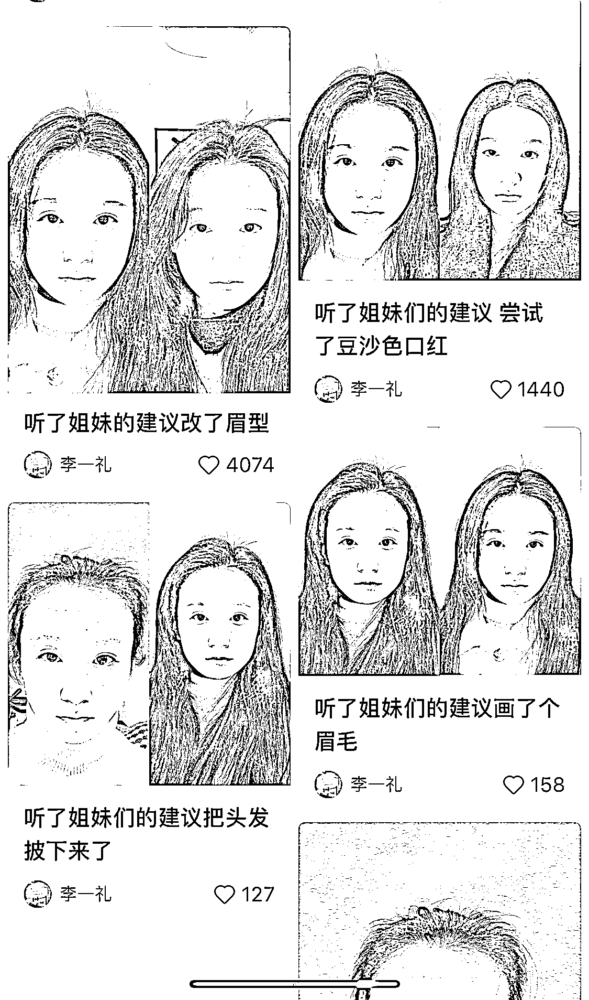

# 2）成长记录，普通人也能起号

成长记录类账号，核心不是打造“完美人设”，而是把你真实变好的过程展示出来。它有个硬条件：你愿不愿意把真实的自己亮出来。还有个软条件：抗压能力要够强。流量既能带来机会，也会带来审视；当你的某个观点被质疑、被抨击时，能不能稳住心态、用正向方式回应，决定了你能走多远。

它的好处很直接：几乎人人都能做，尤其适合想改变现状、总觉得自己“还不够好”的人。短板也要说清楚：你得敢于面对自己的不足。变现方式主要是接广告，以软性植入为主。

实操时记住一句话：账号的每个标签，都要从你的个人特色里长出来，别做成千篇一律的模板号。

取名时，常见思路是放大你的个人辨识度，而不是随便凑字。可以从三类标签找灵感：
- 身份类标签：xx同学、时尚奶奶xxx、贫穷学生xxx；
- 赛道类标签：xx要减肥、xx改造日记、xx变形记、xx在行动、xx在线听劝、xxx听劝版、xx要换头；
- 特色类标签：方圆脸xxx、干敏皮xxx。

简介写清四件事：你是谁、你的目标是什么、你已经做过什么、目前拿到了什么结果。
头像可以用真人照片、神似本人的卡通头像，或能表达当下心情的表情包头像。
背景图放能体现你个人特点的画面，或者一句听劝、励志型文案。

笔记类型：
封面用改造前后对比图，配上文字“改造第n天”。
标题可以按“账号名/人名 + 养成或挑战 + 第几天 + 变化结果”来组合。
话题：#听劝改造 #小艾同学 #素人改造

