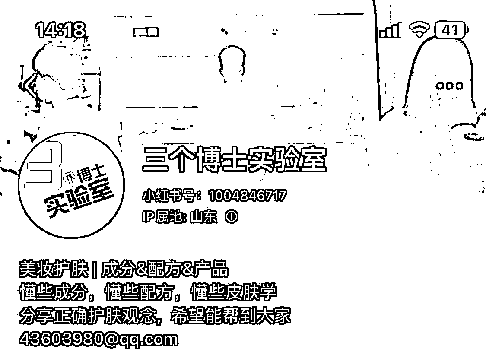
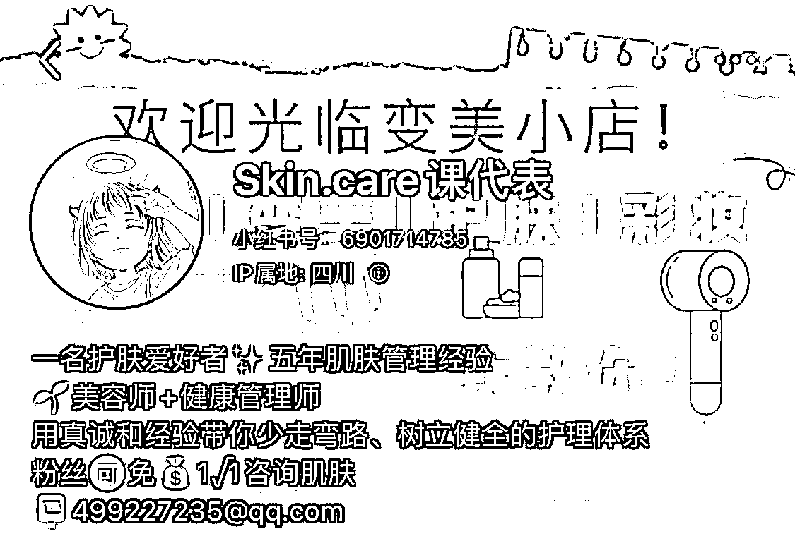
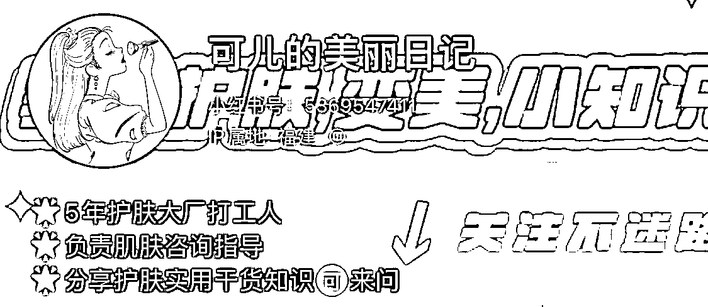
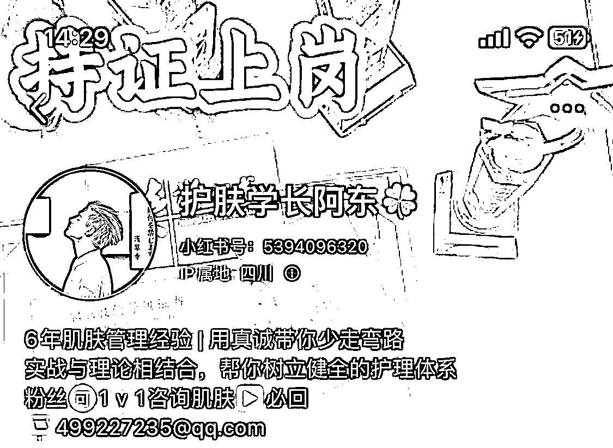
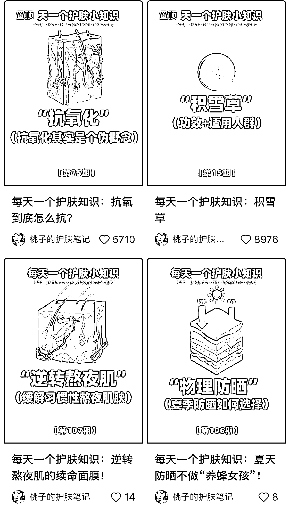
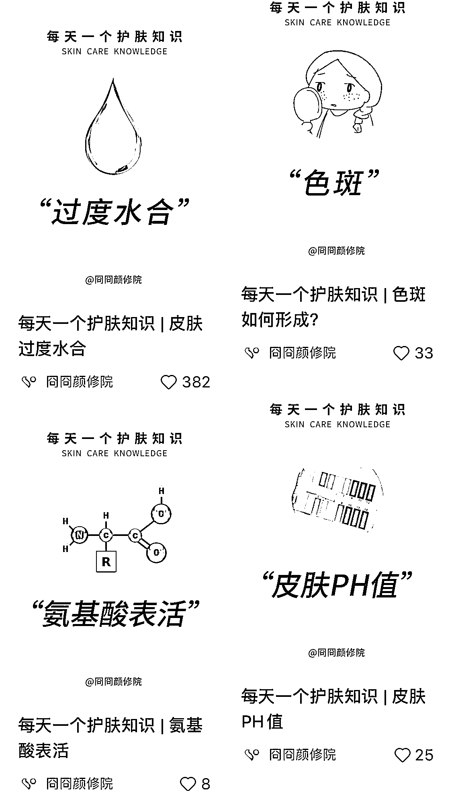
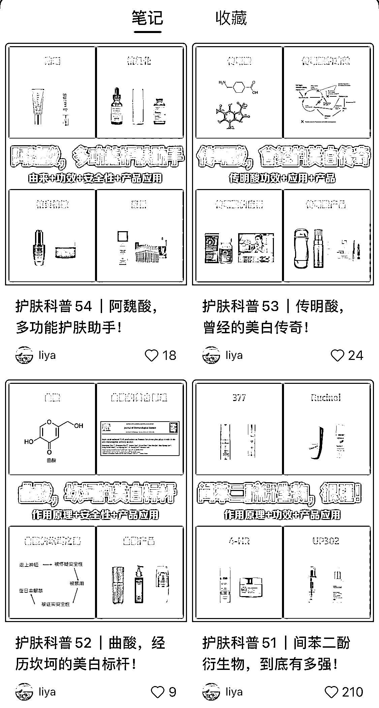
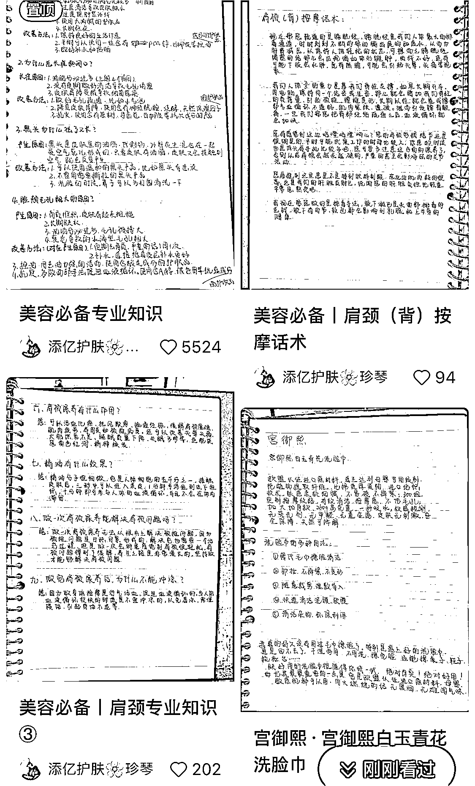
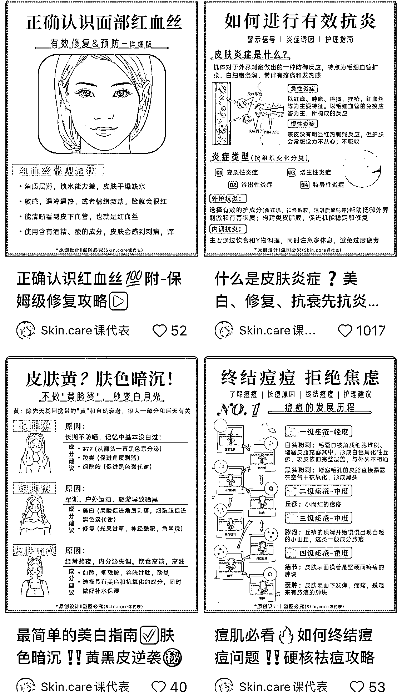
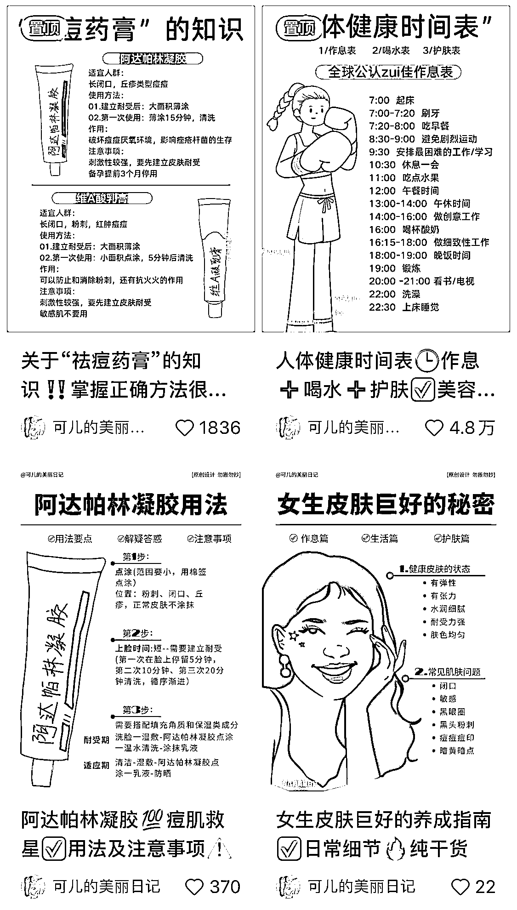

# 3）资料型内容：靠搜索流量做私域

所谓资料型内容，核心就是通过整理信息来吸引精准用户。它对你的硬性要求有三点：会归纳整理、会做图、会优化关键词——这几项能力都指向同一个目标：吃透搜索型流量。同时，软性方面也需要你保持终身学习的习惯，毕竟知识更新很快。

这类内容最大的优点是稳定：产出不费力，持续发内容并不难，而且很容易把人引流到自己的私域池子。缺点也很明显——想破圈、被大众熟知比较困难。变现路径相对清晰：引导私域成交，外加接广告。

下面是具体的实操指南。

账号名称怎么起？常规做法是带上你的领域关键词。从搜索流量的推荐机制来看，这样更容易在搜索结果里占据靠前位置。比如“xx护肤笔记”“xx成分说”“护肤实验室xx”这类组合。

简介可以套用一套公式：资料的主要内容 + 用户关注你的理由 + 联系方式或私信引导。

头像的选择：可以是你认真学习时的照片，也可以是一本书，或者一张能体现资料感的图。背景图则要突出专业感，最好做成合集风格，顺便放上引导关注的内容。

来看几个案例参考：

笔记的构成也有门道。封面采用“主题+图示+关键词”的排版；标题按照“护肤知识+关键词（搜索流量）+主题”来写；正文则可以围绕成分科普、解决特定问题、分析网红观点，或是做一期合集整理。

头图封面参考如下：

掌握这些细节，资料型内容就能稳定为你带来搜索流量，并逐步沉淀到私域变现。