# 4）好物推荐型内容

做这类型的账号，门槛不算高，但想跑出来还是得花心思。下面把关键点都给你捋清楚。

**基础要求**
- 硬性条件：对购物有热情，乐于安利，还得有点拍照能力。
- 加分项：愿意露脸，效果往往更好。
- 优势：内容做起来相对省力，完成度容易达标，商单接得顺手（甚至常能置换到产品）。
- 短板：想破圈真的很难，赛道已经卷到飞起。
- 赚钱路径：接商单（可分报备与不报备两种）。

**具体操作细节点**  
- 账号昵称：走个性化风格，越能让人记住越好。  
- 个人简介：写明自己的基本情况（比如干敏肌、混油皮、手残党、学生党）+ 打算安利哪些类目的好物 + 联系方式。  
- 头像：优先用真人照片。  

案例参考：  
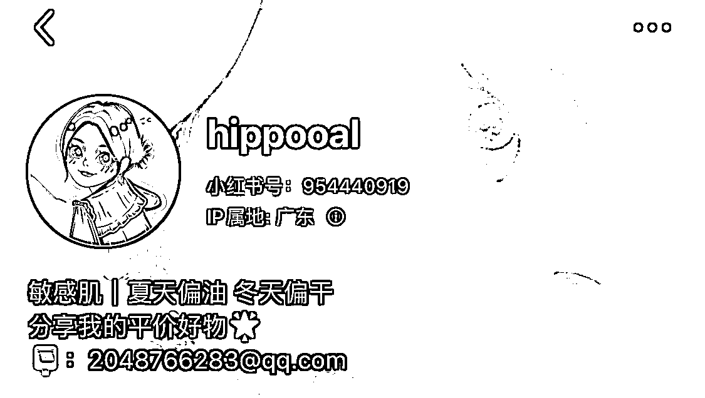  
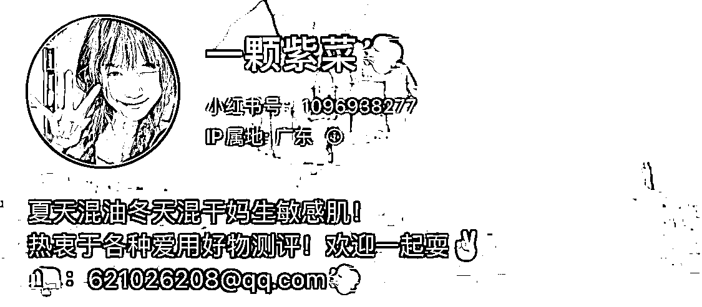

**封面与标题怎么搭？**  
这里给你几组现成的模板，核心记住标题公式：关键词（截搜索流量）+ 主题。

- 方案一：封面用产品图 + 生活场景  
标题按公式走。  
参考示意：  
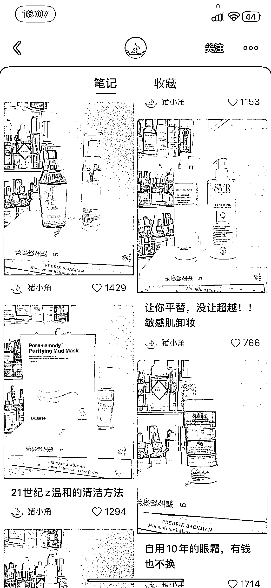  
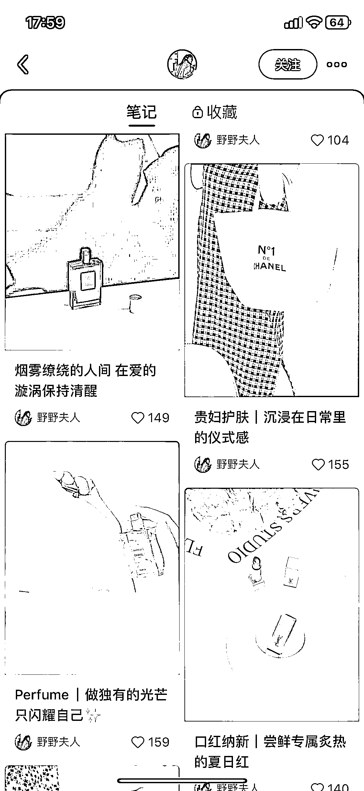  
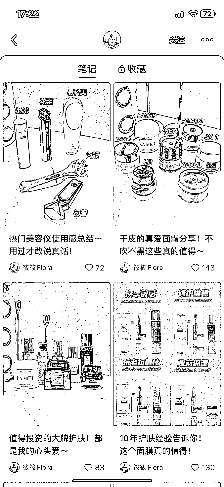  
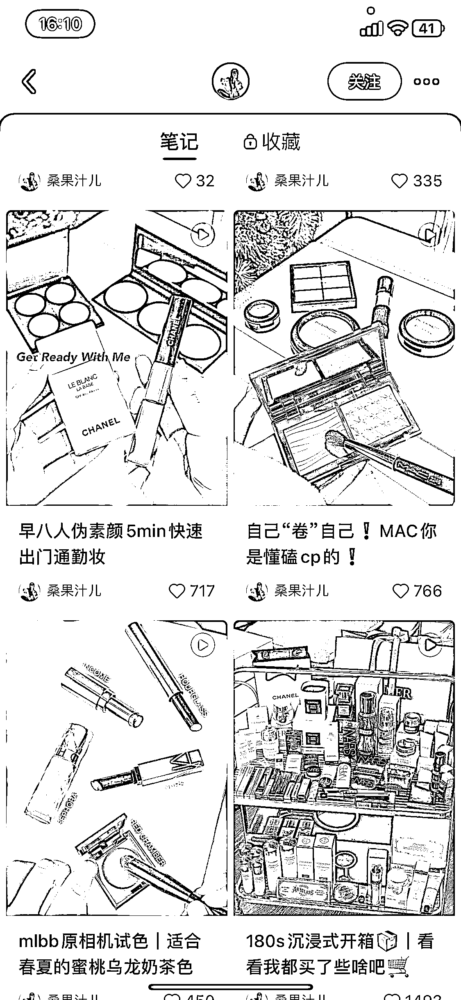

- 方案二：封面展示成品效果 / 操作步骤图  
标题按公式走。  
参考示意：  
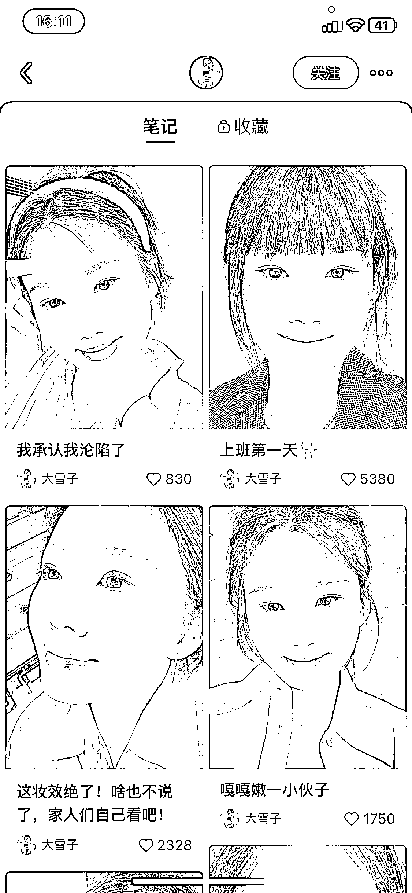  
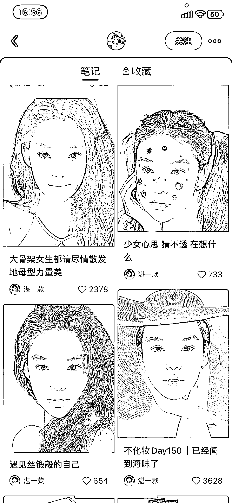  
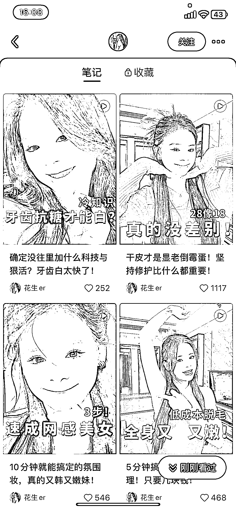  
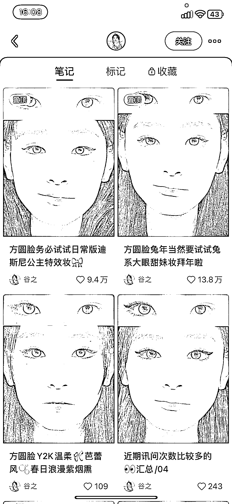

- 方案三：封面放产品图 + 文案关键词 + 核心特点（可加上使用效果）  
标题按公式走。  
参考示意：  
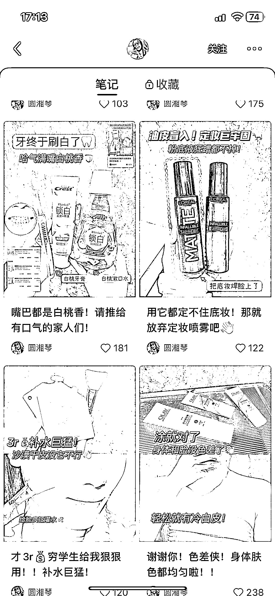  
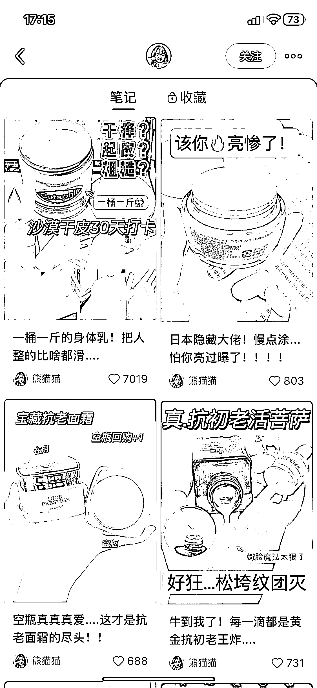  
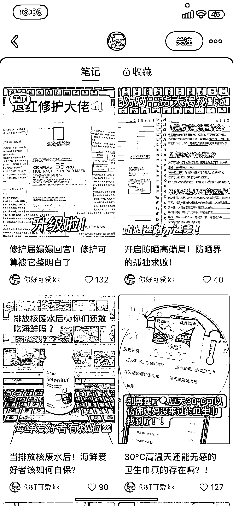

- 方案四：封面用产品 + 局部效果对比展示  
标题按公式走。  
参考示意：  
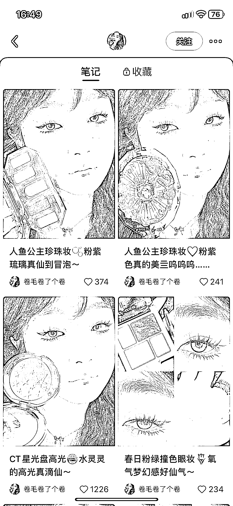  
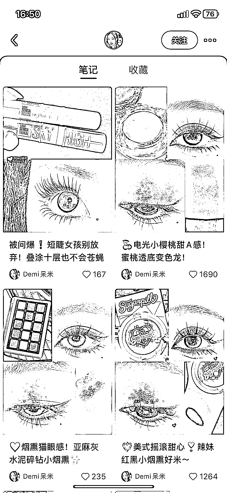  
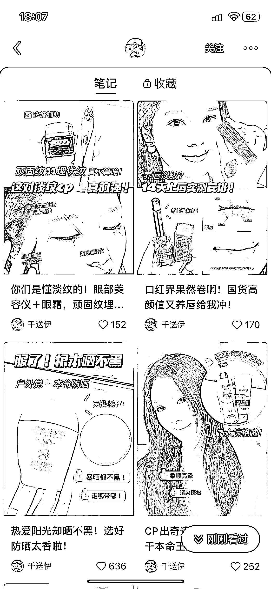  
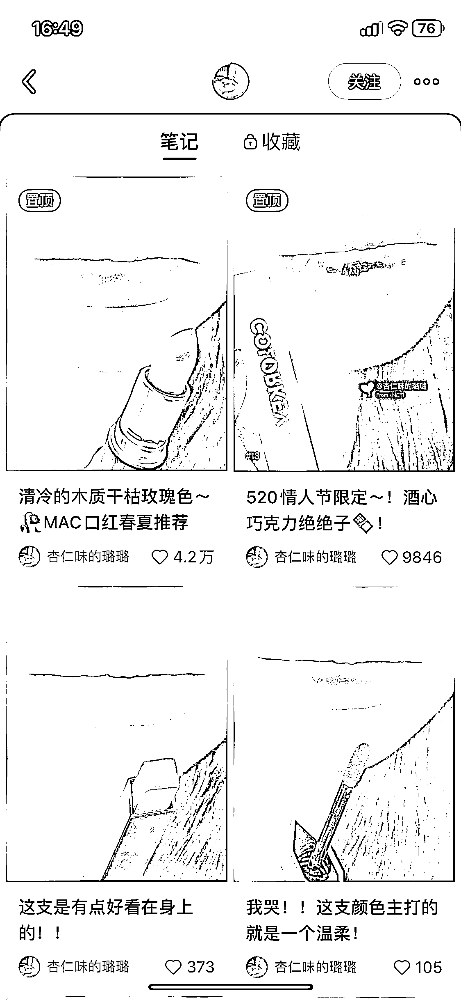

- 方案五：真人出镜 + 手持产品 + 花字标题  
标题按公式走。  
参考示意：  
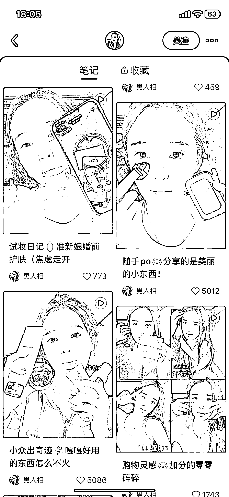  
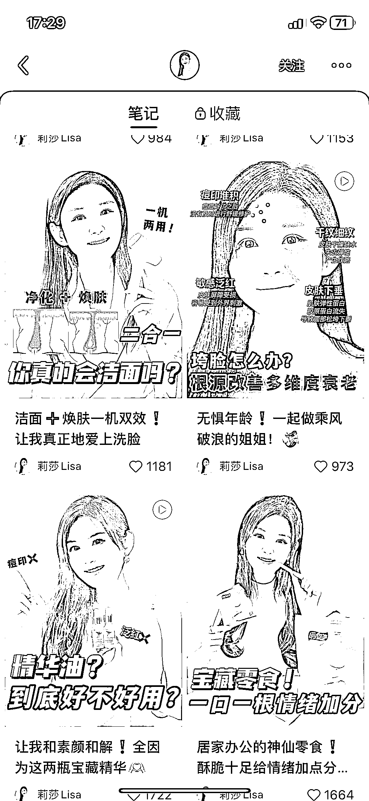

- 方案六：封面放大局部问题，制造痛点冲击感  
标题按公式走。  
参考示意：  
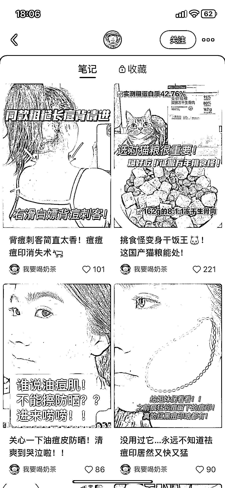  
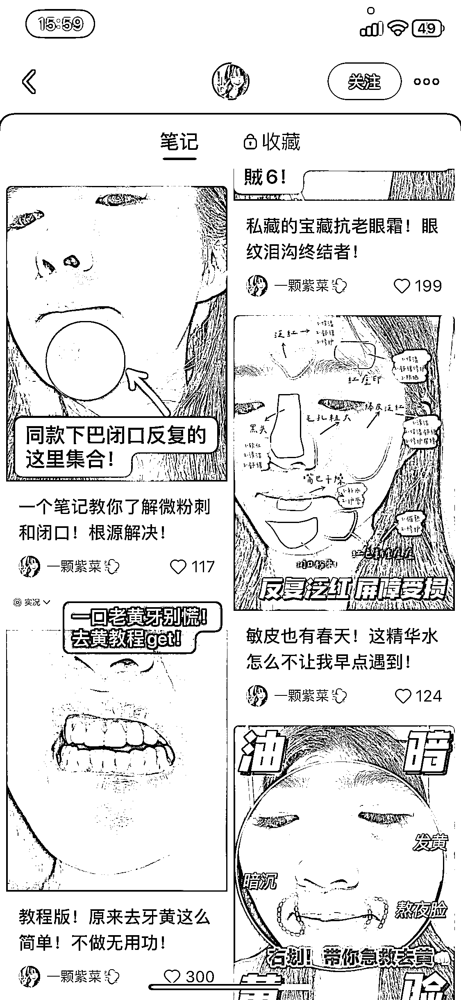