# 5）特殊记忆点，让品牌记住你

想让广告不被用户一眼划过，靠的不是追热点，而是给内容加一个别人难以复制的专属标签。这个方向就是“创新型内容”：在自己熟悉的赛道里叠加特殊元素，用独特性形成差异，同时明确告诉品牌——这类广告，你能接。

具体可以这样做出记忆点：

• 把美食与护肤/美妆组合在一起，制造新鲜的反差感。  
参考：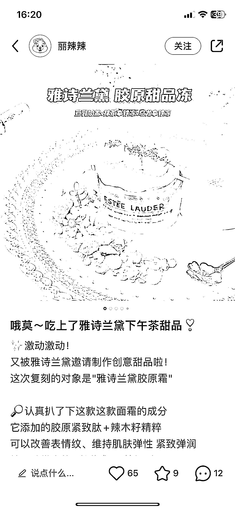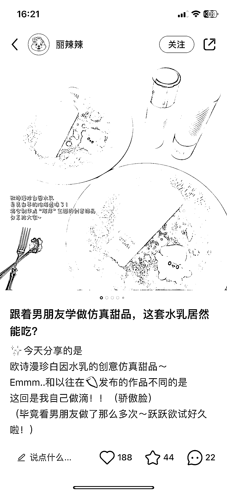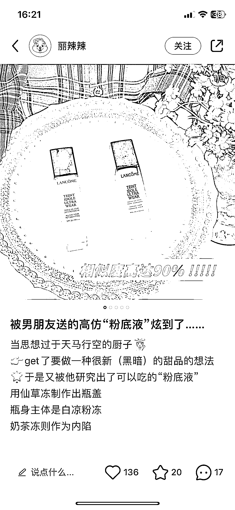

• 用手绘结合护肤/美妆，让产品表达带上鲜明的个人风格。  
参考：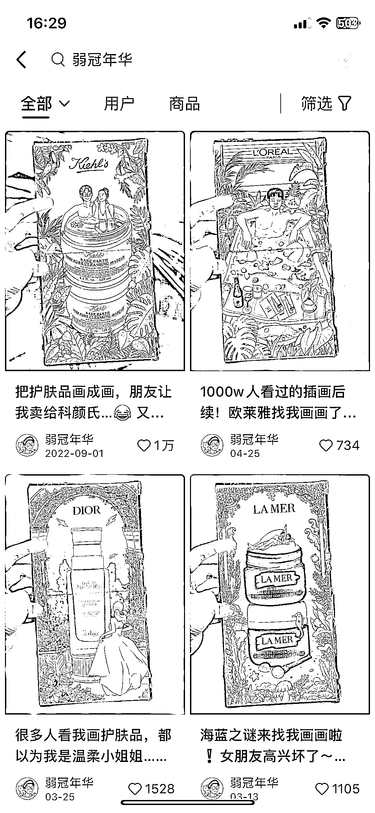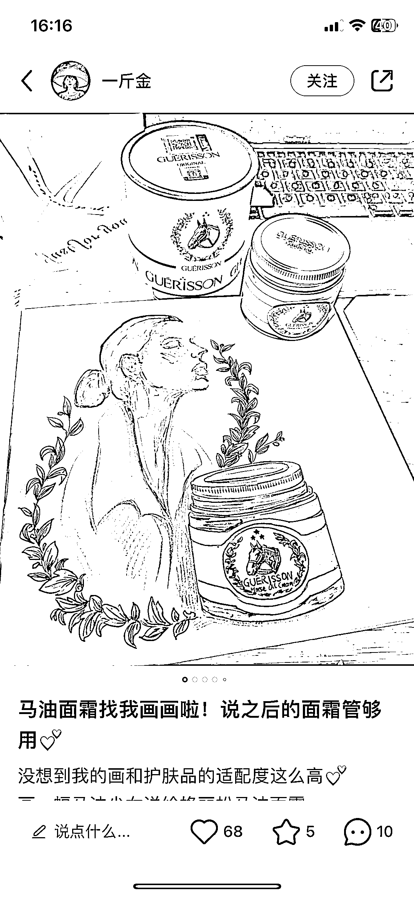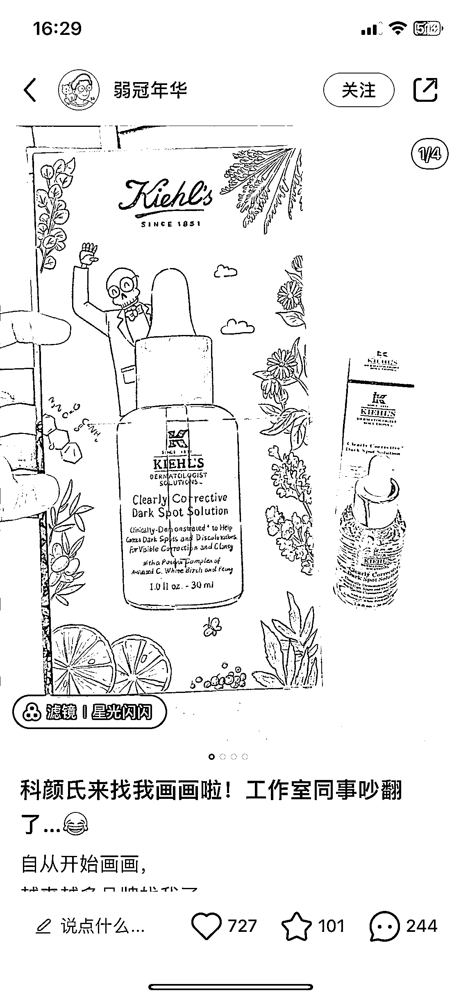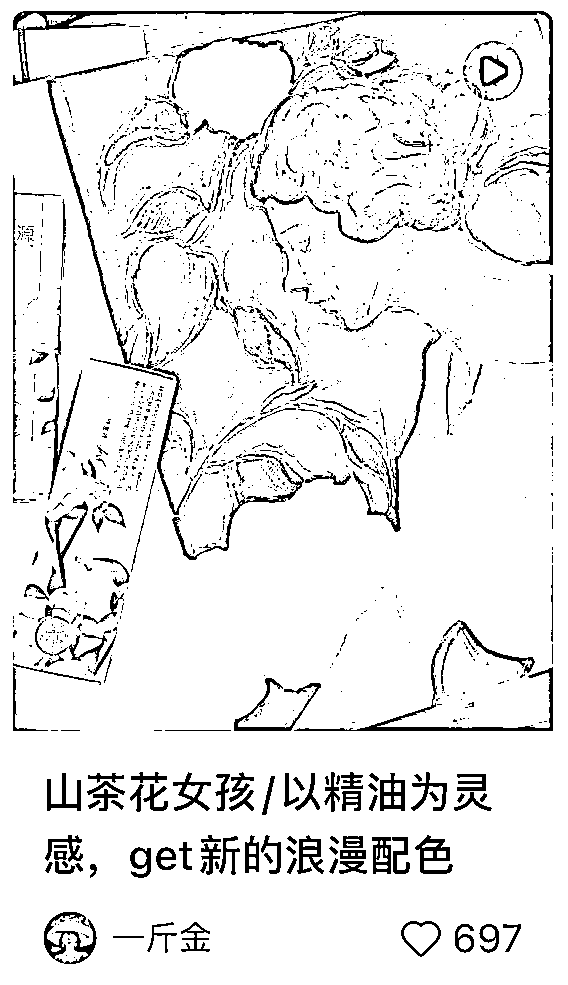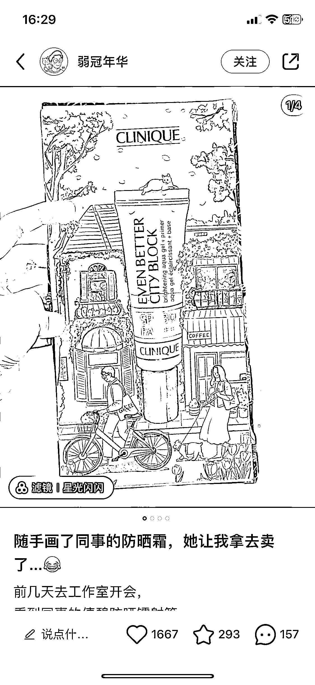

• 选显色度高的彩妆产品来画画，让画面更有视觉冲击力。  
参考：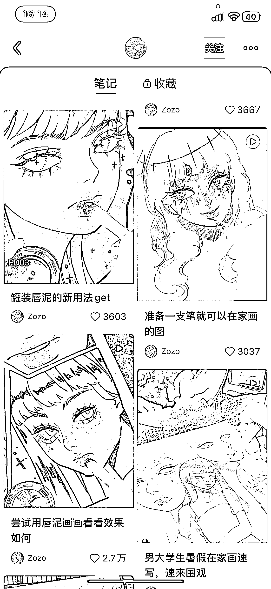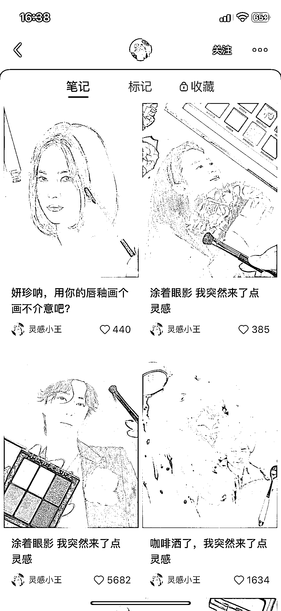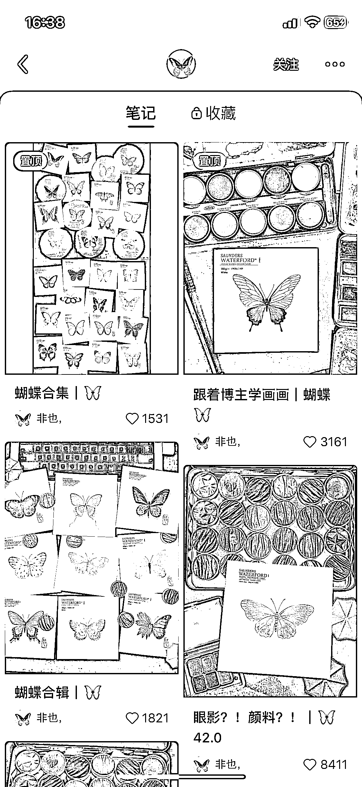

• 对产品外观做DIY改造，比如手绘、贴钻等，把普通产品变成内容亮点。  
参考：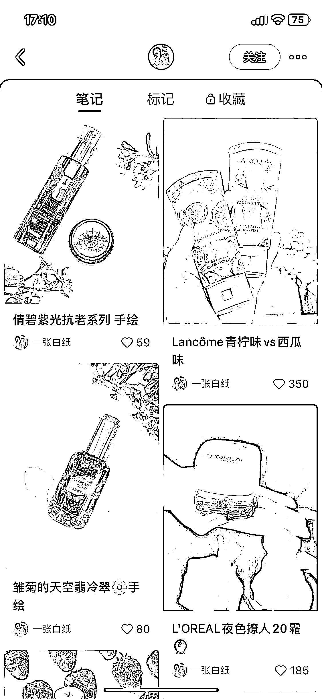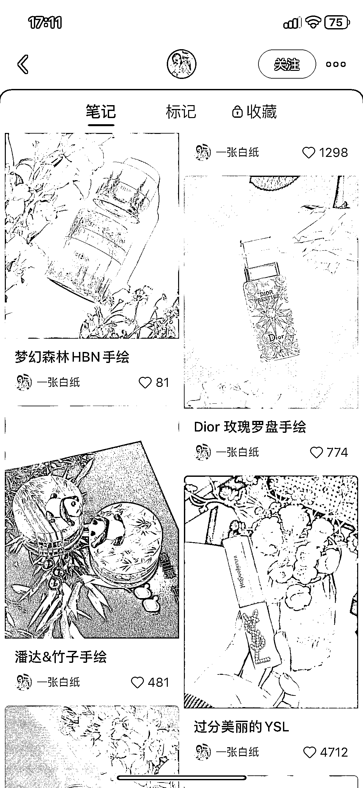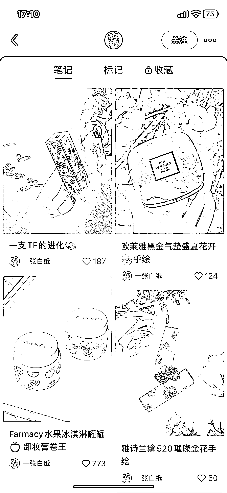

• 用plog记录日常，在内容版面里预留广告位；参考画面左上角放置的都是护肤类产品。  
参考：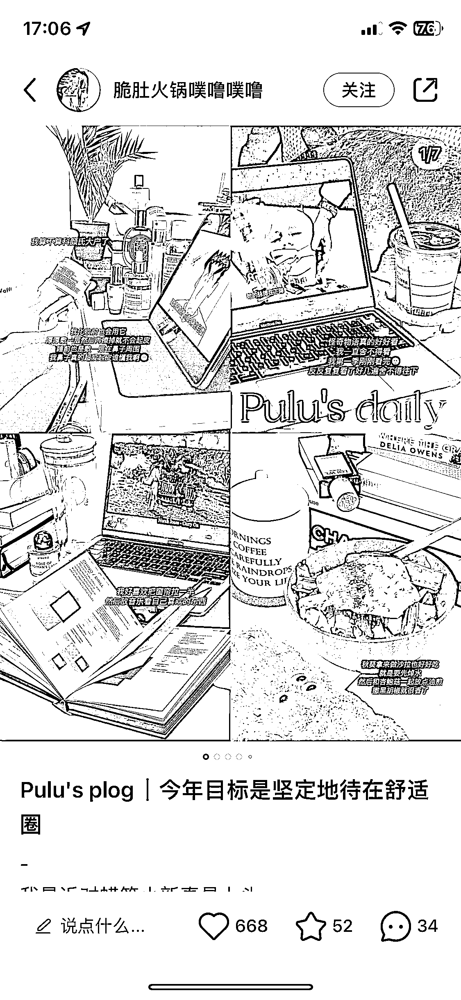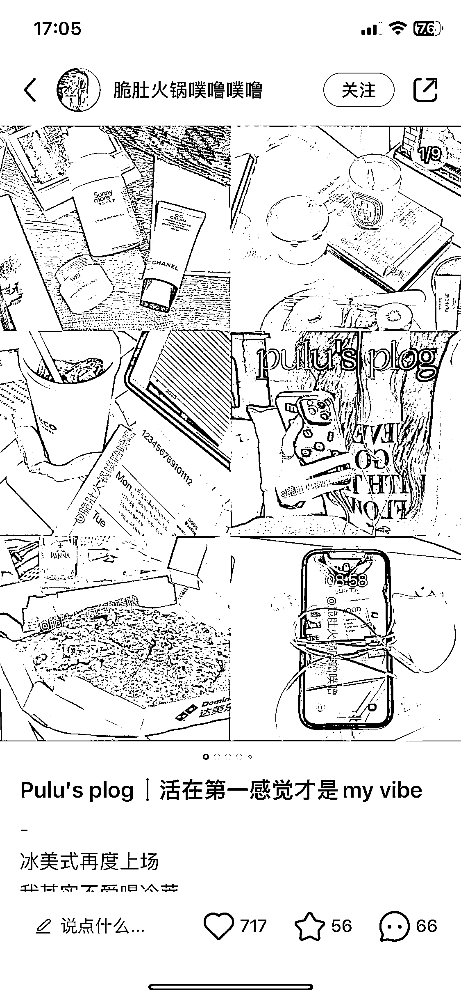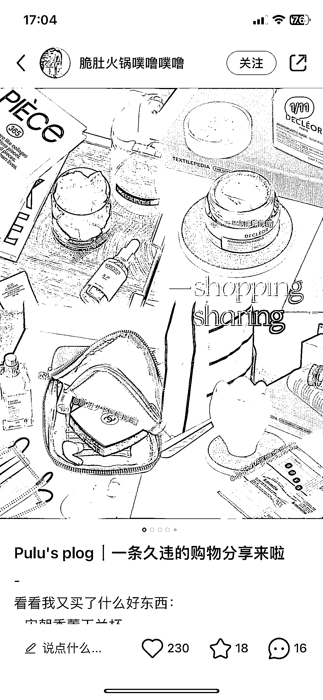

这些特殊记忆点，既是内容差异化的抓手，也是给品牌看的合作名片：这类创意广告，你能接，而且能接得让人记住。