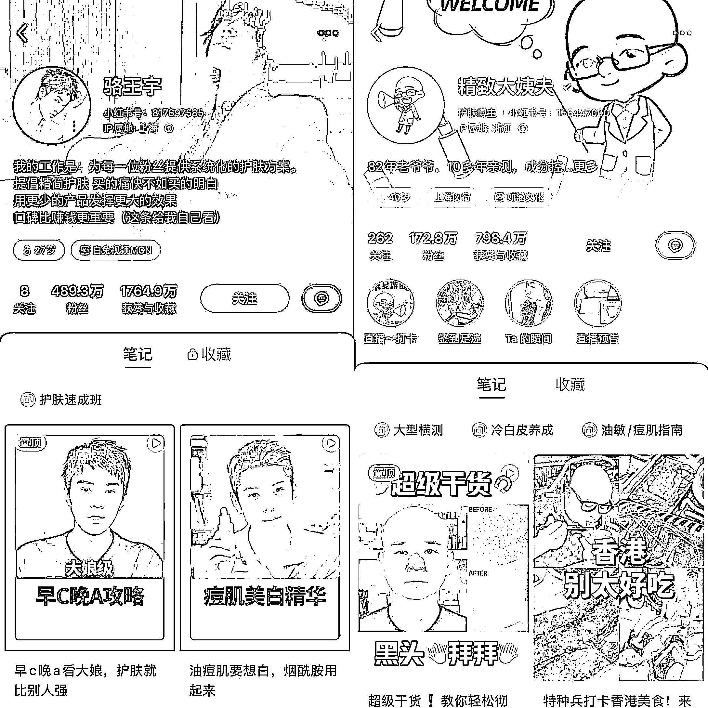
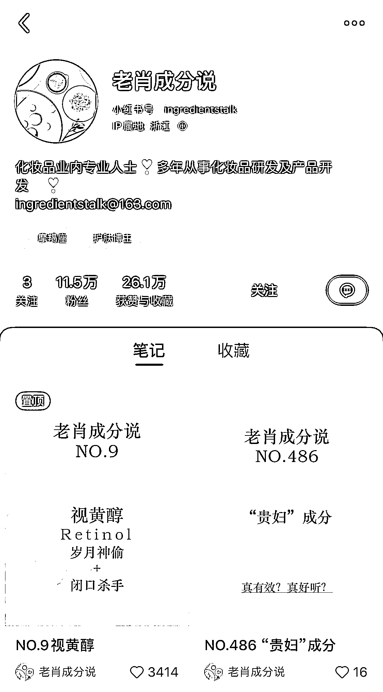
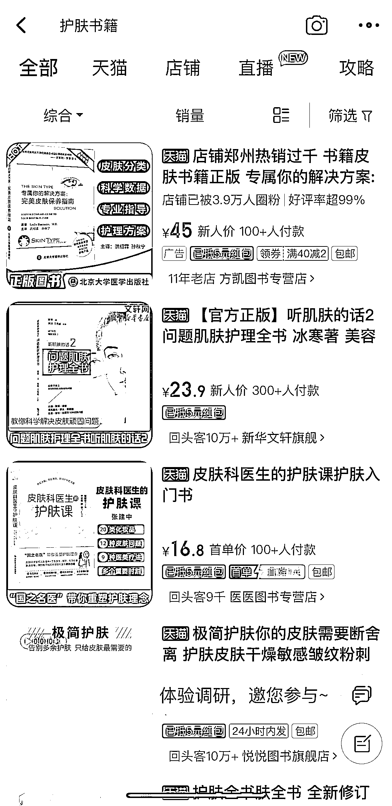
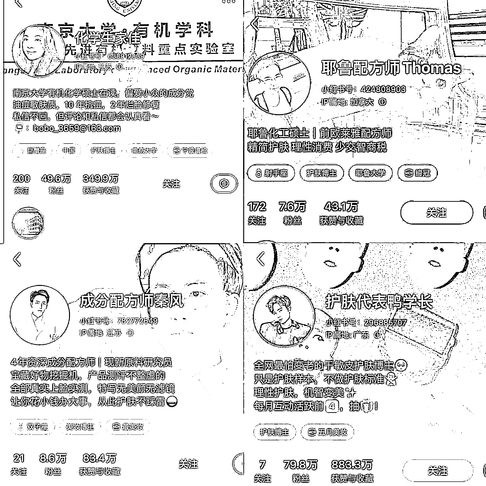

# 8.1.2.3 这样操作就对了

这个领域其实不挑性别，男性博主同样能做出成绩，尤其头部阵营里骆王宇、精致大姨夫都是典型代表。

想做这个方向几乎没有硬性门槛，真要说什么算门槛，也就是持续学习护肤知识和长期坚持。初期哪怕不想投钱也没问题，只专注做护肤科普就行，下面就是一种常见形式。不知道下一步怎么走的时候，多看看同行怎么做，同行就是最好的老师。

至于时间投入，每天最好不要低于两小时，否则成长速度会太慢。这些时间重点花在表达能力、写作能力、护肤专业能力这几个方面。

表达和写作说白了就是多看、多练，而且这两件事必须同时进行。多看是指高频刷对标博主的内容，多练是亲自上手实践，不能光看不练，站在岸上永远学不会游泳。护肤专业知识可以去找护肤类书籍、公众号文章，知乎、微博也能辅助学习，用这些资料补充知识盲区，同时留意别人是怎么把知识点讲清楚的。

具体操作可以从这些方面展开：

一、注册一个小红书账号

想在小红书做内容博主，有部手机和一个手机号就能启动。无论是新号还是以前用过的老号都行，完全没必要非要换全新手机号，只要账号状态正常、没被限制，就不必纠结这些细节。

二、打理账号形象

下面几个细节都能给账号加分：

1. 昵称：最好跟护肤有关，或者能体现专业背景，像“化学生XX”“医学硕士XX”“爱护肤的XX”“配方师XX”都可以。
2. 简介：给大家一个关注你的理由。可以写自己研究护肤多少年、解决过多少皮肤问题、有什么专业背书，或者和这个赛道有关的兴趣；总之目标就是让人信赖你。记得在简介最后一行留下邮箱，方便品牌方来洽谈合作。
3. 头像：清晰是底线，最好还能透出专业感，这是很不错的加分项。
4. 背景图：可以用来补充简介内容，放一张能辅助说明自己的照片就很合适。

具体可以看看下面这些博主：

