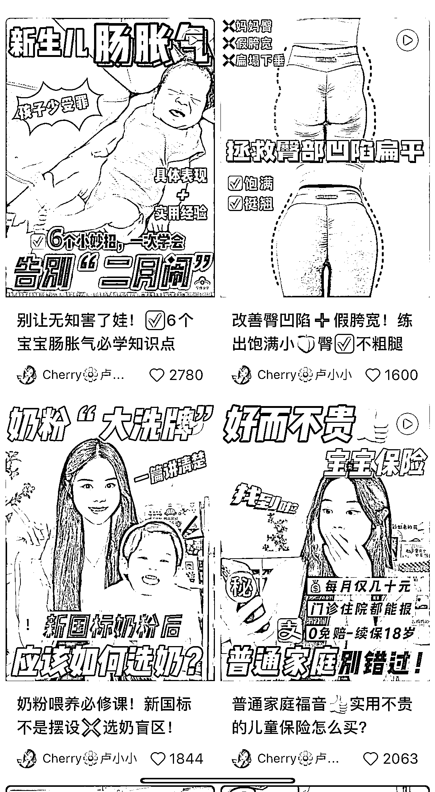
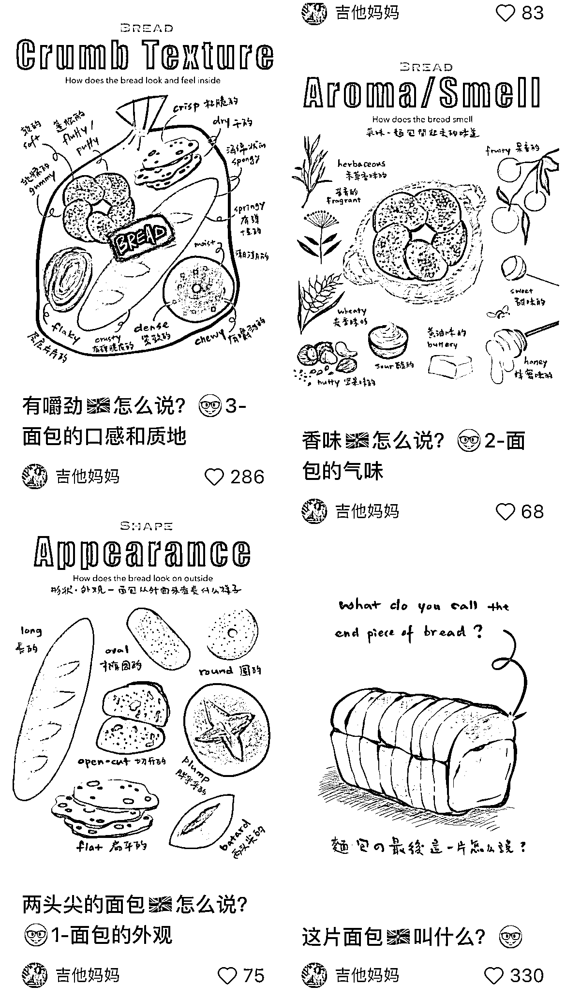
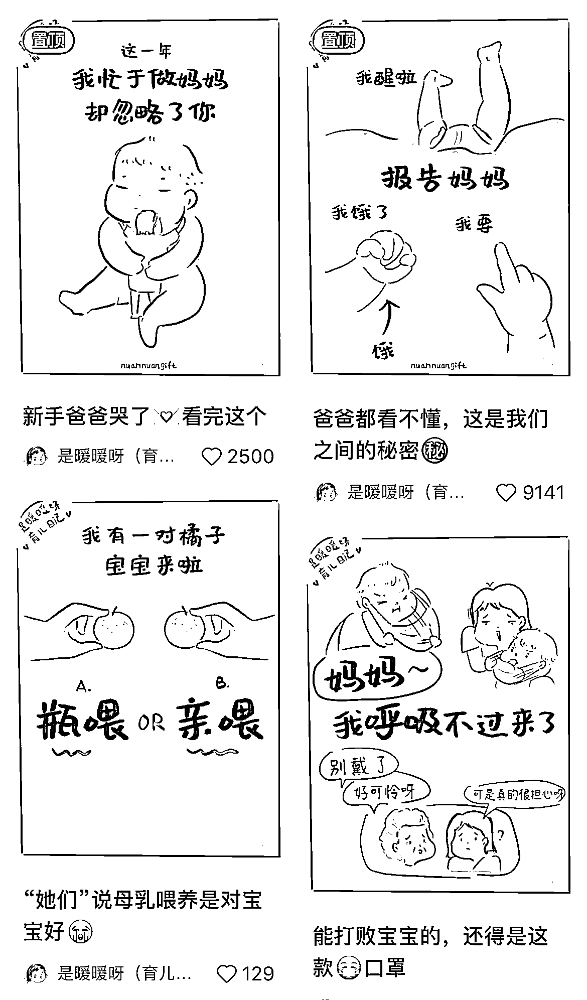
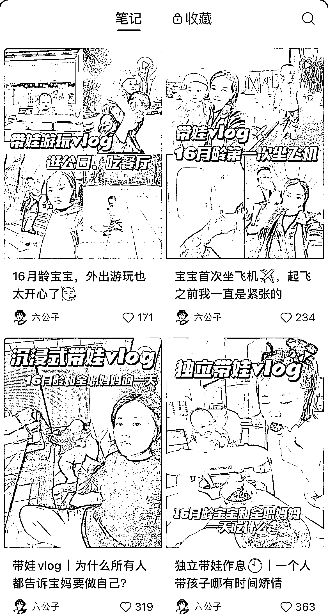
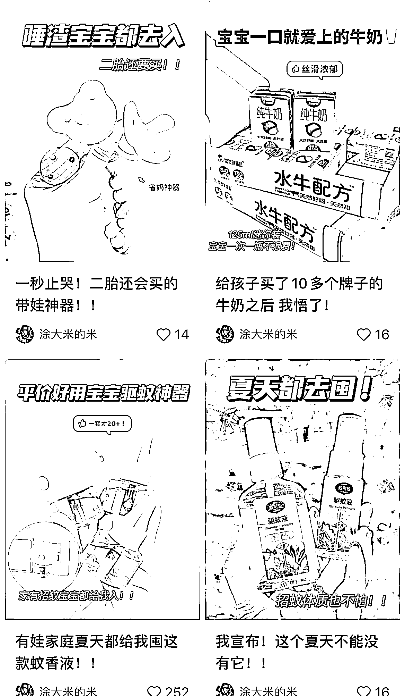

# 8.2.1 一条赛道，三种走法

想进入宝妈内容领域，先要选好方向。这个赛道大体能分成三类：知识科普、母婴日常、好物分享，三者的要求与回报各不相同。

先说知识科普。这类最难，难度给到五星。门槛高在哪里？做一篇有深度的内容，需要查阅大量资料、反复打磨，非常耗费时间。想走这条路，你得有扎实的知识积累，学习能力够强，信息检索也拿手，同时还得有明确的个人IP意识；要是还能蹭到热点，那就更能加分。好处也很直接：流量大、涨粉快。但短板是更新频率很难稳住，对宝妈来说，时间成本实在太重。

再看母婴日常，难度三星。门槛不算高，但内容制作同样要花不少时间。最关键的是宝宝本身要有看点，要么可爱，要么有辨识度，同时家长还得会包装；会手绘或者懂拍摄，属于额外优势。做到有特色的话，涨粉很快，流量可观，也不缺广告合作。不过缺点很清楚：拍摄和剪辑都很耗精力，而且如果宝宝没有鲜明特点，很难跑出来。

最后是好物分享，难度两星。门槛最低，也不需要投入太多时间，很适合刚入门的宝妈。前提是喜欢买买买、愿意分享，而且会拍照；如果善于挖掘真正实用的好东西，就更有竞争力。它的优势在于出内容快、不占用太多精力，可以带货，也容易接到推广；但缺点是这个方向已经很卷，想突破圈层比较困难。

