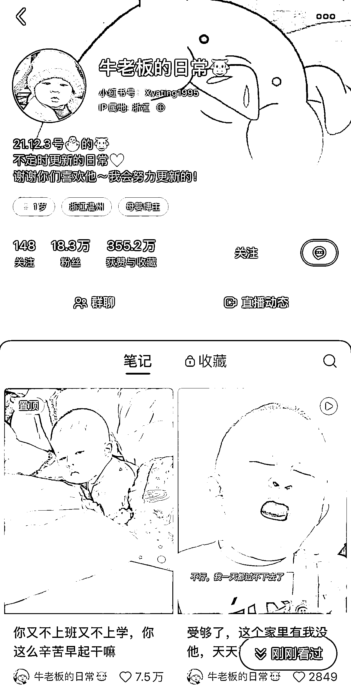
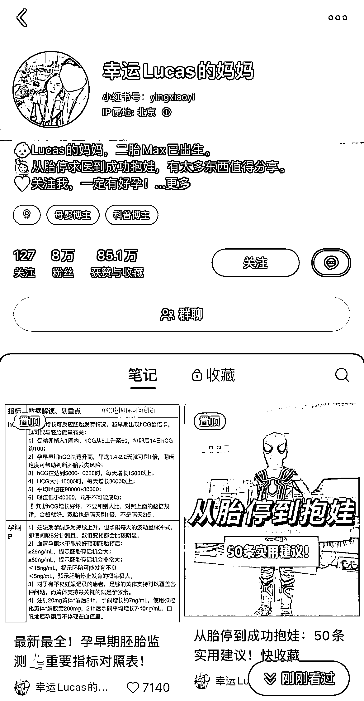
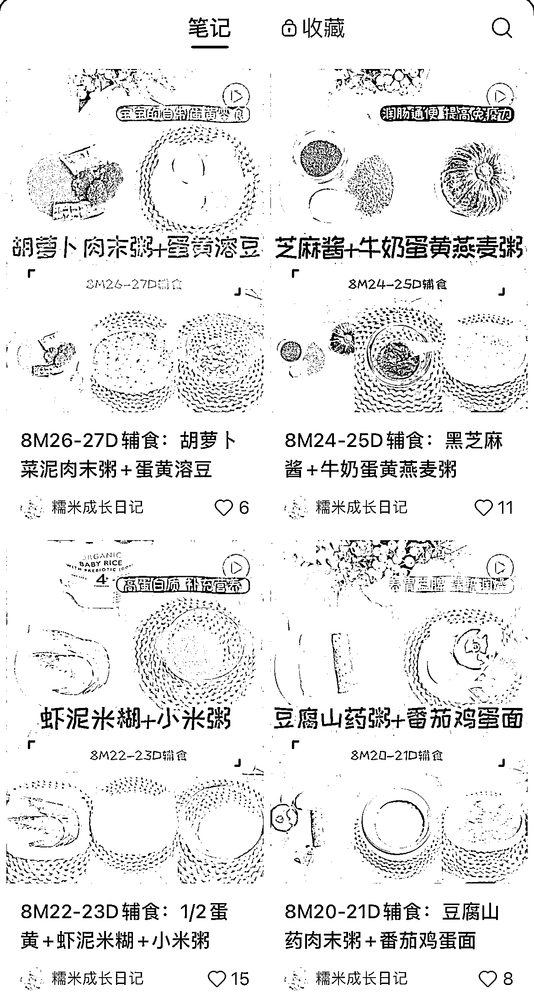

# 8.2.3 账号实操

1）账号装修

账号定位：做母婴赛道，真人出镜的IP更容易赢得信任和共鸣

昵称：可以结合宝宝的名字，用“XX妈妈”这样的格式，或者干脆直接用宝宝的名字

头像：建议用真人正面照，或者和宝宝的合影

2）内容创作

① 选题

宝妈们可以先从自己的带娃经验出发，整理一份可以持续输出的选题清单，再按照手册里教的方法去找对标账号和爆款笔记，结合自己的储备去套用爆款结构，做出自己的笔记。

② 封面

小红书封面的重要性真的不用多说！新手起号阶段，可以大胆多模仿爆款封面，照着1比1复刻人家的字体、配色、构图。但到了后期要建立个人IP，还是得打造属于自己、一眼就能被认出来的专属封面。

③ 内容

内容图片的重要程度其实不如封面，但如果有自己固定的模板，效率会高很多，直接套用就行。比如黄油相机可以保存自己的模板，出图速度很快，宝妈们能省下不少时间。

内容文案就更不是重点了，按手册里的方法来处理就可以。