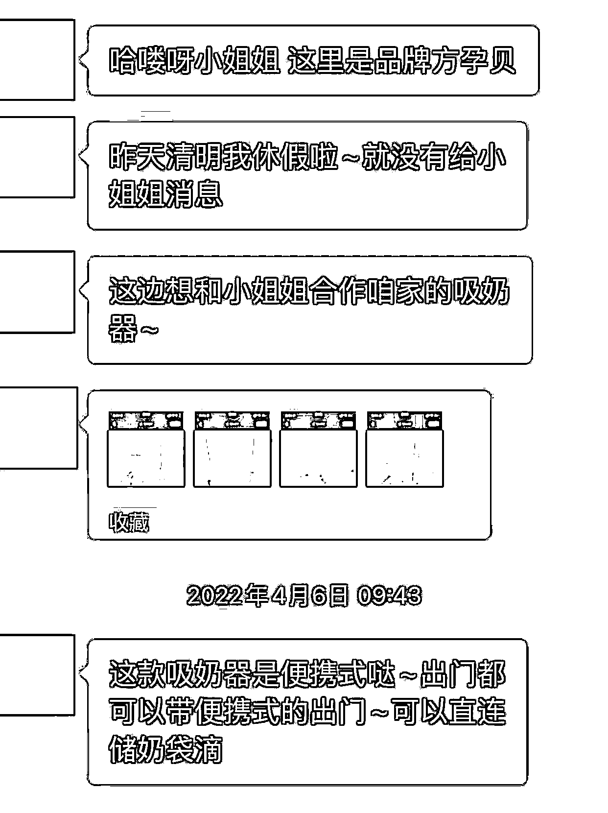
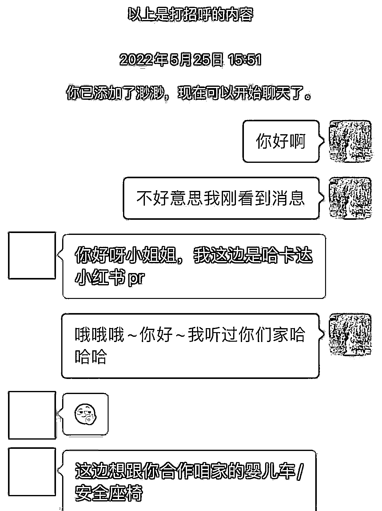

# 8.2.4 母婴号变现首选：接广

对母婴账号来说，想用较低门槛、较快速度获得收益，广告合作是值得优先尝试的方向。

品牌PR往往会主动私信来谈合作，所以一定要勤看消息。起步阶段大多是产品置换；等粉丝量涨起来，合作就可能升级为笔记佣金结算。

账号达到1000分后，可以开通蒲公英，通过官方渠道接广告；具体操作手册里已有详细说明，这里不再展开。

做知识型内容的母婴账号，比如幼儿英语启蒙方向，可以把直播变成课程、训练营与绘本的销售入口；偏好好物分享或日常记录的账号，则适合直播带货，也可以在小红书开店上架商品，直接完成销售。

