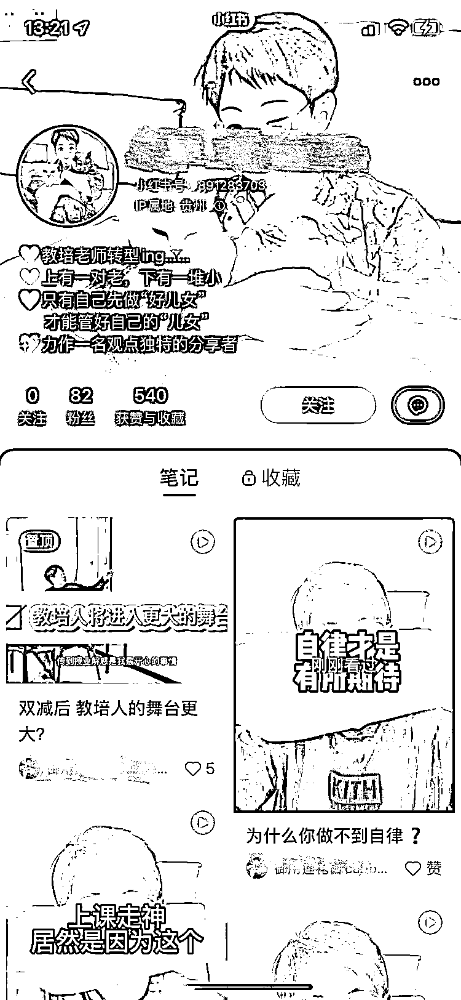
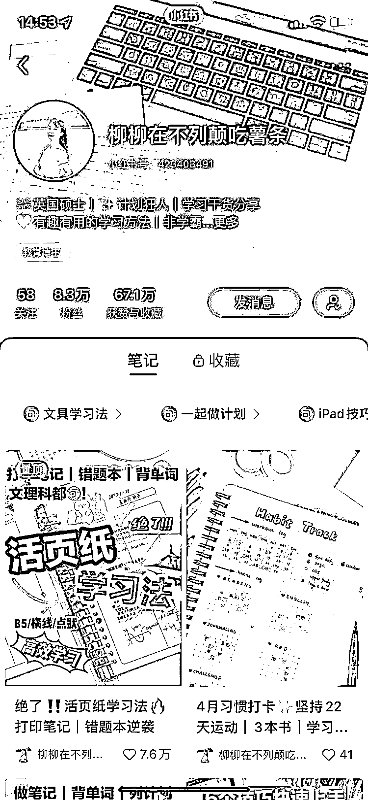
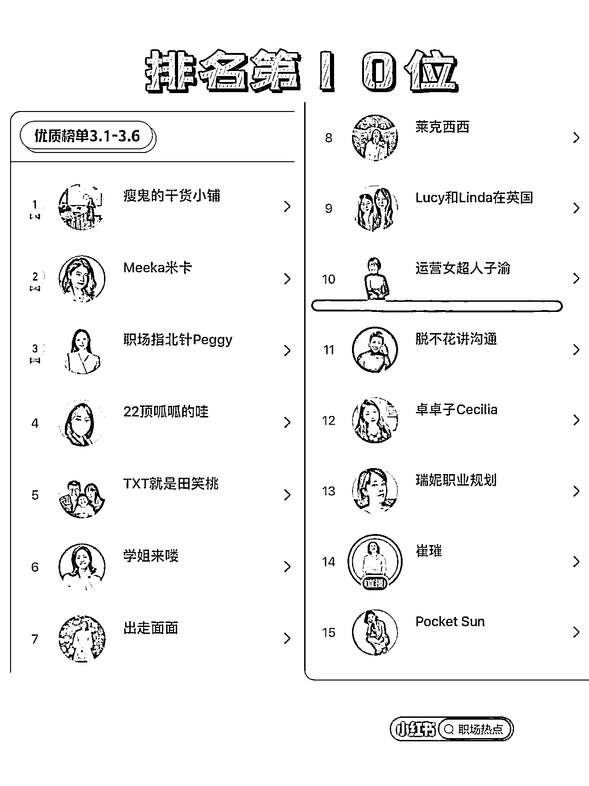
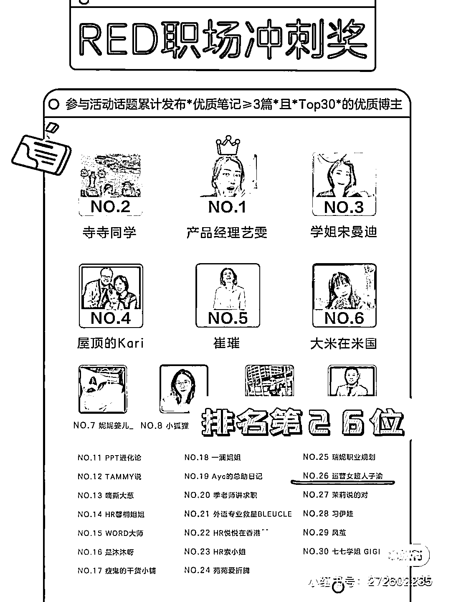
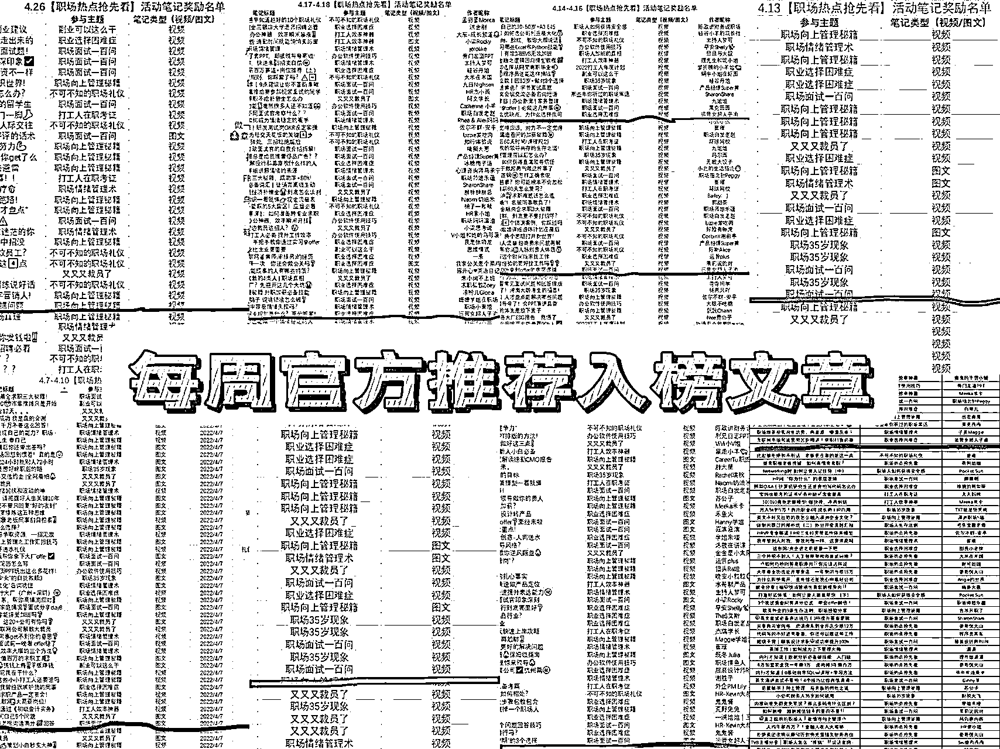
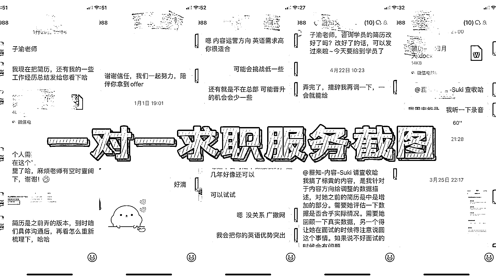
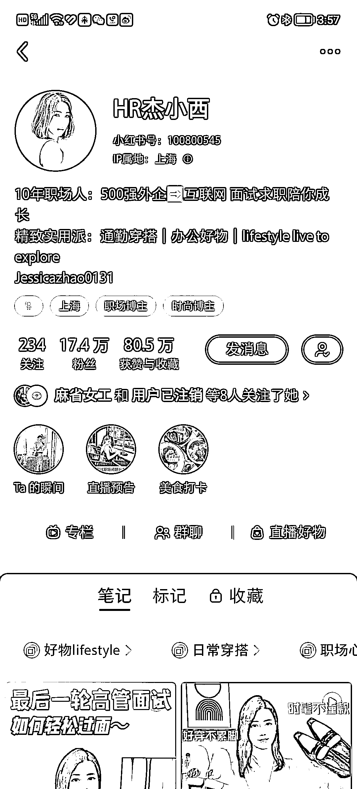
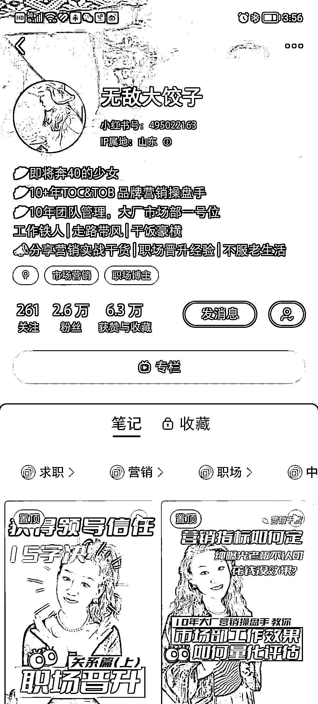
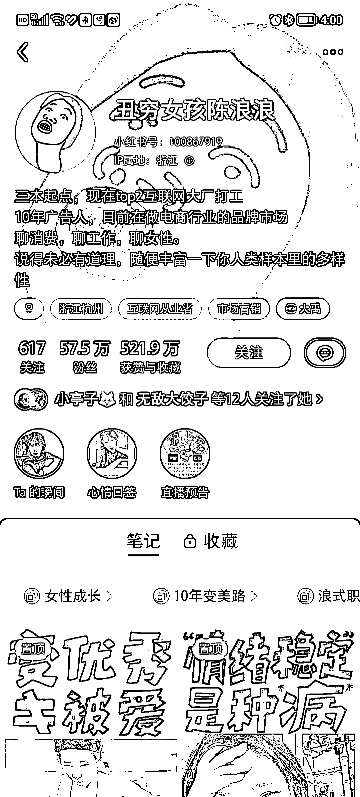

# 8.3.1.1 职场号，别只发鸡汤

在职场内容里，成长号一直是热门选项。原因不复杂：不挑长相，不要求硬技能，也不必有现成资源；笔记容易出爆款，千赞万赞不罕见，上手门槛低。

可难点也在这里。内容同质化严重，人设记忆点弱，更现实的是——变现空间有限，说白了就是难赚钱。先把话说清楚：不是说所有成长号都不行，做得好的不少。我指的是那种整号只发鸡汤式内容的账号，比如这类：

这类号接广告时，大单很难落到头上，因为可植入的产品场景少，报价也低。像有些应用推广合作，账号未满一万粉时，费用可能就百元左右，性价比不高（当然并非每个博主都如此）。

带货同样吃力。只发自律鸡汤，很难自然带出货；若能把日常学习、办公环境中的真实物件自然放进内容里，广告和带货才有机会跑通。

付费咨询也不是没有可能，但前提是你有专业优势，或者能提供明确价值点，否则大多只能吸引低价咨询。

这类账号不妨现在就动手改打法，重点不是先涨粉，而是先把变现路径理顺。否则后面大概率会为收入发愁。

看完一圈账号后，我发现职场博主想跑出收入，通常绕不开两种打法：

第一种，把生活方式和个人成长绑在一起：真人或真实场景多出现，内容里留出产品位置，目标就是承接单价更高的广告。我见过有账号专门拍桌面好物，再融合学习成长内容：

第二种，死磕一个明确价值点，例如求职、转行、技能服务、写作成长等。这条路的付费转化通常更顺，我自己走的是运营求职转型。我早先对标的博主，变现靠的就是求职、转行、面试咨询；我本人线上线下都做过不少分享，于是把账号落在职场求职咨询和运营能力提升上。

放在📕，职场博主确实算容易起步的一类。

平台2亿用户中，90后占72%，多数人已经工作。他们的关注点不只有吃喝玩乐、旅游购物，还有实习求职和职业成长，需求盘子很大。

内容形式也不挑：视频之外，短图文、长图文都适合讲实用技能、职场规则和沟通方法。背景普通、灯光一般，同样可以开号。

更关键的是，职场号赚钱并不完全卡粉丝数。美妆、穿搭粉丝少时接广告很难，而职场博主的主要收入常常来自咨询。只要持续输出观点和干货、拿到读者信任，付费咨询就能跑起来，服务可能覆盖简历打磨、面试策略训练、职业路径规划等，但不局限于此。

我一边学一边做，今年初粉丝过万。期间接过几十个企业推广、1个出版社合作和1次媒体采访；每月能成交几单到十几单付费咨询，带过不少同学入门运营。后来还做了自己的职场课程，正在准备推广。

这个方向对背景挺宽容，分享者往往有自己的职业经历。不过别把它想成专家专属，只要你对某一领域有判断、有方法，就能输出。

比如我关注过一位本职是HR的博主，分享求职和改简历，权威感很足：

还有账号讲专业成长，例如市场营销到底做什么、怎么入行。想选行业、选岗位的人，可以借此提前看到真实工作内容。

也有人走松弛路线，只聊职场体验和打工日常。对还没入职的年轻人来说，这类内容能让他们提前感受真实职场，完成从学生到职场人的切换，同样有市场。

说到底，职场博主以职场为背景，可能分享的范围却很宽。判断标准很简单：内容对别人有用、有帮助，就成立。

和美妆、穿搭不同，后者若没有自有产品，起步时常要自己买货拍摄；职场号主要靠内容，现金投入几乎为零。但时间投入跑不掉：每天要吸收信息、整理加工再发布，我差不多会花1小时。