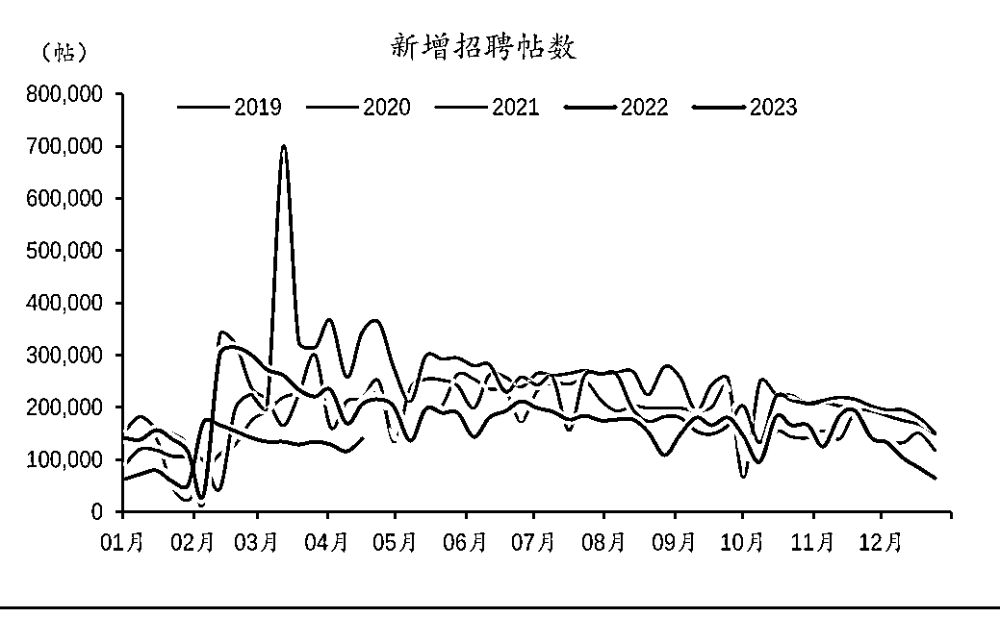
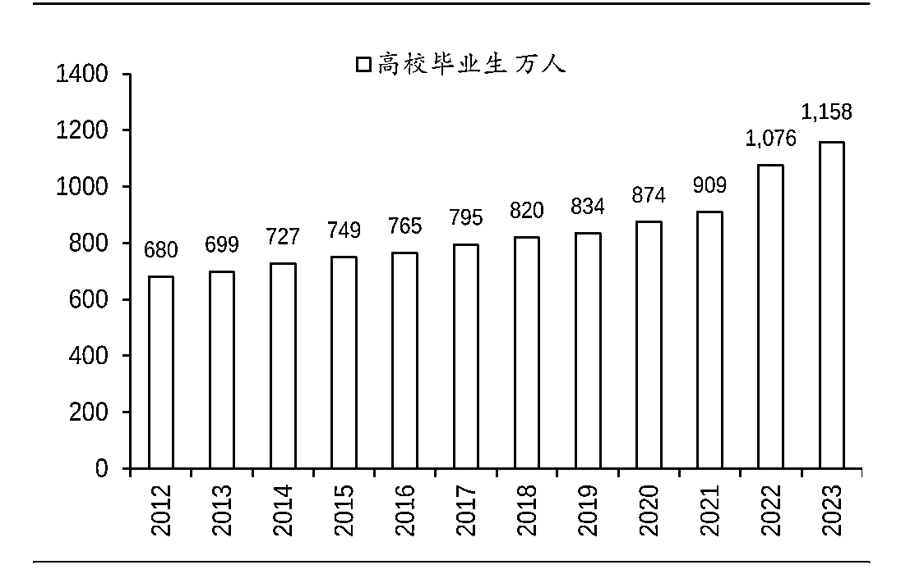
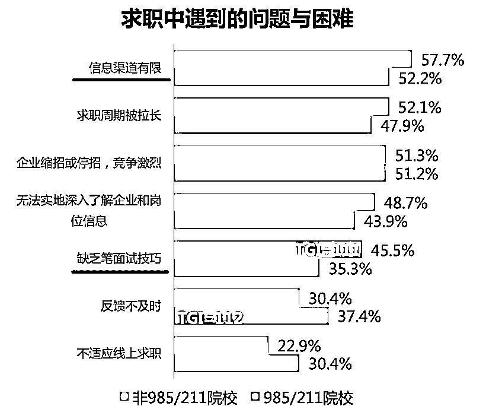
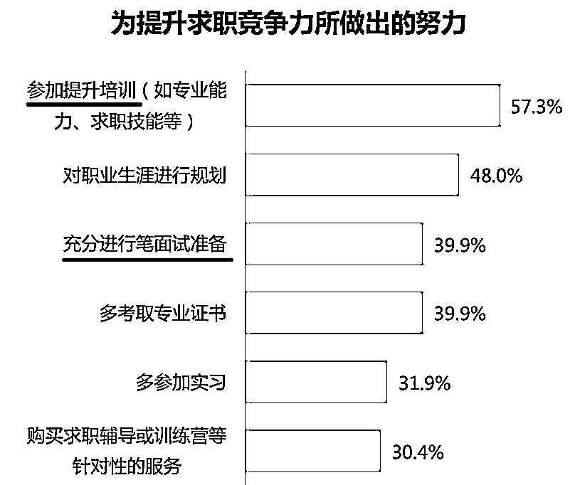

# 8.3.3.4 职场号变现，别急着唱衰

看到这里，你也许会犯嘀咕：职场类账号是不是离“赚钱”有点远，做纯博主恐怕不太划算？先别急着下结论。职场号其实很适合打造个人IP。起步阶段，它的商业转化或许比不上美妆、家居、母婴这些赛道，但只要愿意长期深耕，能跑通的变现路径并不少。具体可以翻看上方 @子渝 关于职场号的案例分享。

数据来源：国泰君安行业景气度观察系列报告

数据来源：教育部

另外，近两年就业市场偏紧，反而给职场账号添了一把火。今年应届毕业生规模达到历史高点，叠加宏观经济下行，不少企业放慢招聘脚步，甚至压缩岗位，年轻人找工作的压力明显加大。也正因如此，学生群体更愿意投入求职技巧和专业能力培训，让自己在竞争中多一分优势。

