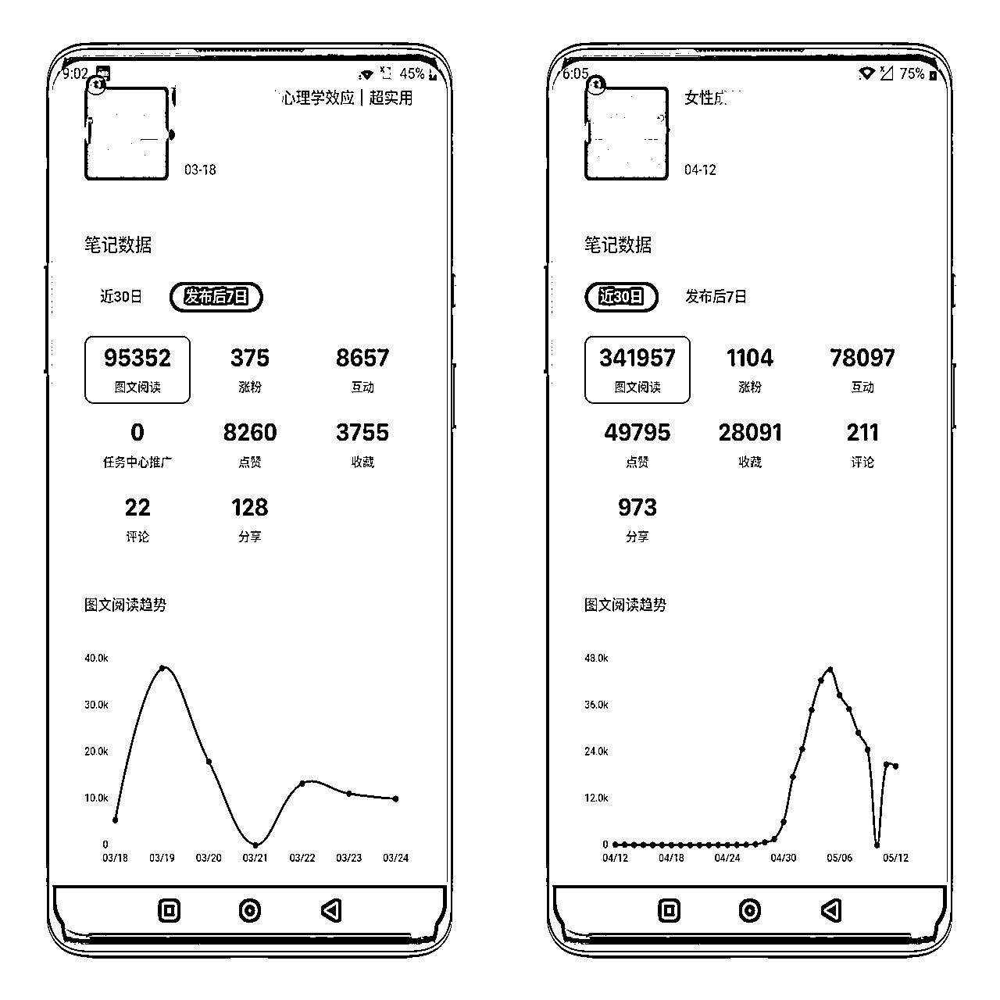

# 8.4.1 成长号出数快

在成长号这条赛道里，跑出数据并不算难。拿我自己的实操经历来拆，会更直观。

我先拿一个账号试水。等这个号的数据有了起色，我马上又铺开了更多账号。单账号从启动到跑起来，前后花了10天：其中3天用来养号；笔记更到第7篇，点赞突破1000+，算是第一个小台阶。

到第10篇时，已经有做文案替换的广告主主动找上门，开价100元，想替换我那条600赞的笔记。第16篇笔记发出后，7天拿到9w阅读、8w点赞。到现在，我单篇笔记的最高阅读量达到46w，点赞6.4w。

眼下，一个账号单条广告的均价在120元以上，每个月能带来1000+的收入。