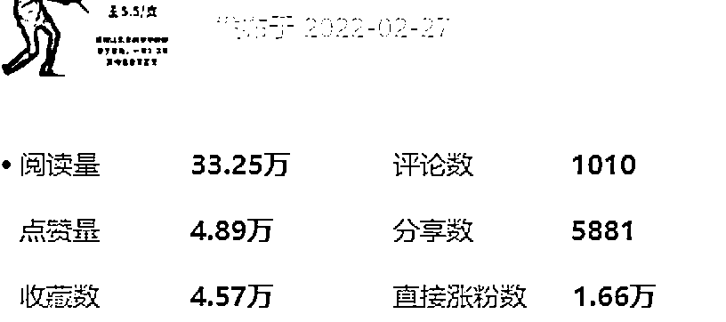

# 8.5.1.1 宠物赛道，新手先做哪一类？

近些年宠物行业越来越热。比起承担养娃的压力，不少年轻人更愿意养一只成本可控、又能提供情绪陪伴的宠物，并把它们当成家里的一员，心甘情愿为毛孩子花时间、掏腰包。

不过，我进入这个领域其实挺偶然。没有像一些同行那样做严谨调研和数据分析，我只是从自己的强项出发：我是铲屎官，对自家毛孩子特别上心，平时一有空就泡论坛学科学养宠，顺手挑性价比高的用品，还特别爱把经验安利给周围朋友。所以我的底牌很明确——有一定知识积累（多少不重要）+愿意持续分享。于是我把大方向定在宠物，具体切入口选科普。事后看，这个选择误打误撞，却正好是新人比较容易上手的赛道之一。

说说我起号的过程：2021年10月，我利用通勤时间发一些简单的科普笔记和萌宠日常。后来发现科普内容的流量更可观，靠借势爆款标题，一个月左右攒到近千粉丝，也零零散散接了些广告，单个产品报价几百元。到2022年2月，我用一个爆款模板，一周涨粉3万，广告合作接连而来，报价达到四位数。

宠物赛道大体可分为萌宠、吃播、科普三类。

萌宠：难度5星。必备条件是宠物本身有特点，或者号主擅长包装；此外还要会讲故事、会拍摄剪辑。优点是流量池大、出大V的概率高；缺点是泛粉偏多、用户画像不够精准、报价偏低。

吃播：难度3星。必备条件是宠物吃饭特别香，或者号主场景布置能力较强；其他条件是会基础拍摄剪辑。优点是流量中等、成片难度比萌宠低；缺点和萌宠类似。

科普：难度2星。必备条件是具备宠物知识储备；其他条件是简单拍摄剪辑或文案排版。优点是制作简单、几乎零成本、可批量生产、用户画像精准、报价较高；缺点是流量相对少，很难跑出大V。

正因为科普内容容易量产，它成了不少机构和品牌做账号的切入点。对刚入局宠物赛道的小白，我的建议是先从科普起步，先用猛一点的方式把账号快速启动；之后再决定是搭建同类矩阵账号来引流卖货，还是深耕内容，转型成更有深度的科普博主。